# BÁO CÁO TIẾN ĐỘ TUẦN 3

Phan Chí Cường - 23520207. GVHD: ThS. Trần Anh Dũng.

Kỳ báo cáo: 05/10/2026 - 11/10/2026. Ngày lập: 14/10/2026.

## 1. Mục tiêu và công việc tuần 3

Tiếp nối đề cương tuần 1 và kết quả khảo sát tuần 2, tuần 3 chuyển 24 yêu cầu chức năng cốt lõi thành thiết kế nghiệp vụ, tương tác dịch vụ, dữ liệu và mẫu màn hình đầu tiên. Kỳ kế hoạch là 05/10-11/10/2026; bộ sản phẩm được tổng hợp và hoàn thiện ngày 14/10/2026.

| Nhiệm vụ tuần 3 | Công việc đã thực hiện | Sản phẩm |
| --- | --- | --- |
| Phân tích nghiệp vụ | Xác định vai trò, điều kiện, luồng chính và ngoại lệ | 14 nhóm use case; mô tả sâu 4 nghiệp vụ |
| Vẽ sơ đồ | Biểu diễn chức năng, hoạt động, trình tự và mô hình miền | 2 use case; 4 activity; 3 sequence; 1 kiến trúc; 3 mô hình dữ liệu |
| Thiết kế dữ liệu ban đầu | Phân công dữ liệu cho 7 dịch vụ; xác định khóa và bất biến | Danh sách thực thể, quan hệ và ràng buộc |
| Phác thảo UI | Thiết kế đường đi và trạng thái quan trọng của người dùng | 7 mẫu màn hình bằng hình vector |
| Rà soát thiết kế | Đối chiếu 24 yêu cầu; kiểm tra tình huống tiền và hàng | Ma trận truy vết và 12 tình huống rà soát |

Phương pháp: phân tích từ yêu cầu tuần 2, mô hình hóa và đi từng bước qua các tình huống giả định. Các mẫu màn hình là wireframe tĩnh trong báo cáo, chưa phải ứng dụng chạy hoặc nguyên mẫu đã kiểm thử với người dùng. Các thiết kế chưa được đánh giá qua phỏng vấn hoặc thử nghiệm với người sử dụng.

| Nội dung | Trang nội dung |
| --- | --- |
| Vai trò, use case và phân tích chi tiết | 2-5 |
| Sơ đồ hoạt động và trình tự | 6-12 |
| Kiến trúc và dữ liệu ban đầu | 13-17 |
| Bảy mẫu màn hình | 18-24 |
| Truy vết, rà soát và kế hoạch tiếp theo | 25-27 |

Quy ước: YC01-YC24 kế thừa báo cáo tuần 2. NV01-NV14 là các nhóm nghiệp vụ dùng trong báo cáo này; HD là hoạt động, TT là trình tự, KT là kiến trúc, MD là mô hình dữ liệu và UI là mẫu màn hình. Số trang ở bảng trên không tính trang bìa.

## 2. Vai trò và nhóm chức năng quản lý

Chủ hộ quản lý trong phạm vi hộ của mình; quản lý cửa hàng chỉ thực hiện hành động và địa điểm được giao. Đường nối trong hình biểu diễn sự tham gia vào nhóm chức năng, không tự cấp quyền phê duyệt hoặc quyền đọc giá vốn.

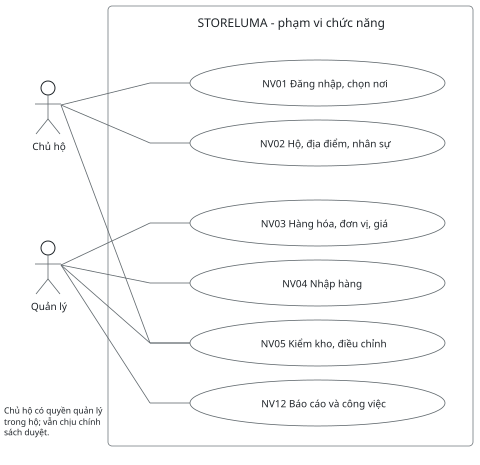

| Nhóm nghiệp vụ | Phạm vi và điều kiện |
| --- | --- |
| NV01 / NV02 | Đăng nhập, chọn hộ/địa điểm; cấu hình nơi làm việc, mời người và gán quyền. |
| NV03 / NV04 / NV05 | Thiết lập hàng, nhận hàng, theo dõi tồn, kiểm đếm và điều chỉnh theo quyền. |
| NV12 | Xem/xuất báo cáo, nhận cảnh báo và xử lý công việc; có thời điểm cập nhật dữ liệu. |

## 3. Vai trò vận hành và giới hạn trách nhiệm

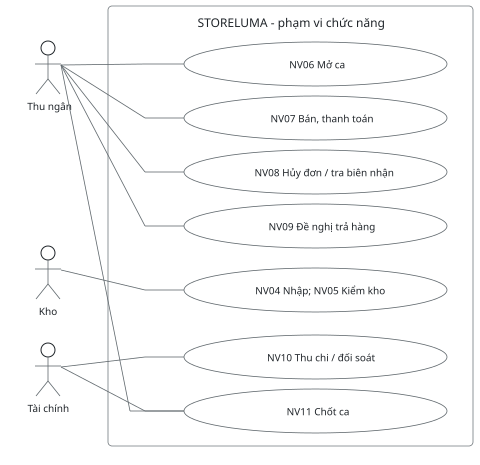

| Nhóm bổ sung | Người thực hiện và giới hạn |
| --- | --- |
| NV13 - Khách hàng cơ bản | Thu ngân/chủ hộ: lưu thông tin cần thiết, tra lịch sử; khách lẻ không bắt buộc có hồ sơ. |
| NV14 - Lịch sử và vận hành | Người có quyền xem lịch sử chứng từ. Quản trị nền tảng theo dõi dịch vụ và phục hồi; truy cập dữ liệu hộ cần quyền hỗ trợ có hạn và lưu vết. |

Thu ngân được lập đề nghị trả hàng nhưng việc duyệt phụ thuộc quyền riêng; nhân viên kho xác nhận hàng không đồng nghĩa được chi tiền. Một người có thể kiêm vai trò nếu được cấp quyền. Quyền được kiểm tại dịch vụ xử lý, cùng hộ, địa điểm và trạng thái chứng từ.

## 4. Phân tích chi tiết nhập hàng và bán hàng

### 4.1 NV04 - Nhập hàng từ nhà cung cấp

| Thuộc tính | Nội dung |
| --- | --- |
| Yêu cầu / tác nhân | YC06-07; nhân viên kho, người được quyền xác nhận nhập. |
| Điều kiện trước | Đăng nhập; kho hoạt động; nhà cung cấp và SKU hợp lệ; có quyền nhập tại kho. |
| Luồng chính | 1. Chọn nhà cung cấp, kho, hàng. 2. Nhập lượng thực nhận và giá. 3. Kiểm dữ liệu, lưu nháp. 4. Xác nhận bằng mã thao tác. 5. Ghi phiếu, biến động và giá vốn. 6. Tạo khoản phải trả từ sự kiện nhập mua. |
| Ngoại lệ | Thiếu quyền/dữ liệu sai: giữ nháp và nêu lỗi. SKU đang kiểm kho: chưa ghi nhận. Gửi lại xác nhận: trả kết quả cũ. Finance chậm: phiếu kho đã ghi sổ, khoản phải trả hiển thị đang đồng bộ. |
| Kết quả | Phiếu đã ghi sổ bất biến, tồn tăng một lần. Trả tiền nhà cung cấp là nghiệp vụ riêng; tồn đầu kỳ không tạo công nợ. |

### 4.2 NV07 - Bán và xác nhận thanh toán

| Thuộc tính | Nội dung |
| --- | --- |
| Yêu cầu / tác nhân | YC12-14; thu ngân; Sales phối hợp Inventory và Finance. |
| Điều kiện trước | Ca mở, địa điểm sẵn sàng; giỏ có báo giá còn hiệu lực, quyền hợp lệ, mã chống lặp. |
| Luồng chính | 1. Kiểm giá/quyền ở máy chủ. 2. Lưu tiến trình đơn. 3. Giữ đủ hàng cho mọi dòng. 4. Chuẩn bị giữ hàng chắc chắn trước thu tiền. 5. Xác nhận tiền. 6. Ghi xuất kho và giá vốn. 7. Hoàn tất đơn, cho in biên nhận. |
| Ngoại lệ | Thiếu tồn: chưa thu. Chưa rõ thanh toán: chờ đối soát, không thu lại. Đã có tiền nhưng kho lỗi: giữ trạng thái cần kiểm tra, thử lại cùng mã; bồi hoàn theo quyền nếu không thể giao. |
| Kết quả | COMPLETED chỉ khi tiền đã xác nhận và kho đã ghi xuất. In lỗi không chạy lại thanh toán. |

## 5. Phân tích chi tiết trả hàng và chốt ca

### 5.1 NV09 - Trả hàng một phần và hoàn tiền

| Thuộc tính | Nội dung |
| --- | --- |
| Yêu cầu / tác nhân | YC16; thu ngân đề nghị, người có quyền duyệt, kho nhận, tài chính chi. |
| Điều kiện trước | Đơn gốc đã hoàn tất; còn lượng và tiền được trả; chính sách trả hàng cho phép. |
| Luồng chính | 1. Chọn dòng, lượng, lý do. 2. Khóa hạn mức còn trả, kể cả phiếu đang xử lý. 3. Tính tiền theo giảm giá gốc. 4. Phê duyệt. 5. Nhận vào hàng bán được hoặc cách ly. 6. Hoàn bằng mã duy nhất. 7. Hoàn tất phiếu trả. |
| Ngoại lệ | Vượt lượng/tiền: từ chối. Kho đang kiểm: giữ đã duyệt, chờ nhận. Đã nhận hàng nhưng hoàn tiền lỗi: chờ hoàn tiền, không xóa chứng từ nhận. Chi tiền mặt cần ca đang mở. |
| Kết quả | Phiếu trả riêng có trạng thái hàng và tiền. Đơn gốc vẫn hoàn tất; chỉ cập nhật thông tin trả một phần/toàn bộ. |

### 5.2 NV11 - Chốt ca và đối chiếu tiền

| Thuộc tính | Nội dung |
| --- | --- |
| Yêu cầu / tác nhân | YC20; thu ngân đề nghị, người có quyền xác nhận chênh lệch. |
| Điều kiện trước | Ca của quầy đang mở; người thực hiện có quyền; không chốt trùng. |
| Luồng chính | 1. Chuyển sang đang chốt và chặn giao dịch mới. 2. Hoàn thành/đối soát giao dịch tiền mặt đang dở. 3. Tính tiền dự kiến. 4. Ghi số đếm. 5. Ghi lý do và duyệt lệch nếu có. 6. Lưu kết quả và đóng ca. |
| Ngoại lệ | Còn thanh toán/hoàn tiền chưa rõ: chưa đóng ca. Thiếu lý do hoặc quyền duyệt: giữ đang chốt. Gửi lại lệnh đóng: trả cùng kết quả. |
| Kết quả | Một quầy tối đa một ca đang mở/đang chốt. Số đếm không sửa doanh thu hay dòng tiền đã ghi. |

Chính sách đề xuất để thiết kế ban đầu: trả trong 7 ngày; quá hạn cần duyệt ngoại lệ. Thu ngân giảm tối đa 5%; vượt mức cần quản lý. Các ngưỡng này cần được trao đổi với người dùng/GVHD và cấu hình trước khi áp dụng thực tế.

## 6. Sơ đồ hoạt động nhập hàng

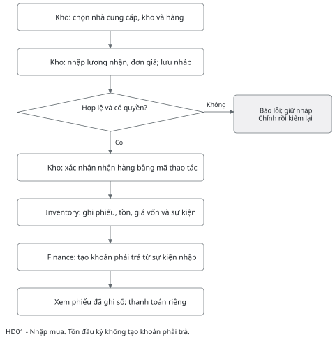

Giao dịch cục bộ của Inventory ghi phiếu nhận, biến động, tồn, giá vốn và sự kiện cần phát cùng nhau. Finance nhận sự kiện nhập mua và tạo khoản phải trả theo mã phiếu; nhận lại sự kiện không tạo thêm công nợ.

Nhánh dữ liệu không hợp lệ quay lại chỉnh nháp; xác nhận chỉ thực hiện khi kiểm tra lại thành công. SKU đang kiểm kho không được nhận thêm trong lúc đóng băng. Khi mất phản hồi, tra cứu mã thao tác trước khi thử lại.

Tiêu chí thiết kế: nhập 10 chai giá 10.000 làm tăng 10 chai và khoản phải trả 100.000; chưa tạo chi tiền. Với phiếu tồn đầu kỳ, chỉ tăng tồn và giá trị đã duyệt.

## 7. Sơ đồ hoạt động bán tại quầy

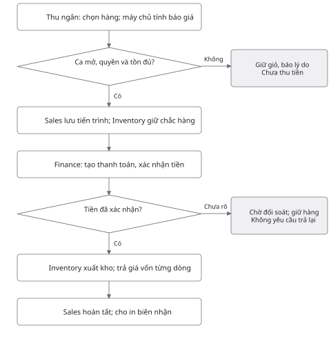

Nhánh chưa rõ khác với thất bại chắc chắn. Nếu chưa tạo thanh toán hoặc đã xác nhận thất bại và không còn bước thu tiền cạnh tranh, có thể hủy an toàn và giải phóng giữ hàng. Nếu chưa rõ hoặc đã thu, giữ tiến trình để đối soát, không tự giải phóng phần hàng đã chuẩn bị.

Giữ hàng thực hiện nguyên tử cho toàn bộ dòng. Hai người cùng mua mặt hàng còn một đơn vị chỉ một người giữ được hàng. Hàng đã chuẩn bị cho thu tiền không tự hết hạn trong khi kết quả tiền chưa rõ.

Trước thu tiền, báo giá hết hạn hoặc giá đã đổi phải được tính lại và người bán chấp nhận. Tồn trên màn hình chỉ để tham khảo; quyết định bán dựa trên kiểm tra ở dịch vụ kho.

## 8. Sơ đồ hoạt động trả hàng

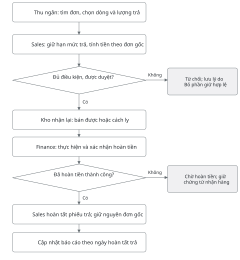

Trước phê duyệt, Sales kiểm soát lượng đã trả và lượng trong các phiếu đang giữ hạn mức. Hai yêu cầu trả đồng thời không được cùng dùng phần còn lại của một dòng bán.

Hàng hỏng nhận lại vào khu vực cách ly; không làm tăng lượng có thể bán. Nếu kho đang đóng băng SKU để kiểm đếm, phiếu giữ trạng thái đã duyệt và đợi nhận. Phiếu chỉ hoàn tất khi cả hàng và tiền đã hoàn thành.

Ví dụ: bán 2 chai giá 20.000, giảm cả đơn 4.000; mỗi chai thực trả 18.000. Trả 1 chai hoàn 18.000, không lấy giá bán hiện tại. Trả phần cuối nhận phần làm tròn còn lại để tổng hoàn không vượt số thực thu.

## 9. Sơ đồ hoạt động chốt ca

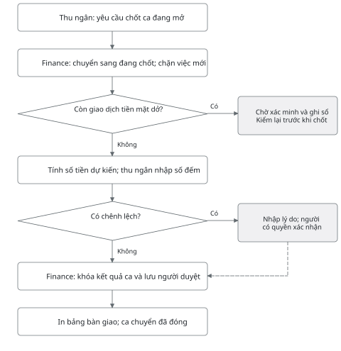

Khi chuyển OPEN sang CLOSING, Finance kiểm tra và chặn việc tạo thao tác tiền mặt mới cùng một cơ chế khóa với việc đăng ký thanh toán/hoàn tiền. Những thao tác đã bắt đầu vẫn được tiếp tục, đối soát và ghi nhận vào ca đó trước khi đóng.

Tiền dự kiến = tiền đầu ca + tổng tiền mặt vào quầy - tổng tiền mặt ra quầy. Chỉ lấy sổ tiền chuẩn của Finance, không dùng số tổng hợp báo cáo có thể đang trễ. Thanh toán điện tử được trình bày riêng.

Nếu có chênh lệch, người có quyền xác nhận với lý do và dấu vết; không sửa số giao dịch để ép khớp. Thành công muộn sau một tình huống bất thường phải mở hồ sơ đối soát, không bỏ qua bằng chứng đã nhận tiền.

## 10. Trình tự bán hàng giữa các dịch vụ

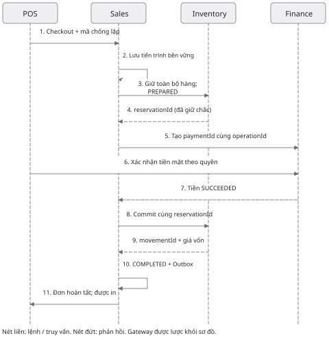

Sales lưu CheckoutProcess trước khi gọi dịch vụ khác. Mỗi bước có mã nghiệp vụ duy nhất; Inventory kiểm đủ tồn, giữ toàn bộ dòng và chuyển PREPARED trước bước có thể nhận tiền. Finance ghi xác nhận tiền mặt và dòng sổ tiền trong cùng giao dịch cục bộ.

Mũi tên POS tới Finance là thao tác xác nhận của người có quyền qua Gateway. Sales đọc trạng thái tiền hoặc nhận sự kiện đã xác nhận; sau đó yêu cầu Inventory commit. Sales chỉ ghi COMPLETED khi nhận bằng chứng xuất kho cùng giá vốn.

Sự kiện hoàn tất được ghi cùng đơn trong Outbox; tiến trình phát lại tới Reporting/Notification. Mất phản hồi sau commit được xử lý bằng truy vấn cùng mã, không khởi tạo đơn, payment hay reservation mới.

## 11. Trình tự trả hàng và hoàn tiền

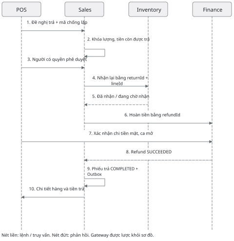

Sơ đồ thể hiện luồng sau khi được duyệt. Bước 6 chỉ tiếp tục khi bước 5 xác nhận đã nhận hàng. Nếu kho đang đóng băng SKU hoặc chưa nhận xong, dừng ở chờ nhận; không hoàn tiền trước trong phương án cốt lõi này.

Inventory chống nhận trùng theo returnId và dòng trả. Finance chống hoàn trùng theo refundId, kiểm số tiền đã hoàn/đang giữ và payment gốc. Hoàn tiền mặt gắn ca đang mở của lần chi, có người xác nhận.

Nếu đã nhận hàng mà tiền hoàn chưa rõ, Sales giữ REFUND_PENDING để đối soát. Không nhận lại hàng lần hai, không xóa việc hàng đã về kho. Báo cáo trả hàng ghi theo thời điểm phiếu trả hoàn tất; báo cáo tiền theo dòng sổ tiền thực tế.

## 12. Trình tự phục hồi sau mất kết nối

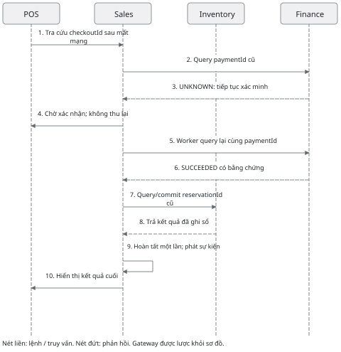

UNKNOWN là chưa đủ bằng chứng kết luận. Giao diện hiển thị mã đơn và trạng thái chờ, khóa thao tác thu thêm trên cùng đơn. Worker phục hồi từ tiến trình đã lưu, dùng paymentId và reservationId cũ để tiếp tục sau khi khởi động lại.

Nếu query cho thấy tiền thất bại chắc chắn, chỉ giải phóng giữ hàng khi đã loại trừ bước thu tiền cạnh tranh. Nếu tiền đã thành công nhưng kho chưa ghi xuất, tiếp tục cùng mã; trường hợp không thể giao cần người có quyền xử lý bồi hoàn.

Khách thanh toán điện tử chỉ được xác nhận qua kết quả nhà cung cấp đã kiểm chứng. Mã QR, ảnh chụp hay chuyển hướng trình duyệt chưa đủ. Giai đoạn đồ án có thể dùng môi trường mô phỏng và phải ghi rõ DEMO.

## 13. Ranh giới dịch vụ và giao tiếp

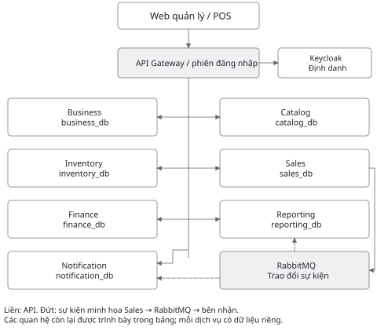

| Quan hệ | Cách phối hợp dự kiến |
| --- | --- |
| Web → Gateway → dịch vụ | Yêu cầu trực tiếp; mỗi dịch vụ kiểm quyền hành động và dữ liệu. Gateway không sở hữu đơn, tiền hay tồn. |
| Sales → Catalog / Inventory / Finance | API để báo giá, giữ/xuất hàng, thanh toán/hoàn tiền; lưu tiến trình để thử lại và tra cứu. |
| Business → Inventory / Finance | Sự kiện yêu cầu khởi tạo kho/quầy; địa điểm chỉ sẵn sàng sau đủ xác nhận. |
| Dịch vụ nguồn → RabbitMQ → bên nhận | Outbox phát sự kiện; Inbox chống xử lý trùng. Reporting cập nhật bản tổng hợp; Notification tạo việc cần xử lý. |

Mỗi dịch vụ có API, cơ sở dữ liệu, tài khoản truy cập và bản đóng gói riêng. Có thể dùng chung máy PostgreSQL để tiết kiệm tài nguyên, nhưng không truy vấn hoặc tạo khóa ngoại xuyên cơ sở dữ liệu. Chi tiết phiên bản công nghệ sẽ chốt khi dựng dự án.

## 14. Mô hình miền tổ chức và hàng hóa

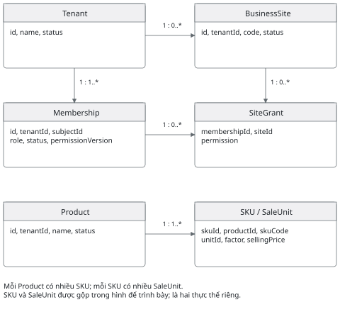

Tenant là hộ kinh doanh; BusinessSite là địa điểm thuộc hộ. Một membership liên kết định danh đăng nhập với hộ và quyền; SiteGrant giới hạn nơi được làm việc. Một người có thể tham gia nhiều hộ nhưng mỗi thao tác chỉ dùng một ngữ cảnh đã kiểm tra.

Khối Product, SKU và SaleUnit thuộc Catalog; khối tổ chức và quyền thuộc Business. Mũi tên biểu diễn quan hệ một-nhiều, không phải lời gọi API. Thuộc tính trên hình là tập con cần thiết để phân tích, chưa phải toàn bộ lược đồ vật lý.

Một SKU có đơn vị cơ sở; các đơn vị bán có hệ số quy đổi dương. Giá và hệ số được chụp vào dòng chứng từ lúc bán. Ngừng SKU hoặc thay giá không viết lại lịch sử. Mã SKU và mã địa điểm duy nhất trong phạm vi hộ, không bắt buộc duy nhất toàn hệ thống.

## 15. Mô hình miền bán hàng và trả hàng

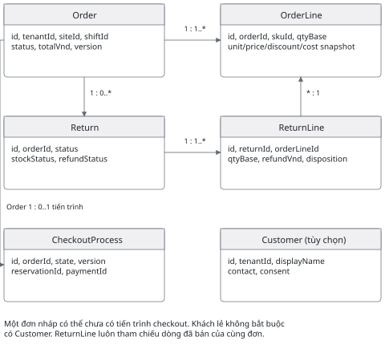

OrderLine giữ tên hàng, đơn vị, hệ số, đơn giá, giảm giá phân bổ và giá vốn tại lần xuất. orderId và returnId ràng buộc trong cùng hộ; ReturnLine chỉ dùng dòng thuộc đơn gốc. Customer là tùy chọn, mỗi đơn gắn tối đa một khách hàng.

CheckoutProcess lưu bước hiện tại, lần thử tiếp theo, mã giữ kho, mã thanh toán và lỗi gần nhất. Return cũng cần tiến trình tương tự để phục hồi giữa bước nhận hàng và hoàn tiền. Các tham chiếu sang Inventory/Finance là ID nghiệp vụ, không phải khóa ngoại xuyên dịch vụ.

Order: DRAFT → PENDING → COMPLETED; khi cần kiểm tra dùng REVIEW. CANCELLED chỉ dùng trước hoàn tất khi an toàn về tiền và kho. Return: REQUESTED → APPROVED → STOCK_RECEIVED → REFUND_PENDING → COMPLETED; từ chối trước thực hiện phải trả lại hạn mức đã giữ.

## 16. Mô hình tồn kho và sổ tiền

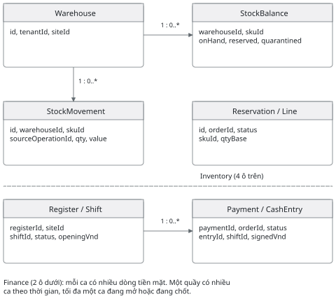

Inventory: Warehouse có nhiều StockBalance và StockMovement. Balance duy nhất theo hộ, kho, SKU. Reservation có nhiều dòng, giữ toàn bộ dòng hoặc không dòng nào. Movement là lịch sử bất biến: số lượng, giá trị, loại biến động, chứng từ nguồn và thời điểm.

Finance: Register có nhiều Shift theo thời gian; Payment có thể gắn một ca khi thu tiền mặt. CashEntry thuộc một ca và nguồn nghiệp vụ duy nhất. Refund tham chiếu Payment gốc và có thể chi ở ca khác; đầu ca không phải doanh thu. Các cặp thực thể gộp trên hình sẽ thành bảng riêng.

Tồn khả dụng = onHand - reserved - quarantined, các thành phần không âm. Giá vốn dùng bình quân gia quyền di động trong Inventory; giá vốn xuất được lưu vào dòng đơn. Hàng trả nhập theo giá vốn gốc, hàng cách ly giữ giá trị tới khi có chứng từ xuất hủy.

## 17. Dữ liệu ban đầu và ràng buộc thiết kế

| Dịch vụ sở hữu | Thực thể/bảng dự kiến | Ràng buộc trọng tâm |
| --- | --- | --- |
| Business | Tenant, Site, Membership, SiteGrant, SupportGrant | siteCode duy nhất theo hộ; không mất chủ hộ cuối; hỗ trợ có thời hạn. |
| Catalog | Product, SKU, SaleUnit, SellingPrice | skuCode duy nhất theo hộ; factor > 0; đơn vị đã dùng không sửa hệ số. |
| Inventory | Supplier, Receipt/Line, Balance, Movement, Reservation/Line, CountSession, Adjustment | Balance (tenant, warehouse, sku); ghi movement theo nguồn duy nhất; kiểm kho đóng băng SKU. |
| Sales | Customer, Quote, Order/Line, Return/Line, CheckoutProcess, ReturnProcess | Đơn có version; chụp giá/đơn vị; giữ hạn mức trả khi đang xử lý. |
| Finance | Register, Shift, Payment, Refund, CashEntry, Payable | Một ca OPEN/CLOSING mỗi quầy; sổ tiền chỉ ghi thêm/đảo; hoàn không vượt thực thu. |
| Reporting | DailySales, DailyCash, StockProjection, Checkpoint, ExportJob | Chống lặp event; dữ liệu có dataAsOf, lọc theo hộ/địa điểm. |
| Notification | WorkItem, Notification, DeliveryAttempt | Dấu vết nguồn; gộp việc đang mở cùng nguyên nhân; đã xem tách khỏi đã xử lý. |

### 17.1 Quy ước dùng chung

Mỗi bản ghi nghiệp vụ có tenantId; thêm siteId khi thuộc địa điểm. Khóa duy nhất, cache, thông điệp và điều kiện đọc đều giữ phạm vi hộ. Khóa ngoại chỉ trong cơ sở dữ liệu của dịch vụ sở hữu; tham chiếu ngoài được xác minh qua API hoặc sự kiện.

Tiền VND lưu số nguyên, truyền API bằng chuỗi số; lượng dùng số thập phân chính xác (dự kiến numeric(18,3)). Giá vốn nội bộ giữ độ chính xác cao hơn, làm tròn tại giá trị chứng từ. Không dùng số thực nhị phân để tính tiền.

Các dịch vụ phát/nhận sự kiện có Outbox/Inbox riêng; eventId, operationId, tenantId, aggregateId, version và thời điểm. Ghi thay đổi nghiệp vụ cùng Outbox trong một giao dịch; ghi Inbox cùng kết quả xử lý. Sự kiện đến sai thứ tự cần kiểm version, chờ hoặc đồng bộ lại nguồn.

Kiểm kho chỉ bắt đầu khi không còn giữ hàng hoặc thao tác dở trong phạm vi chọn. Khóa SKU được kiểm trong cùng giao dịch với mọi lệnh tăng/giảm tồn; sau duyệt lệch, ghi movement và mở khóa.

## 18. Mẫu giao diện đăng nhập và điều hướng

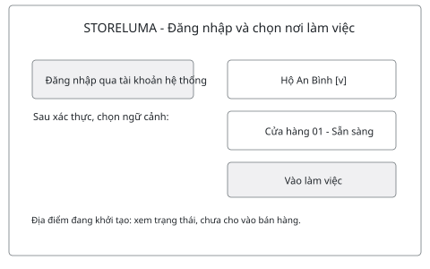

| Điểm vào | Đường đi chính |
| --- | --- |
| Quản lý | Đăng nhập → chọn hộ/địa điểm → hàng hóa, nhập/tồn, quỹ/ca, báo cáo. |
| Thu ngân | Đăng nhập → chọn nơi/quầy → mở ca → POS → giao dịch → chốt ca. |
| Xử lý phát sinh | Công việc cần xử lý → chứng từ gốc → hành động có quyền → xem trạng thái mới. |

Giao diện chỉ liệt kê hộ và địa điểm được cấp quyền. Địa điểm đang khởi tạo hiển thị lý do chưa dùng được; thêm một địa điểm chưa sẵn sàng không chặn những địa điểm đang hoạt động của cùng hộ.

Nếu quyền bị thu hồi trong phiên, dịch vụ từ chối thao tác mới và giao diện tải lại ngữ cảnh. Không dựa riêng vào việc ẩn nút trên màn hình. Thao tác đổi hộ phải xác nhận hoặc lưu nháp công việc đang làm để tránh nhập nhầm.

Các hình UI01-UI07 dùng dữ liệu giả định Hộ An Bình, Cửa hàng 01. Đây là bản phác thảo cấu trúc và trạng thái, chưa kiểm thử khả dụng, chưa chuyển thành thiết kế Figma hay giao diện React.

## 19. Mẫu giao diện quản lý hàng hóa

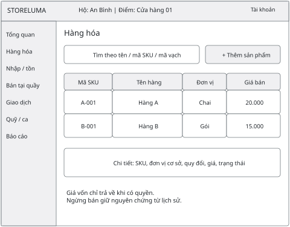

| Thành phần | Hành vi dự kiến |
| --- | --- |
| Tìm kiếm | Nhập tên, SKU, mã vạch; chỉ trả hàng trong hộ. Hiển thị đang tải, không có kết quả và lỗi kết nối riêng. |
| Thêm/sửa hàng | Kiểm mã trùng, đơn vị cơ sở, hệ số dương và giá. Lưu với version để tránh ghi đè thay đổi mới. |
| Đơn vị và giá | Hiển thị giá theo đơn vị bán; không sửa hệ số đơn vị đã dùng. Chứng từ cũ giữ snapshot. |
| Quyền xem | Không trả trường giá vốn khi thiếu quyền. Nút thêm/sửa chỉ hiện với người được cấp quyền. |
| Ngừng kinh doanh | Xác nhận trạng thái; SKU đã ngừng không bán mới nhưng vẫn tra được giao dịch cũ. |

Liên kết yêu cầu: YC04-05. Mẫu ưu tiên dữ liệu cần cho nhập và bán; nhập CSV thuộc phần mở rộng sau khi chức năng cốt lõi ổn định.

## 20. Mẫu giao diện nhập hàng và tồn kho

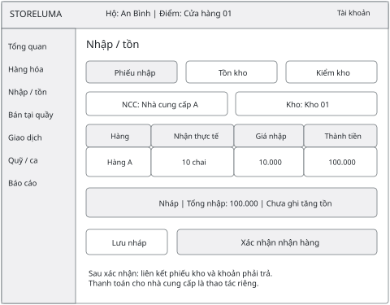

| Thành phần | Hành vi dự kiến |
| --- | --- |
| Phiếu nhập | Chọn nhà cung cấp, kho, lượng thực nhận và đơn giá. Lưu nháp chưa ảnh hưởng tồn hoặc tiền. |
| Xác nhận | Kiểm lại quyền, trạng thái kho/SKU; giữ mã thao tác khi gửi lại. Thành công hiển thị số phiếu và trạng thái khoản phải trả. |
| Tồn kho | Tab tồn hiển thị thực tế, giữ cho đơn, cách ly, có thể bán; mở lịch sử biến động và chứng từ nguồn. |
| Kiểm kho | Chọn phạm vi; cảnh báo khóa bán/nhập SKU đang đếm. Nhập số đếm, lý do lệch; gửi người có quyền duyệt. |
| Trạng thái lỗi | Nêu dòng hàng sai; nếu mất phản hồi phải tra phiếu cũ. Phiếu đã ghi sổ không trở lại nháp để sửa trực tiếp. |

Liên kết yêu cầu: YC06-10. Bảng tồn và biểu mẫu kiểm kho được xác định ở mức hành vi; bố cục chi tiết từng tab sẽ tiếp tục hoàn thiện khi triển khai.

## 21. Mẫu giao diện bán tại quầy

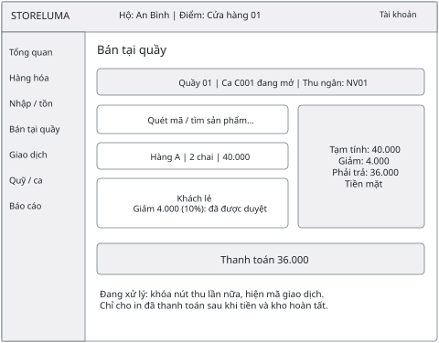

| Trạng thái | Cách hiển thị và thao tác |
| --- | --- |
| Sẵn sàng | Quầy/ca ở đầu màn hình; máy quét nhập mã như bàn phím; ưu tiên tìm hàng và thay lượng nhanh. |
| Cần duyệt giảm | Ví dụ giảm 4.000/40.000 = 10%, vượt mức đề xuất 5% của thu ngân; yêu cầu quản lý duyệt trước thu. |
| Đang xử lý | Vô hiệu hóa thu thêm trên cùng đơn; hiển thị mã đơn, tiến trình tiền và hàng; có thao tác kiểm tra trạng thái. |
| Thiếu tồn / giá đổi | Chỉ rõ dòng bị ảnh hưởng; yêu cầu chấp nhận báo giá mới; chưa thu tiền khi giữ tồn thất bại. |
| Hoàn tất / in lỗi | Cho in biên nhận nội bộ; in lại giữ cùng đơn, không thanh toán lại. Mất mạng chỉ giữ giỏ nháp và tra giao dịch cũ khi kết nối lại. |

Liên kết yêu cầu: YC11-15, YC17-18. Biên nhận nội bộ được phân biệt với hóa đơn điện tử. Chế độ thanh toán mô phỏng phải có nhãn DEMO.

## 22. Mẫu giao diện giao dịch và trả hàng

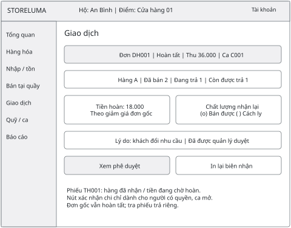

| Thành phần | Hành vi dự kiến |
| --- | --- |
| Tra cứu đơn | Lọc số đơn, ngày, khách trong quyền. Đơn đang chờ cho xem trạng thái nhưng không in như đã thanh toán. |
| Lượng và tiền trả | Hiện đã bán, đã trả, đang giữ và còn được trả; tính theo snapshot đơn gốc. Không cho nhập tiền vượt giới hạn. |
| Duyệt và nhận hàng | Lưu lý do, người duyệt, chất lượng từng dòng; người kho chỉ xác nhận hàng trong quyền. |
| Hoàn tiền | Hiện refundId, ca chi và trạng thái. Nếu chưa rõ, cho kiểm tra lại cùng phiếu; không có nút hoàn thêm để bỏ qua trạng thái. |
| Lịch sử xử lý | Xem ai thực hiện, thời điểm, chứng từ hàng và tiền; mở công việc đối soát khi có lỗi. |

Liên kết yêu cầu: YC14-17, YC23. Bố cục tách thông tin đơn và phiếu trả để tránh hiểu nhầm đơn gốc bị hủy.

## 23. Mẫu giao diện quỹ và chốt ca

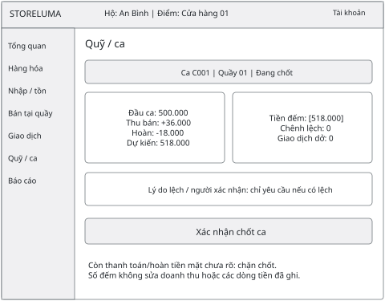

| Thành phần | Hành vi dự kiến |
| --- | --- |
| Tiền dự kiến | Tính từ sổ tiền Finance: đầu ca, tiền vào, tiền ra. Có liên kết tới từng chứng từ. |
| Đếm và lệch | Nhập số đếm; tự tính lệch = số đếm - dự kiến. Có lệch phải có lý do và người xác nhận theo quyền. |
| Việc chưa xong | Hiện thanh toán/hoàn tiền mặt chưa rõ; chặn đóng ca tới khi xử lý xong. |
| Xác nhận chốt | Khóa với thao tác bắt đầu tiền mặt mới; thử lại không tạo bản chốt mới; ca đã đóng chỉ xem/in. |
| Thu chi ngoài bán | Ghi loại khoản và chứng từ, xác định có tác động quầy hay không; trả nhà cung cấp không tự trở thành giá vốn hàng bán. |

Liên kết yêu cầu: YC19-20. Ví dụ 500.000 + 36.000 - 18.000 = 518.000. Đếm 517.000 tạo lệch -1.000 để giải trình; không đổi doanh thu thuần 18.000.

## 24. Mẫu giao diện báo cáo và công việc

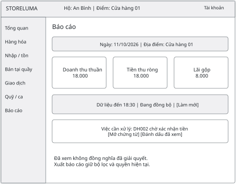

| Thành phần | Hành vi dự kiến |
| --- | --- |
| Bộ lọc | Thời gian và địa điểm trong quyền; xuất giữ đúng bộ lọc. Nhãn thời gian theo múi giờ cửa hàng. |
| Chỉ tiêu | Doanh thu theo đơn hoàn tất; trả hàng theo thời điểm phiếu trả hoàn tất; tiền theo sổ tiền. Lãi gộp dùng giá vốn đã chụp khi xuất. |
| Dữ liệu trễ | Hiện dataAsOf và trạng thái đang đồng bộ; không mô tả số liệu tổng hợp như số liệu trực tiếp tuyệt đối. |
| Công việc | Giao dịch chờ tiền, lệch ca, tồn thấp liên kết tới chứng từ. Đã xem không tự đóng công việc. |
| Quyền | Ẩn và không trả dữ liệu lãi/giá vốn khi thiếu quyền; vận hành kỹ thuật không mặc nhiên xem kinh doanh của hộ. |

Liên kết yêu cầu: YC21-24. Ví dụ minh họa trong hình là bán và trả trong cùng ngày, không có giao dịch khác; khi trả ngày sau, báo cáo phản ánh giảm ở ngày trả.

## 25. Đối chiếu thiết kế với yêu cầu tuần 2

Ma trận cho biết nơi mỗi yêu cầu được phân tích trong bộ thiết kế. “Mục” là số đề mục trong báo cáo. Các màn hình chi tiết chưa vẽ riêng được ghi rõ để tiếp tục hoàn thiện khi xây dựng.

| YC | Nội dung | Thiết kế liên quan |
| --- | --- | --- |
| 01 | Đăng nhập, ngữ cảnh | NV01; MD01; UI01 |
| 02 | Hộ và địa điểm | NV02; KT01; MD01; UI01 |
| 03 | Nhân sự, quyền | NV02; MD01; mục 3, 17; màn hình phân quyền chi tiết ở tuần 4 |
| 04 | Sản phẩm, biến thể | NV03; MD01; UI02 |
| 05 | Đơn vị, giá | NV03; MD01; UI02, UI04 |
| 06 | Nhà cung cấp | NV04; mục 4, 17; UI03 |
| 07 | Nhận hàng | NV04; HD01; UI03 |
| 08 | Tồn và lịch sử | NV05; MD03; UI03 |
| 09 | Kiểm kho | NV05; mục 17; UI03 (hành vi tab) |
| 10 | Điều chỉnh, hàng hỏng | NV05; MD03; mục 16-17; biểu mẫu chi tiết khi triển khai kho |
| 11 | Mở ca | NV06; MD03; UI01, UI04 |
| 12 | Giỏ và báo giá | NV07; MD02; UI04 |
| 13 | Hoàn tất đơn | NV07; HD02; TT01, TT03; UI04 |
| 14 | Xác nhận, đối soát | NV07, NV10; TT03; UI05 |
| 15 | Hủy trước hoàn tất | NV08; mục 7, 12, 15; UI05 |
| 16 | Trả và hoàn tiền | NV09; HD03; TT02; UI05 |
| 17 | Biên nhận | NV08; mục 4; UI04-05 |
| 18 | Khách hàng | NV13; MD02; UI04 (khách tùy chọn) |
| 19 | Thu chi, trả nhà cung cấp | NV10; MD03; UI06 |
| 20 | Chốt ca | NV11; HD04; UI06 |
| 21 | Báo cáo, xuất | NV12; KT01; UI07 |
| 22 | Thông báo, việc cần xử lý | NV12; mục 17; UI07 |
| 23 | Lịch sử, xử lý phát sinh | NV14; TT03; UI05 |
| 24 | Vận hành | NV14; KT01; mục 3, 17; màn hình kỹ thuật ở giai đoạn vận hành |

Các yêu cầu chất lượng tuần 2 được đưa vào thiết kế: quyền theo hộ/địa điểm (CL01), tiền và tồn chính xác (CL02), phục hồi cùng mã (CL03), trạng thái UI rõ (CL05), dữ liệu/dịch vụ riêng (CL06), truy vết (CL08), giới hạn dữ liệu cá nhân (CL09). Hiệu năng và sao lưu (CL04, CL07) cần đo/thử sau triển khai.

## 26. Rà soát thiết kế bằng tình huống

Đã đối chiếu các sơ đồ, mẫu màn hình và quy tắc dưới đây bằng cách đi từng bước trên tài liệu. Đây là kiểm tra tính nhất quán của thiết kế; chưa phải kết quả chạy kiểm thử phần mềm.

| Mã | Tình huống | Kết luận thiết kế |
| --- | --- | --- |
| RS01 | Nhập 10 chai giá 10.000, chưa trả tiền | Tồn +10, phải trả +100.000; tiền quầy không đổi (HD01). |
| RS02 | Bán 2 chai giá 20.000, giảm 4.000 | Giảm 10% cần duyệt; thu 36.000, tồn còn 8 (HD02, UI04). |
| RS03 | Trả 1 chai của đơn trên, còn bán được | Hoàn 18.000, tồn lên 9; đơn gốc vẫn hoàn tất (HD03). |
| RS04 | Đầu ca 500.000; chỉ có RS02-03 | Dự kiến 518.000; doanh thu thuần 18.000, giá vốn thuần 10.000, lãi gộp 8.000. |
| RS05 | Hai người mua mặt hàng còn 1 | Giữ hàng nguyên tử; chỉ một đơn được thu; không bán âm (TT01). |
| RS06 | Mất mạng sau xác nhận tiền | Tra paymentId cũ; chưa rõ thì chờ; không thu thêm (TT03). |
| RS07 | Kho đã xuất, phản hồi bị mất | Commit/query cùng reservationId trả kết quả cũ, không xuất lại. |
| RS08 | Nhận hàng trả rồi hoàn tiền lỗi | Giữ hàng đã nhận, chờ hoàn; không nhận/hoàn trùng (TT02). |
| RS09 | Hai phiếu trả cùng lượng còn lại | Sales giữ hạn mức cả phiếu dở, không cho vượt lượng/tiền. |
| RS10 | Chốt ca khi tiền mặt chưa rõ | Giữ đang chốt; hoàn tất đối soát trước đóng (HD04). |
| RS11 | ID đơn thuộc hộ khác, quyền bị thu hồi | Dịch vụ từ chối truy cập; không tiết lộ chứng từ; tải lại quyền. |
| RS12 | Sự kiện lặp hoặc đến muộn | Inbox chống lặp, kiểm version; UI hiện thời điểm dữ liệu (KT01, UI07). |

Các điểm đã làm rõ sau rà soát: ví dụ giảm 10% phải có bước duyệt; đơn, hàng và tiền có trạng thái riêng; ca chốt dùng sổ tiền chuẩn; trả hàng giữ hạn mức cả khi chưa hoàn tất; mẫu báo cáo có thời điểm dữ liệu.

Giới hạn: chưa có đo p95, tải đồng thời, thử lỗi dịch vụ, thử in máy thật, đánh giá khả dụng hoặc chạy khôi phục cơ sở dữ liệu. Những nội dung này cần bằng chứng thực thi ở các tuần phát triển/kiểm thử.

## 27. Sản phẩm hoàn thành và công việc tiếp theo

### 27.1 Kết quả của nhiệm vụ tuần 3

Đã tạo bộ thiết kế ban đầu gồm 14 nhóm nghiệp vụ, mô tả chi tiết 4 nghiệp vụ trọng tâm, 13 sơ đồ và 7 mẫu màn hình. Ma trận liên kết đủ 24 yêu cầu chức năng tuần 2 tới phần thiết kế tương ứng. Sản phẩm nằm trực tiếp trong báo cáo; nguồn vector và nội dung có thể chỉnh sửa được lưu cùng dự án.

Bộ thiết kế đáp ứng đầu ra “thiết kế và mẫu màn hình đầu tiên”. Các sơ đồ tập trung vào luồng cốt lõi và lỗi ảnh hưởng tiền, hàng, quyền. Lược đồ vật lý đầy đủ, hợp đồng API chi tiết và toàn bộ màn hình phụ sẽ tiếp tục hoàn thiện khi triển khai từng nhóm chức năng.

### 27.2 Kế hoạch tuần 4: 12/10-18/10/2026

| Việc cần làm | Sản phẩm / điều kiện hoàn thành dự kiến |
| --- | --- |
| Dựng cấu trúc dự án | Monorepo, các dịch vụ tách riêng, cấu hình môi trường và hướng dẫn chạy; không dùng chung bảng nghiệp vụ. |
| Dựng hạ tầng phát triển | Compose cho PostgreSQL, RabbitMQ, Keycloak và Gateway; health check và bí mật ngoài mã nguồn. |
| Đăng nhập và ngữ cảnh | Đăng nhập, đăng xuất, chọn hộ/địa điểm; kiểm tra thiếu quyền và truy cập khác hộ. |
| Hộ, địa điểm, nhân sự | Business API và dữ liệu ban đầu; tạo địa điểm chờ khởi tạo, chỉ sẵn sàng khi kho/quầy xác nhận. |
| Kiểm tra nền hệ thống | Chạy luồng đăng nhập → chọn nơi → quyền cơ bản; kiểm khởi tạo lặp không nhân đôi; ghi hướng dẫn và kết quả. |

Báo cáo lập ngày 14/10, trong tuần 4 theo kế hoạch. Bảng trên là đầu việc chuyển tiếp; chưa ghi nhận các mục đó đã triển khai. Ưu tiên nền đăng nhập, phân quyền và tổ chức trước khi sang danh mục/nhập hàng tuần 5.

### 27.3 Những nội dung cần trao đổi

Xác nhận cửa hàng/ngành hàng tham khảo, mức giảm giá, hạn trả hàng, chính sách người lập-người duyệt, thiết bị quầy và phương thức thanh toán. Rủi ro chính là độ phức tạp phối hợp nhiều dịch vụ; triển khai một luồng hoàn chỉnh trước, rồi bổ sung phạm vi đã ưu tiên. Chưa có phản hồi hoặc biên bản duyệt của GVHD trong lần lập này.

### Tài liệu làm căn cứ

[1] Phan Chí Cường. Đề cương chi tiết Đồ án 2: Storeluma - Hệ thống microservices phục vụ hộ kinh doanh. Ngày 27/09/2026; kế hoạch tuần 3-4 ở trang 10.

[2] Phan Chí Cường. Báo cáo tiến độ tuần 2: Khảo sát nhu cầu và xác định yêu cầu hệ thống. Ngày 03/10/2026; yêu cầu YC01-YC24 và kế hoạch tuần 3.
