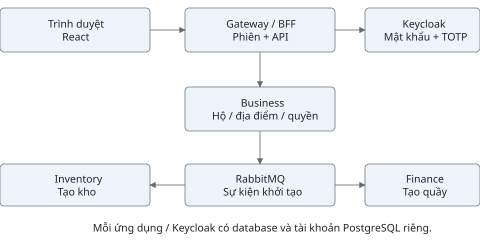
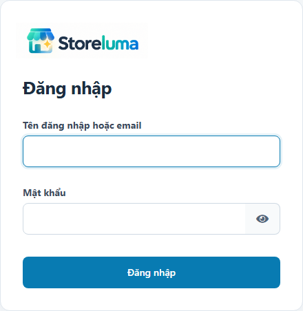
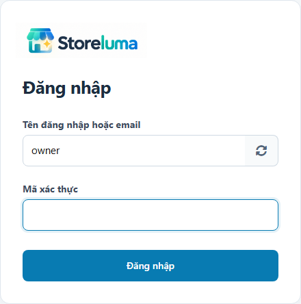
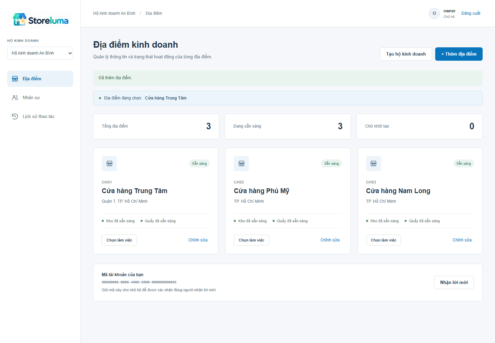
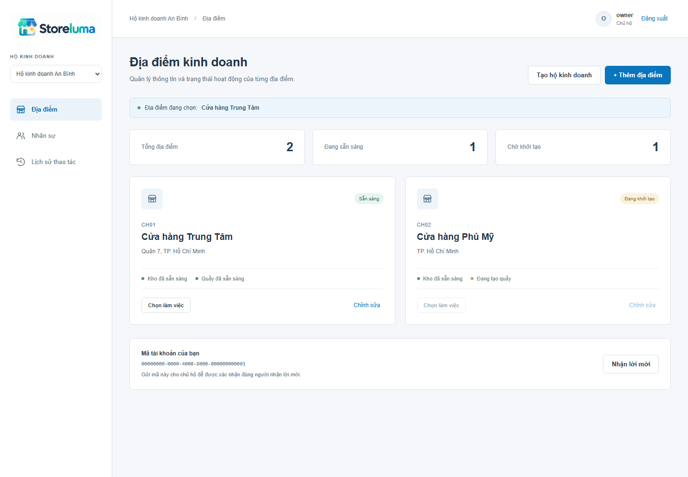
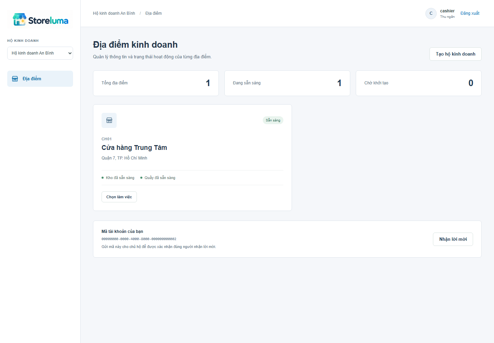
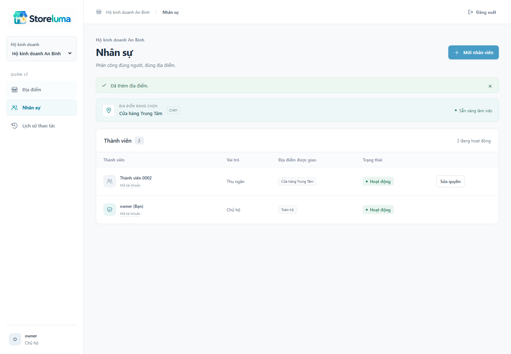
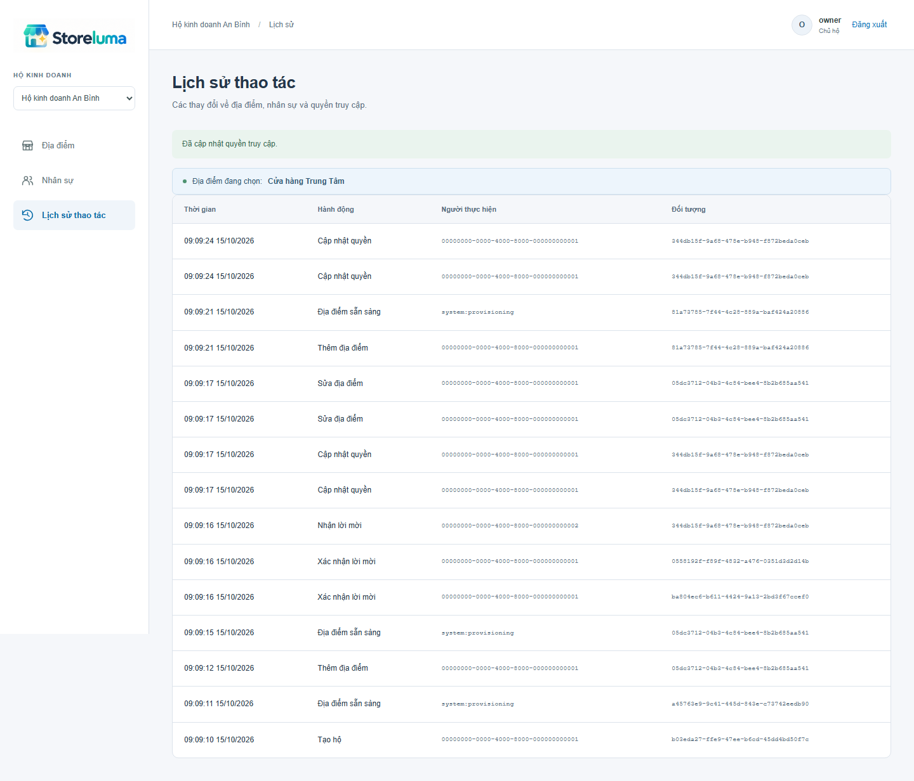
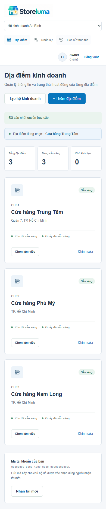

# STORELUMA - BÁO CÁO TIẾN ĐỘ TUẦN 4
Phan Chí Cường - 23520207 | GVHD: ThS. Trần Anh Dũng
Kỳ kế hoạch 12/10-18/10/2026. Ngày hoàn thiện: 16/10/2026.

## 1. Mục tiêu và kết quả tuần 4

Theo kế hoạch Đồ án 2, tuần 4 (12/10-18/10/2026) thực hiện dựng dự án, đăng nhập, quản lý hộ và địa điểm kinh doanh; sản phẩm cần đạt là nền hệ thống và quyền cơ bản. Báo cáo này ghi nhận kết quả đã thực hiện đến ngày 16/10/2026, tiếp nối phần yêu cầu tuần 2 và thiết kế tuần 3.

| Nhiệm vụ | Sản phẩm đã thực hiện |
| --- | --- |
| Dựng dự án | Mã nguồn TypeScript; React; các dịch vụ NestJS; Docker Compose; migration và cấu hình môi trường cục bộ. |
| Đăng nhập và phiên | Keycloak, mật khẩu + TOTP; Gateway/BFF giữ token phía máy chủ; chọn ngữ cảnh hộ/địa điểm; đăng xuất. |
| Hộ và địa điểm | Tạo hộ kèm địa điểm đầu tiên; thêm/sửa/tạm ngừng địa điểm; cấp kho và quầy bất đồng bộ. |
| Quyền cơ bản | Vai trò theo từng hộ và phạm vi địa điểm; lời mời đúng tài khoản; khóa thành viên; nhật ký thao tác. |
| Kiểm tra và bàn giao | 20/20 ca kiểm thử tích hợp và giao diện đạt; ảnh chụp bản chạy; hướng dẫn chạy; hợp đồng API và báo cáo. |

Tiêu chí hoàn thành

Có thể chạy hệ thống cục bộ, đăng nhập, tạo một hộ, chờ địa điểm sẵn sàng rồi chọn nơi làm việc. Chủ hộ cấp quyền cho nhân viên; tài khoản ở hộ khác và nhân viên ngoài phạm vi không được truy cập. Tạo lại cùng một thao tác hoặc nhận lại sự kiện không tạo bản ghi kho/quầy trùng.

Các chức năng hàng hóa, nhập hàng, tồn kho chi tiết, bán hàng và tài chính nghiệp vụ chưa triển khai trong tuần này. Dữ liệu trong ảnh và bộ kiểm thử là dữ liệu trình diễn, không phải dữ liệu vận hành của một hộ kinh doanh thực tế.

## 2. Nền dự án và kiến trúc đã dựng

Trình duyệt dùng giao diện React cùng nguồn với Gateway tại localhost:4100. Gateway xử lý phiên và chuyển API đến Business. Keycloak đảm nhiệm xác thực. Business, Inventory và Finance trao đổi sự kiện qua RabbitMQ; mỗi dịch vụ chỉ truy cập database của chính mình.

| Thành phần | Phạm vi hiện tại |
| --- | --- |
| Gateway + Business | Chạy thực tế: đăng nhập/phiên, hộ, địa điểm, thành viên, lời mời, nhật ký. |
| Inventory + Finance | Chạy thực tế: tiếp nhận yêu cầu tạo kho/quầy và trả sự kiện sẵn sàng. Chưa xử lý giao dịch nghiệp vụ. |
| Catalog, Sales, Reporting, Notification | Đã tạo khung mã nguồn, migration và health endpoint; thuộc profile full. Chưa chạy nghiệp vụ và không thuộc bộ kiểm thử tuần 4. |

Stack: Node.js 24, NestJS 12.1.3, React 19.3.0, PostgreSQL 17, RabbitMQ 4.1, Keycloak 26.4.7, openid-client 6.8.8. Phiên bản npm được khóa bằng package-lock.json; image hạ tầng được khai báo trong compose.yaml. Đây là cấu hình phát triển cục bộ.

## 3. Đăng nhập và quản lý phiên

Luồng đã triển khai

Người dùng chọn đăng nhập; Gateway tạo state, nonce và PKCE S256, sau đó chuyển sang Keycloak. Keycloak yêu cầu mật khẩu và mã TOTP. Callback hợp lệ tạo một phiên mới, đổi mã phiên và đưa người dùng về ứng dụng. Không dùng password grant và không đưa access token vào localStorage.

| Điểm kiểm soát | Cách thực hiện |
| --- | --- |
| Phiên ứng dụng | Cookie HttpOnly, SameSite=Lax; dữ liệu phiên mã hóa AES-256-GCM trong PostgreSQL của Gateway. |
| Yêu cầu thay đổi dữ liệu | Kiểm tra Origin và CSRF token tại Gateway; Business tiếp tục xác minh JWT và quyền nghiệp vụ. |
| Thời hạn và đăng xuất | Phiên tối đa 15 phút; hết hạn phải đăng nhập lại. Đăng xuất xóa phiên BFF và chuyển hướng kết thúc phiên Keycloak. |

Kiểm thử đã xác nhận đăng nhập mật khẩu + TOTP thành công, cookie có thuộc tính đúng, trình duyệt không nhận access token qua API phiên, phiên hết hạn bị từ chối và đăng xuất trả về luồng đăng nhập. Ngày 16/10 hoàn thiện giao diện đăng nhập: gom logo và nội dung, đồng bộ font, ô nhập, nút và focus ở bước mật khẩu/TOTP. Kiểm tra thêm hiện/ẩn mật khẩu, báo sai thông tin, đăng nhập, đăng xuất và bố cục 320/390/768 px đạt. Bản cục bộ dùng HTTP loopback; chưa triển khai HTTPS.

## 4. Quản lý hộ và địa điểm kinh doanh

Tạo hộ ghi đồng thời thông tin hộ, membership OWNER của người tạo, địa điểm đầu tiên và yêu cầu khởi tạo. Thêm địa điểm tiếp theo chỉ dành cho chủ hộ. Mã địa điểm là duy nhất trong từng hộ, tên và địa chỉ được kiểm tra đầu vào ở máy chủ.

| Tác vụ | Ràng buộc áp dụng |
| --- | --- |
| Tạo mới | Idempotency-Key lưu cùng kết quả; thử lại cùng khóa/nội dung trả kết quả cũ. Cùng khóa nhưng nội dung khác trả 409. |
| Chỉnh sửa | Chủ hộ hoặc quản lý đúng phạm vi; kiểm tra version để tránh ghi đè dữ liệu đã thay đổi. |
| Chọn nơi làm việc | Địa điểm thuộc hộ, trong phạm vi được giao và đang ACTIVE. PROVISIONING hoặc SUSPENDED bị từ chối. |

Bộ kiểm thử gửi đồng thời sáu yêu cầu tạo hộ cùng khóa và nhận cùng một tenantId, với một địa điểm đầu tiên. Giao diện tạo được địa điểm CH03 và một hộ mới qua biểu mẫu thật. Ca W4-20 tiếp tục chọn nơi làm việc, mời và nhận nhân viên qua giao diện, rồi đối chiếu dữ liệu và nhật ký tại API.

## 5. Khởi tạo kho và quầy qua sự kiện

Khi tạo địa điểm, Business cấp trước siteId, warehouseId và registerId, đặt trạng thái PROVISIONING rồi ghi site.provision.requested vào Outbox trong cùng transaction. Inventory tạo kho; Finance tạo quầy; hai dịch vụ phát warehouse.ready và register.ready. Chỉ khi nhận đủ hai phản hồi đúng các mã đã cấp, Business mới chuyển địa điểm sang ACTIVE.

Kết quả kiểm tra gián đoạn và gửi lại

Đã dừng Finance rồi tạo CH02. Kho được tạo, quầy chưa sẵn sàng; chọn CH02 bị trả 409 trong khi CH01 vẫn ACTIVE. Sau khi khởi động Finance, thông điệp tồn trong queue được xử lý và CH02 chuyển sang ACTIVE.

Outbox chỉ đánh dấu gửi xong sau publisher confirm. Consumer ghi Inbox và thay đổi dữ liệu trong cùng transaction, ACK sau commit. Phát lại cùng sự kiện năm lần và chờ sự kiện kiểm tra tiếp theo được nhận vẫn chỉ có một kho và một quầy cho địa điểm. Đây là xử lý an toàn khi thông điệp có thể được giao nhiều lần, không phải bảo đảm exactly-once trên toàn hệ thống.

## 6. Phân quyền theo hộ và địa điểm

Một tài khoản có thể tham gia nhiều hộ với vai trò khác nhau. Vai trò và site_ids lưu ở membership, không suy ra từ tên tài khoản. Business tra lại trạng thái membership mỗi yêu cầu nên việc khóa thành viên có hiệu lực ngay cả khi người đó còn phiên đăng nhập.

| Thao tác tuần 4 | Chủ hộ | Quản lý | Vai trò khác |
| --- | --- | --- | --- |
| Xem/chọn địa điểm ACTIVE | Toàn hộ | Được giao | Được giao |
| Tạo thêm địa điểm | Có | Không | Không |
| Sửa/tạm ngừng địa điểm | Toàn hộ | Được giao | Không |
| Mời, đổi quyền, khóa nhân viên | Có | Không | Không |
| Xem danh sách nhân sự/nhật ký | Có | Không | Không |

Vai trò khác gồm CASHIER, STOCK và ACCOUNTANT. Tuần 4 mới kiểm soát quyền nền tổ chức; quyền bán hàng, nhập kho hay xử lý tài chính sẽ được bổ sung khi triển khai các nghiệp vụ tương ứng. Mọi tài khoản đã xác thực có thể tạo một hộ mới của riêng mình; điều này không cấp quyền ở hộ đang tồn tại.

Các ca kiểm thử đã từ chối truy cập hộ khác, địa điểm ngoài phạm vi, header tự khai danh tính và yêu cầu cấp quyền của thu ngân. W4-19 kiểm tra quản lý sửa đúng địa điểm được giao; thu ngân, kho và tài chính bị từ chối sửa địa điểm. Phiên kiểm tra lại ngữ cảnh; giao diện cập nhật vai trò và địa điểm khoảng 2,5 giây một lần, còn API kiểm quyền từng yêu cầu.

## 7. Lời mời và quản lý thành viên

Chủ hộ lấy mã tài khoản từ đúng người nhận, chọn vai trò và địa điểm, sau đó xác nhận đã đối chiếu người nhận. Hệ thống sinh mã lời mời ngẫu nhiên, chỉ hiển thị trong lần tạo, có hạn 48 giờ và lưu hash trong database. Không tự cấp quyền dựa trên email chưa xác minh.

| Tình huống | Hành vi đã thực hiện và kiểm tra |
| --- | --- |
| Sai người nhận | Tài khoản khác cầm cùng mã lời mời bị từ chối; không tạo membership. |
| Hết hạn hoặc dùng lại | Lời mời hết hạn hoặc đã sử dụng trả 409. Nhận hợp lệ chỉ tạo một membership. |
| Đổi quyền/khóa | Chủ hộ sửa vai trò, phạm vi và trạng thái; version cũ bị từ chối. Thành viên BLOCKED không truy cập được hộ. |
| Bảo vệ chủ hộ | Không thay đổi OWNER qua chức năng sửa thành viên, tránh làm mất quyền quản trị hộ. |

Lời mời hiện được chuyển trực tiếp giữa chủ hộ và nhân viên. Chưa có gửi email, quản lý lời mời qua email hoặc luồng chuyển quyền sở hữu. API kiểm tra người mời vẫn là chủ hộ hoạt động tại thời điểm xử lý nhận lời mời; chưa có ca kiểm thử độc lập cho tình huống mất quyền người mời.

## 8. Nhật ký và lưu trữ dữ liệu

Business ghi nhật ký tạo hộ, thêm địa điểm, địa điểm sẵn sàng, sửa địa điểm, xác nhận/nhận lời mời và cập nhật quyền. Bản ghi gồm hộ, người thực hiện, đối tượng, thời điểm và dữ liệu trước/sau phù hợp. Giao diện hiển thị tối đa 50 bản ghi mới nhất; chỉ chủ hộ được xem.

| Database | Dữ liệu chính |
| --- | --- |
| business_db | tenants, sites, memberships, invitations, audit, idempotency, outbox, inbox. |
| inventory_db / finance_db | warehouses / registers; mỗi bên có outbox và inbox riêng. |
| gateway_db / keycloak_db | Phiên ứng dụng / tài khoản và cấu hình xác thực; tách khỏi dữ liệu nghiệp vụ. |

Database và tài khoản PostgreSQL tách theo dịch vụ trên cùng một máy chủ PostgreSQL cục bộ. Tài khoản Business thử kết nối finance_db bị từ chối. Khởi động lại Business và Gateway vẫn giữ dữ liệu và phiên; nhật ký tạo/sẵn sàng địa điểm và đổi quyền còn truy vấn được. Chưa kiểm thử khôi phục từ bản sao lưu hoặc mất cả máy chủ.

## 9. Hợp đồng API và dữ liệu

API công khai đi qua Gateway ở localhost:4100. GET /auth/session kiểm tra lại ngữ cảnh đã chọn, bỏ ngữ cảnh khi site ngừng hoặc quyền không còn; trả danh tính, CSRF token và thời hạn; các API nghiệp vụ /v1 dùng cookie phiên. POST/PATCH yêu cầu CSRF token và Origin đúng. Hợp đồng chi tiết nằm tại docs/week-04/api-contract.md và được đối chiếu với controller hiện tại.

| API | Mục đích / quyền |
| --- | --- |
| GET /v1/me | Danh tính, memberships của tài khoản đã đăng nhập. |
| POST /v1/tenants | Tạo hộ và địa điểm đầu tiên; cần Idempotency-Key. |
| GET/POST /v1/tenants/{t}/sites | Xem địa điểm theo phạm vi / chủ hộ thêm mới. |
| GET/PATCH /v1/tenants/{t}/sites/{s} | Xem / cập nhật địa điểm đúng quyền; PATCH kiểm tra version. |
| POST /v1/context | Chọn hộ và địa điểm ACTIVE được giao. |
| GET /v1/tenants/{t}/memberships | Chủ hộ xem danh sách thành viên. |
| POST /v1/tenants/{t}/invitations | Chủ hộ tạo lời mời đã xác nhận người nhận. |
| POST /v1/invitations/accept | Đúng người nhận chấp nhận lời mời còn hạn. |
| PATCH /v1/tenants/{t}/memberships/{m} | Chủ hộ sửa quyền/trạng thái với version hiện tại. |
| GET /v1/tenants/{t}/audit | Chủ hộ xem nhật ký gần nhất. |

Ký hiệu {t}, {s}, {m} là UUID của hộ, địa điểm và membership. Site có trạng thái PROVISIONING/ACTIVE/SUSPENDED; membership có ACTIVE/BLOCKED. Mã địa điểm duy nhất theo cặp tenant_id + code; membership duy nhất theo tenant_id + subject_id.

Lỗi chính: 400 dữ liệu không hợp lệ; 401 chưa xác thực hoặc hết phiên; 403 thiếu quyền/CSRF; 404 ngoài hộ hoặc phạm vi; 409 xung đột version, thao tác hoặc trạng thái; 503 dịch vụ phía sau gián đoạn. Thông báo lỗi không trả bí mật hay stack trace cho trình duyệt.

## 10. Kiểm thử tích hợp - nhóm 1

Bộ kiểm thử Playwright chạy Chromium với PostgreSQL, RabbitMQ và Keycloak thật trong Docker; không thay bằng dữ liệu giả lập API. Lần chạy toàn bộ ngày 15/10/2026 có 20/20 ca đạt, không bỏ qua, không flaky; thời gian toàn bộ 34.9 giây. Bản tổng hợp công khai: docs/week-04/evidence/verification.md. Mỗi lần chạy kiểm thử cũng xuất JSON kết quả để kiểm tra trên máy chạy.

| Mã | Nội dung kiểm tra | Kết quả |
| --- | --- | --- |
| W4-01 | Đăng nhập mật khẩu + TOTP; cookie HttpOnly/SameSite; không trả token ra trình duyệt. | Đạt |
| W4-02 | Chưa đăng nhập, JWT giả và header tự khai danh tính không vượt xác thực. | Đạt |
| W4-03 | Thiếu CSRF hoặc Origin khác bị trả 403. | Đạt |
| W4-04 | Sáu yêu cầu tạo cùng khóa sinh một hộ/địa điểm; đổi nội dung cùng khóa trả 409. | Đạt |
| W4-05 | Kho và quầy được tạo; chỉ ACTIVE khi đủ hai phản hồi; chọn ngữ cảnh thành công. | Đạt |
| W4-06 | Không đọc được dữ liệu hộ khác hoặc trộn site của hộ khác vào đường dẫn. | Đạt |
| W4-07 | Dừng Finance: site mới chờ, site cũ hoạt động; khởi động lại thì hoàn tất. | Đạt |
| W4-08 | Phát lại sự kiện năm lần; kho/quầy và Inbox không bị nhân bản theo cùng event ID. | Đạt |
| W4-09 | Lời mời cần xác nhận, đúng người, còn hạn, chỉ dùng một lần. | Đạt |

Cách đánh giá

Kiểm tra cả HTTP response và số bản ghi ở database tương ứng. Nhóm gián đoạn dừng container thật, sau đó phục hồi trong phần dọn dẹp của ca kiểm thử. Nhóm tạo đồng thời kiểm tra cùng một tenantId và một địa điểm; không chỉ dựa vào nội dung hiển thị trên màn hình.

## 11. Kiểm thử tích hợp - nhóm 2

| Mã | Nội dung kiểm tra | Kết quả |
| --- | --- | --- |
| W4-10 | Thu ngân chỉ thấy site được giao; không quản lý nhân sự, tạo địa điểm hay cấp quyền. | Đạt |
| W4-11 | Khóa có hiệu lực trong phiên đang dùng; sửa quyền bằng version cũ trả 409. | Đạt |
| W4-12 | Không hạ quyền/khóa OWNER bằng chức năng sửa thành viên. | Đạt |
| W4-13 | SUSPENDED không chọn làm việc; version cũ bị từ chối; kích hoạt lại hợp lệ. | Đạt |
| W4-14 | Khởi động lại Business/Gateway vẫn truy cập được phiên, dữ liệu và nhật ký. | Đạt |
| W4-15 | Tài khoản database Business không kết nối được finance_db. | Đạt |
| W4-16 | Tạo CH03; tìm không dấu, lọc, đổi cách xem; Tab/Escape trong hộp thoại; khóa/mở quyền, nhật ký, logo và màn hình 390 px. | Đạt |
| W4-17 | Phiên hết hạn phía server bị từ chối. | Đạt |
| W4-18 | Đăng xuất xóa phiên BFF và đưa về luồng nhập tài khoản Keycloak. | Đạt |
| W4-19 | Xóa ngữ cảnh khi site ngừng hoặc quyền đổi; quản lý chỉ sửa site được giao; thu ngân, kho, tài chính không được sửa. | Đạt |
| W4-20 | Tạo hộ, chọn nơi, mời và nhận lời mời bằng biểu mẫu thật; kiểm tra phạm vi và nhật ký qua API. | Đạt |

Lỗi phát hiện và xử lý trong quá trình kiểm tra

Rà soát bổ sung phát hiện phiên vẫn trả địa điểm đã chọn sau khi site tạm ngừng. W4-19 tái hiện lỗi trước sửa. Đã kiểm tra lại ngữ cảnh phía Gateway, cập nhật vai trò/phạm vi trên giao diện và bỏ kết quả tải cũ khi đổi hộ. W4-19 và W4-20 được bổ sung trước lần chạy lại toàn bộ. Đã tách nhãn mã lời mời khỏi giá trị mã và báo rõ khi chưa chọn địa điểm cho nhân viên. Đợt hoàn thiện giao diện còn sửa lỗi tác vụ tải nền ghi đè hộ vừa chọn; cập nhật trạng thái dựa trên lựa chọn mới nhất.

Phạm vi của kết luận

Kết quả chứng minh các luồng nền được liệt kê hoạt động trên môi trường cục bộ này. Chưa đo tải cao, độ trễ trên mạng thật, kiểm thử thâm nhập toàn diện, mất PostgreSQL/RabbitMQ, sao lưu/phục hồi hay tương thích nhiều trình duyệt. Không suy rộng kết quả 20 ca thành bảo đảm toàn bộ hệ thống hoàn chỉnh.

## 12. Giao diện sản phẩm và mã nguồn

| Thư mục / tệp | Nội dung |
| --- | --- |
| apps/web/ | React và public/brand/Logo_Storeluma.png; màn hình đăng nhập, địa điểm, nhân sự, lịch sử. |
| services/ | Gateway và bảy dịch vụ nghiệp vụ; main.ts và migration từng dịch vụ. |
| packages/platform/ | Kết nối DB, migration, JWT guard, Outbox/Inbox, RabbitMQ worker. |
| infra/ | Theme đăng nhập tiếng Việt dùng cùng logo; generated/ chứa cấu hình riêng, bị loại khỏi Git. |
| tests/week04.spec.ts | 20 ca kiểm thử; xuất ảnh và JSON kết quả. |
| tools/ + docs/week-04/ | Công cụ thiết lập/đăng nhập, cấu hình nhận diện; tài liệu và minh chứng. |

Logo gốc được lưu trong apps/web/public/brand/ và dùng chung với theme Keycloak qua cấu hình Compose. Đã tạo Dockerfile, Compose, lockfile và workflow kiểm tra cho GitHub Actions. Mã nguồn và workflow đã được đẩy lên GitHub. Báo cáo chỉ xác nhận kết quả kiểm thử cục bộ; chưa xác minh kết quả CI trên GitHub và chưa phát hành môi trường từ xa.

## 13. Hướng dẫn chạy và trình diễn

Thiết lập tại thư mục gốc dự án

Yêu cầu Node.js 24 và Docker Desktop chạy Linux containers. Các cổng 4100, 8180, 55432, 5673, 15673 cần còn trống. Lệnh setup sinh bí mật ngẫu nhiên và ba tài khoản mẫu, giữ nguyên cấu hình nếu đã có.

npm ci npm run setup docker compose up -d --build docker compose ps

Chờ http://localhost:4100/health trả trạng thái ok; mở http://localhost:4100. Lấy mật khẩu và mã TOTP hiện tại bằng lệnh dưới trên máy cá nhân. Chỉ dùng dữ liệu này để đăng nhập demo, không đưa đầu ra vào tài liệu nộp.

node tools/demo-login.mjs owner

Kịch bản trình diễn cho giảng viên

1. Đăng nhập owner bằng mật khẩu và mã TOTP. Tạo hộ, địa điểm đầu tiên CH01; chờ kho và quầy sẵn sàng. 2. Thêm CH02, chọn nơi làm việc; thử tạm ngừng và kích hoạt lại. 3. Mở cửa sổ riêng, đăng nhập cashier; lấy mã tài khoản và nhờ chủ hộ tạo lời mời cho CH01. 4. Nhận lời mời; kiểm tra cashier chỉ thấy CH01 và không có chức năng quản lý nhân sự. 5. Chủ hộ khóa rồi mở lại thành viên; xem nhật ký. Đăng xuất khi kết thúc.

Chạy lại kiểm tra và dừng hệ thống

npx playwright install chromium npm run typecheck npm run build npm test docker compose down

Bộ kiểm thử tạo dữ liệu mới và chủ động dừng/khởi động một số dịch vụ, nên chạy riêng với buổi trình diễn. docker compose down giữ volume dữ liệu; không thêm -v khi cần bảo toàn dữ liệu. Hướng dẫn đầy đủ nằm tại docs/week-04/README.md.

## 14. Sản phẩm bàn giao và kế hoạch tiếp

| Sản phẩm | Vị trí / trạng thái |
| --- | --- |
| Nền ứng dụng 0.4.0 | Mã nguồn trong apps/, services/, packages/; build và typecheck đạt. |
| Môi trường cục bộ | Docker Compose với PostgreSQL, RabbitMQ, Keycloak và bốn ứng dụng phục vụ tuần 4. |
| Tài liệu API / chạy thử | docs/week-04/api-contract.md và README.md. |
| Kiểm thử và ảnh | 20 ca đạt; bản tổng hợp kết quả và 9 ảnh trong docs/week-04/evidence/. |
| Báo cáo tuần 4 | PDF độc lập kèm nội dung Markdown, sơ đồ và ảnh minh chứng. |

Giới hạn còn lại

Môi trường chỉ phục vụ phát triển cục bộ, Keycloak dùng start-dev; chưa triển khai HTTPS hay máy chủ Internet. Phiên hết hạn sau tối đa 15 phút và chưa tự làm mới. Tài khoản mẫu và mã TOTP sinh trên cùng máy chỉ thuận tiện cho trình diễn; sử dụng thật cần thiết bị xác thực riêng. Chưa gửi email lời mời, tự đăng ký, chuyển quyền sở hữu hoặc hoàn thiện vận hành hàng đợi lỗi.

Inventory/Finance mới làm khởi tạo kho/quầy. Catalog, Sales, Reporting và Notification là khung dịch vụ. Chưa có nghiệp vụ danh mục, nhập/xuất, POS, thu chi, báo cáo hoặc thông báo. Chưa xác minh kết quả CI trên GitHub, kiểm thử tải hay sao lưu/phục hồi. Các nội dung này không được tính là sản phẩm hoàn thành tuần 4.

Tuần 5: 19/10-25/10/2026

Theo đề cương, tiếp tục danh mục, nhà cung cấp và nhập hàng. Dự kiến triển khai nhóm hàng, mặt hàng/biến thể, đơn vị tính; danh sách nhà cung cấp; phiếu nhập và dòng hàng; kiểm tra quyền theo hộ/địa điểm trên nền hiện có. Phối hợp Catalog với Inventory để ghi nhận nhập kho, chống gửi lặp và lưu lịch sử.

Tiêu chí tuần kế tiếp: tạo được mặt hàng và nhà cung cấp, lập phiếu nhập đúng địa điểm, kiểm tra số lượng/giá trị hợp lệ và ghi nhận kết quả nhập một lần. Đây là kế hoạch triển khai tiếp, chưa phải kết quả của báo cáo này.

## 15. Tài liệu tham khảo và minh chứng

Tài liệu trong tiến trình đồ án

[1] Phan Chí Cường. Đề cương Đồ án 2 - Storeluma. Bảng kế hoạch 13 tuần, trang 10; mục tiêu và phạm vi hệ thống. [2] Báo cáo tuần 2: yêu cầu và chức năng ưu tiên. [3] Báo cáo tuần 3: phân tích nghiệp vụ, thiết kế dịch vụ, dữ liệu và phác thảo giao diện.

Tài liệu kỹ thuật đã tham khảo

[4] NestJS. Authentication và Authorization. <link href="https://docs.nestjs.com/security/authentication" color="#17635b">docs.nestjs.com/security/authentication</link>; <link href="https://docs.nestjs.com/security/authorization" color="#17635b">docs.nestjs.com/security/authorization</link>.

[5] Keycloak. Running Keycloak in a container; Importing and exporting realms. <link href="https://www.keycloak.org/server/containers" color="#17635b">keycloak.org/server/containers</link>; <link href="https://www.keycloak.org/server/importExport" color="#17635b">keycloak.org/server/importExport</link>.

[6] openid-client. Tài liệu thư viện và ví dụ Authorization Code Flow. <link href="https://github.com/panva/openid-client" color="#17635b">github.com/panva/openid-client</link>.

[7] RabbitMQ. Consumer Acknowledgements and Publisher Confirms. <link href="https://www.rabbitmq.com/docs/confirms" color="#17635b">rabbitmq.com/docs/confirms</link>.

[8] Keycloak. Working with themes. <link href="https://www.keycloak.org/ui-customization/themes" color="#12679a">keycloak.org/ui-customization/themes</link>. Tham khảo ngày 15/10/2026 để đồng bộ nhận diện màn hình đăng nhập.

[9] Tabler. Dashboard UI. <link href="https://github.com/tabler/tabler" color="#12679a">github.com/tabler/tabler</link>. [10] shadcn/ui. Dashboard blocks. <link href="https://ui.shadcn.com/blocks?category=dashboard" color="#12679a">ui.shadcn.com/blocks</link>. Tham khảo bố cục ngày 15/10/2026; tự triển khai bằng React/CSS hiện có, không tích hợp hai thư viện.

Các tài liệu [4]-[7] được tham khảo trong quá trình triển khai ngày 14/10/2026. Quyết định và phạm vi thực hiện được ghi theo mã nguồn của bản 0.4.0, không coi toàn bộ khả năng của framework là chức năng đã làm.

Đối chiếu minh chứng

Hình 2 chụp lại ngày 16/10/2026 sau khi hoàn thiện màn hình đăng nhập. Hình 3-8 giữ từ lần kiểm thử ngày 15/10/2026. Các ảnh đều do Playwright chụp trên ứng dụng thật. Hình 2 gồm hai bước nhập mật khẩu và mã xác thực, chụp trước khi nhập thông tin bí mật. Hình 8 là ảnh cùng giao diện tại chiều rộng 390 px. Hình 1 là sơ đồ triển khai của bản tuần 4. Ảnh dùng dữ liệu trình diễn; không chứa mật khẩu, bí mật TOTP hay mã lời mời.

Kết quả được lưu kèm mã nguồn để có thể chạy lại. Báo cáo ghi nhận tiến độ đến ngày 16/10/2026, không giả định có triển khai production, đánh giá của giảng viên hoặc sử dụng thực tế ngoài những minh chứng đã nêu.
