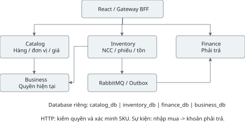
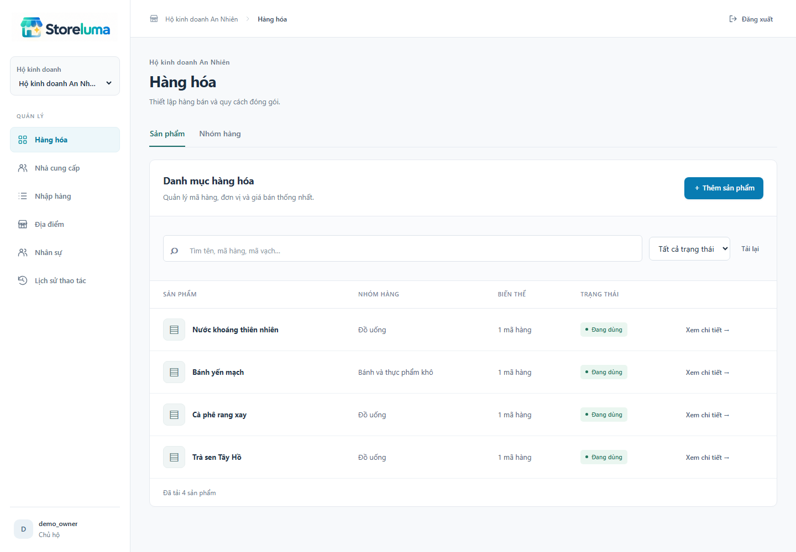
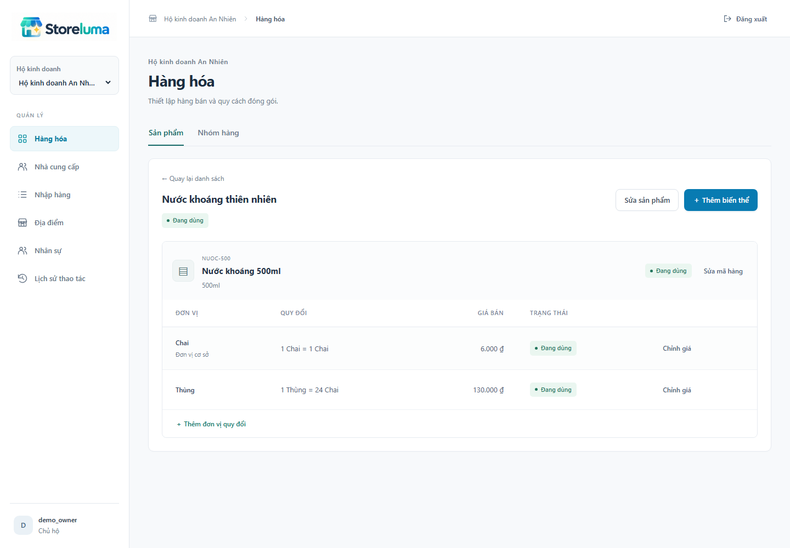
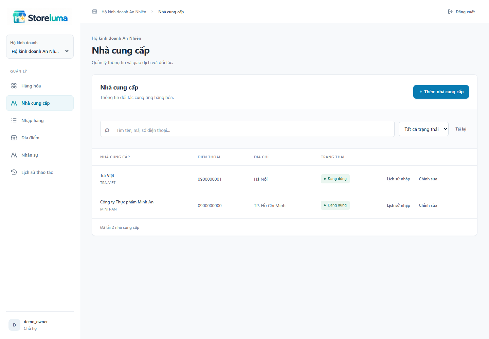
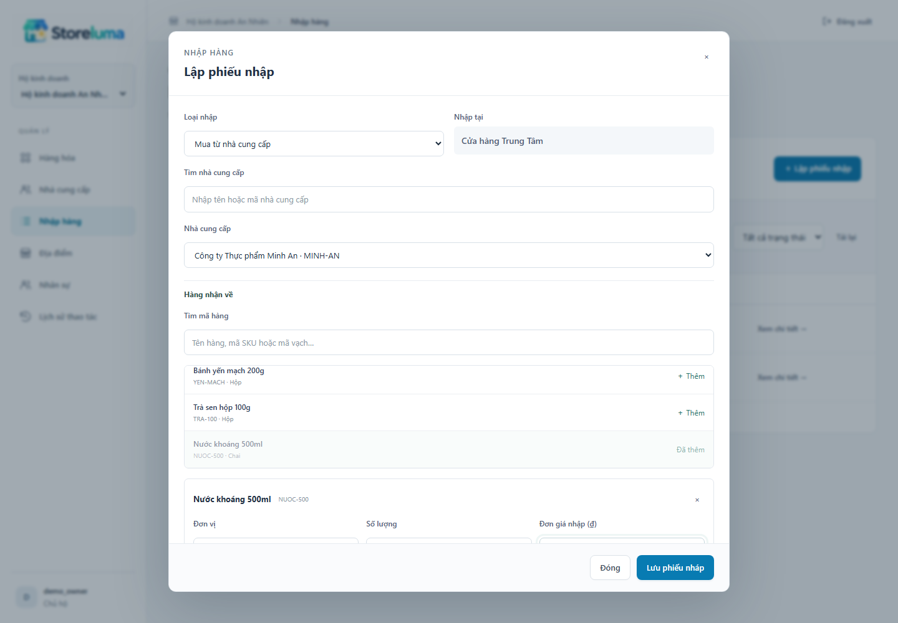
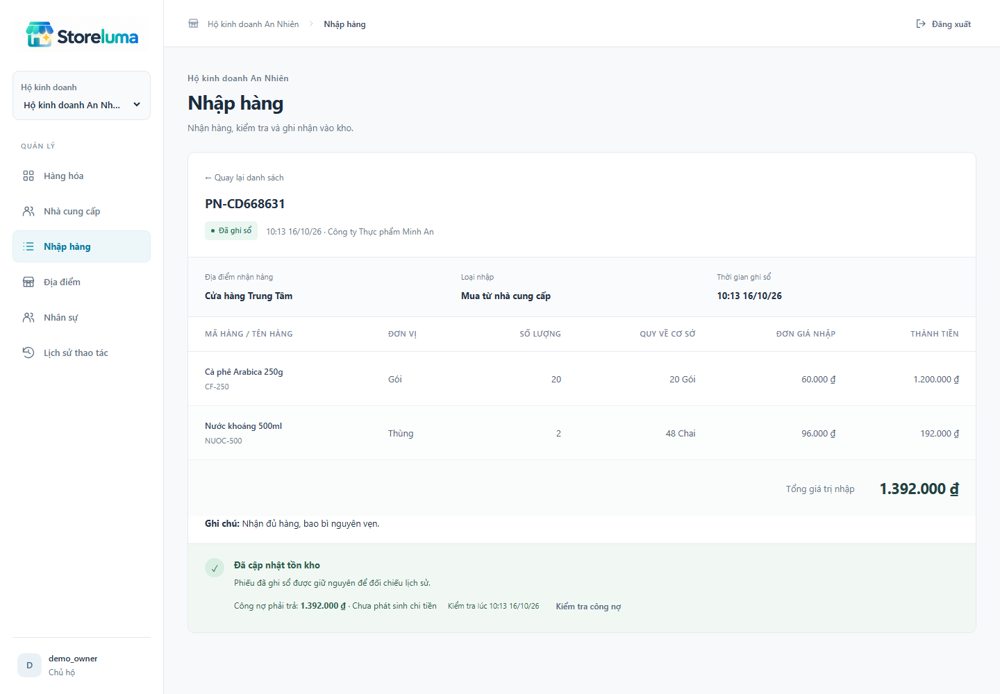
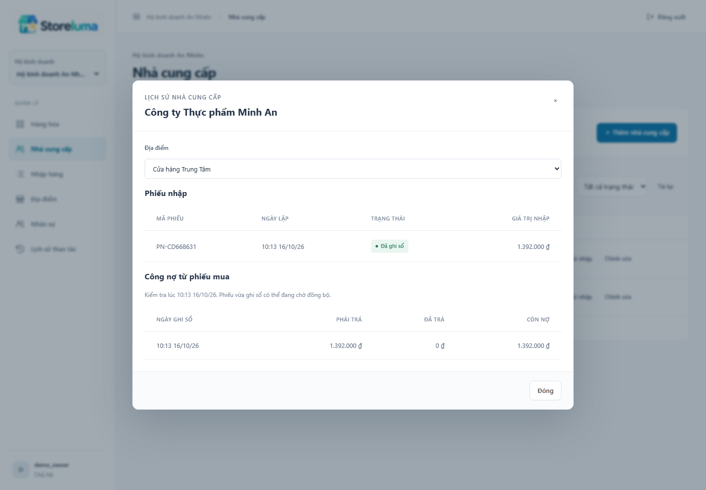
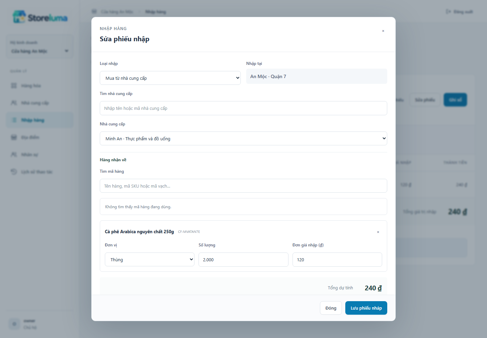
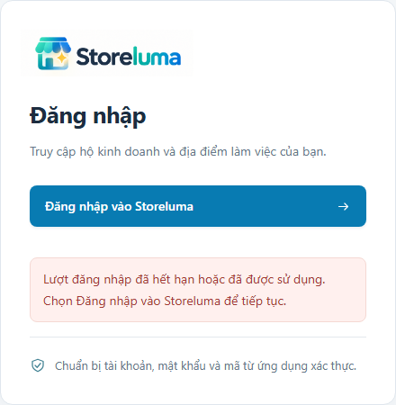

# STORELUMA - BÁO CÁO TIẾN ĐỘ TUẦN 5
Phan Chí Cường - 23520207 | GVHD: ThS. Trần Anh Dũng
Kỳ kế hoạch: 19/10-25/10/2026. Ngày báo cáo: 23/10/2026.

## 1. Mục tiêu và kết quả tuần 5

Theo đề cương, tuần 5 (19/10-25/10/2026) thực hiện danh mục, nhà cung cấp và nhập hàng; sản phẩm cần đạt là thiết lập hàng và nhập kho. Công việc kế thừa YC04-YC07 của tuần 2, thiết kế nhập hàng tuần 3 và nền đăng nhập, hộ/địa điểm, phân quyền tuần 4.

| Mục tiêu | Sản phẩm đã thực hiện |
| --- | --- |
| Danh mục | Nhóm hàng, sản phẩm/SKU, barcode, thuộc tính, đơn vị cơ sở/quy đổi, giá bán và phiên bản. |
| Nhà cung cấp | Tạo, tìm, sửa liên hệ, ngừng giao dịch; lịch sử nhập và khoản phải trả theo địa điểm/quyền. |
| Nhập hàng | Phiếu nháp, sửa/hủy, ghi sổ; snapshot, tồn cơ sở, movement và bình quân gia quyền. |
| Phối hợp dịch vụ | Catalog xác thực hàng; Inventory ghi nhận nhập; Finance tạo phải trả từ sự kiện mua. |
| Giao diện và kiểm tra | React gọi API thật, ảnh chụp ứng dụng; 25 kiểm thử mới và 20 ca hồi quy tuần 4. |

Tiêu chí hoàn thành

Tạo được hàng có đơn vị/giá, thêm nhà cung cấp, lập và ghi sổ phiếu tại đúng địa điểm. Ghi sổ lặp chỉ tăng hàng một lần; nhập mua tạo một khoản phải trả; tồn đầu kỳ không tạo nợ. Finance ngừng không làm mất kết quả nhập đã xác nhận. Quyền được kiểm tại backend, không chỉ bằng việc ẩn nút.

Ngày báo cáo: 23/10/2026, thuộc kỳ kế hoạch. Bản 0.5.0 và các minh chứng trong báo cáo được thực hiện, kiểm tra thực tế ngày 16/10/2026; không dùng ngày trên bìa để thay ngày kiểm thử. Dữ liệu trong ảnh là dữ liệu trình diễn, không phải giao dịch cửa hàng thực tế.

Phạm vi tuần này chưa gồm bán hàng, thanh toán NCC, thẻ kho/kiểm kho đầy đủ, trả hàng hay triển khai production. Phần balance và giá vốn là nền cần có để nhập hàng hoạt động đúng.

## 2. Kiến trúc và trách nhiệm dịch vụ

| Thành phần | Trách nhiệm hiện tại |
| --- | --- |
| Gateway / Business | Gateway giữ phiên và định tuyến; Business là nguồn chuẩn về membership, vai trò, phạm vi và trạng thái địa điểm. |
| Catalog | Nhóm, sản phẩm, SKU, đơn vị, giá bán, lịch sử giá; API nội bộ xác minh hàng hoạt động. |
| Inventory | Nhà cung cấp, phiếu/dòng nhập, snapshot, số lượng/giá trị tồn, movement, Outbox. |
| Finance | Khoản phải trả từ nhập mua; Inbox và khóa duy nhất theo hộ/receipt. Không tự chi tiền. |

Mỗi dịch vụ chạy trong container riêng với database/tài khoản PostgreSQL riêng; không đọc bảng của dịch vụ khác. Catalog và Inventory gọi Business để kiểm quyền hiện tại; Inventory gọi Catalog để xác minh SKU/đơn vị. Gọi nội bộ có actor JWT và chữ ký dịch vụ gắn với nội dung yêu cầu.

RabbitMQ chuyển sự kiện giữa transaction độc lập. Không có distributed transaction bao trùm Inventory và Finance. Sales, Reporting, Notification vẫn là khung cho các tuần sau; không tính là đã có nghiệp vụ chỉ vì có container.

## 3. Thiết lập sản phẩm và mã hàng

Tạo một sản phẩm đồng thời với SKU đầu tiên và đơn vị cơ sở, tránh sản phẩm rỗng không dùng được. SKU gồm mã, tên, barcode tùy chọn, màu/cỡ tùy chọn và giá bán. Mã SKU và barcode duy nhất trong mỗi hộ; hai hộ có thể dùng cùng mã.

| Thao tác | Xử lý |
| --- | --- |
| Tạo / sửa | OWNER hoặc MANAGER; kiểm dữ liệu, lưu version, audit và sự kiện phù hợp. |
| Tìm / phân trang | Tìm tên sản phẩm, tên SKU, mã SKU hoặc barcode tại server; tải tiếp bằng cursor. |
| Ngừng dùng | Đổi trạng thái sản phẩm/SKU; các phiếu cũ giữ snapshot, nghiệp vụ nhập mới bị chặn. |

Nhóm hàng phục vụ phân loại và có trạng thái riêng. Không xóa dữ liệu đã được dùng trên chứng từ. Việc sửa danh mục không trực tiếp thay đổi số lượng tồn.

## 4. Đơn vị quy đổi và giá bán

Mỗi SKU có đúng một đơn vị cơ sở với hệ số 1. Đơn vị bổ sung quy đổi trực tiếp về cơ sở và có giá bán riêng; hệ thống không tự suy ra giá thùng bằng giá lẻ nhân hệ số. Thay giá tạo bản ghi lịch sử và tăng phiên bản.

Ví dụ: nhập 2 thùng, hệ số 24, làm tăng 48 chai. Giá nhập trên phiếu tính theo đơn vị đã chọn. Nếu một thùng giá nhập 96.000 đồng thì giá trị hai thùng là 192.000 đồng, không phải giá bán niêm yết 130.000 đồng/thùng.

Số lượng và hệ số dùng numeric(18,3); tiền VND dùng numeric(20,0) và JSON string. Phép nhân phía ứng dụng dùng BigInt cố định độ chính xác; không dùng float. Lượng cơ sở phải biểu diễn đúng tới 0,001; giá trị dòng làm tròn HALF_UP đến đồng.

Mã SKU, đơn vị cơ sở và hệ số quy đổi được cố định từ lúc tạo trong bản này. Khi cần quy cách khác, thêm đơn vị/SKU mới. Đây là lựa chọn bảo toàn lịch sử; không có chức năng âm thầm sửa hệ số đã áp dụng.

## 5. Nhà cung cấp và lịch sử giao dịch

Nhà cung cấp thuộc Inventory, có mã, tên, số điện thoại/địa chỉ tùy chọn, trạng thái và version. Có tìm theo mã, tên, điện thoại; sửa thông tin hoặc ngừng giao dịch. Không gộp tự động hai hồ sơ chỉ vì trùng số điện thoại.

Ngừng nhà cung cấp chặn lập và ghi sổ phiếu mua mới. Phiếu cũ giữ nguyên tên nhà cung cấp đã chụp trong chứng từ, không đổi theo hồ sơ hiện tại. Mã nhà cung cấp chỉ cần duy nhất trong hộ.

Nút Lịch sử nhập truy vấn phiếu theo nhà cung cấp và địa điểm. OWNER/ACCOUNTANT được xem thêm khoản phải trả từ Finance; có thời điểm kiểm tra, trạng thái chưa đồng bộ hoặc chưa kết nối. Không dùng số 0 thay cho lỗi truy vấn.

STOCK và MANAGER được quản lý nhà cung cấp để nhận hàng. CASHIER không được đọc hồ sơ nhà cung cấp hoặc công nợ. Mỗi API vẫn kiểm membership hiện tại ở Business.

## 6. Lập và kiểm tra phiếu nhập

Người nhận chọn địa điểm, loại nhập, nhà cung cấp, hàng và đơn vị từ dữ liệu server. Biểu mẫu cho nhập lượng, đơn giá theo đơn vị và ghi chú. Danh sách hàng/nhà cung cấp có tìm và tải thêm; không hardcode dữ liệu lựa chọn.

Inventory kiểm kho khớp địa điểm được cấp, supplier hoạt động và Catalog xác nhận SKU/đơn vị thuộc đúng hộ, còn hoạt động. Server tính lại qtyBase, tổng dòng và tổng phiếu; trường tự gửi để ép tổng bị từ chối.

DRAFT chưa tăng tồn hoặc nợ. Có sửa nháp với version mới nhất, hủy nháp nhưng giữ lịch sử. STOCK chỉ sửa nháp do mình lập. Một phiếu nhận tối đa 100 dòng, mỗi SKU xuất hiện một lần. OPENING_STOCK chỉ OWNER, không chọn nhà cung cấp.

## 7. Ghi sổ và cập nhật tồn, giá vốn

Người có quyền xác nhận ghi sổ; Inventory khóa phiếu rồi khóa/cập nhật balance theo thứ tự SKU. Phiếu POSTED, movement, số lượng, giá trị tồn, bình quân và Outbox được commit trong cùng transaction. Nếu một dòng lỗi, toàn bộ thao tác rollback.

Bình quân mới = (giá trị tồn cũ + giá trị nhận) / (lượng tồn cũ + lượng nhận), lưu numeric(20,6). Kiểm thử có 48 đơn vị giá vốn 10.000 và thêm 48 đơn vị giá vốn 12.000: lượng mới 96; giá trị 1.056.000; bình quân 11.000 đồng.

POSTED không sửa hoặc hủy qua API. Tên SKU, đơn vị, hệ số, giá nhập và nhà cung cấp trên phiếu được giữ lại để đối chiếu, kể cả khi đổi hồ sơ sau đó. Phiếu đảo/trả nhập chưa thuộc phạm vi tuần này.

Các số onHand, reserved, quarantined được lưu riêng; available = onHand - reserved - quarantined. Trong phần nhập mới, reserved và quarantined vẫn bằng 0; chưa tuyên bố đã có nghiệp vụ giữ hàng/bán hàng.

## 8. Đồng bộ công nợ và xử lý gửi lặp

Sau commit nhập, Outbox phát inventory.receipt-posted.v1 bằng publisher confirms và mandatory; không đánh dấu đã gửi khi broker trả về do thiếu tuyến nhận. Finance nhận PURCHASE, lưu Inbox và payable trong một transaction; unique theo tenant/receipt chặn cả phát lại với event ID khác. OPENING_STOCK được xử lý nhưng không tạo khoản nợ.

Khi Finance dừng, phiếu nhập vẫn POSTED, hàng vẫn có trong kho. Hàng đợi bền giữ sự kiện để xử lý sau khởi động lại. Giao diện tự kiểm tra công nợ đang chờ và hiển thị thời điểm truy vấn. Khoản phải trả không phải tiền đã trả: paidVnd vẫn bằng 0.

API command dùng Idempotency-Key gắn nội dung; cùng khóa khác nội dung trả 409. Phiếu đã POSTED trả kết quả hiện có khi ghi sổ lại. Worker retry có backoff, tối đa năm lần trước dead letter; deadlock/serialization của transaction được thử lại có giới hạn.

Inbox/Outbox tạo cơ chế giao ít nhất một lần và xử lý hiệu quả một lần theo khóa nghiệp vụ, không phải cam kết transport giao đúng một lần. Chưa có màn hình vận hành dead letter hay khôi phục toàn máy chủ.

## 9. Quyền, API và trải nghiệm sử dụng

| Thao tác | OWNER | MANAGER | STOCK | ACCOUNTANT | CASHIER |
| --- | --- | --- | --- | --- | --- |
| Xem danh mục | Có | Có | Có | Có | Có |
| Sửa hàng/giá | Có | Có | Không | Không | Không |
| Sửa NCC | Có | Có | Có | Không | Không |
| Lập nháp mua | Có | Có | Có | Không | Không |
| Ghi sổ mua | Có | Có | Không | Không | Không |
| Tồn đầu kỳ | Có | Không | Không | Không | Không |
| Giá trị tồn / nợ | Có | Không | Không | Có | Không |

Nhập, đọc phiếu và nợ phải nằm trong site được giao; site tạm ngừng chặn command mới. Giá nhập trên chứng từ được cấp cho người nhận/duyệt hàng, còn avgCost và giá trị tồn tổng hợp chỉ OWNER/ACCOUNTANT. CASHIER không nhận PII nhà cung cấp. Backend loại trường nhạy cảm trước khi trả dữ liệu.

API công khai đi qua /v1/tenants/{tenant}/..., tiếp nối cấu trúc tuần 4. Catalog có categories/products/skus; Inventory có suppliers/receipts/stock-balances; Finance có payables. PATCH cần version. Danh sách trả items và nextCursor, limit mặc định 50, tối đa 200. Hợp đồng chi tiết: docs/week-05/api-contract.md.

Gateway chặn /v1/internal. Service đích xác minh actor JWT cùng token dịch vụ HS256 có hạn 30 giây, gắn method/path/body hash. Business kiểm quyền từ dữ liệu hiện tại; khi không gọi được Business hoặc Catalog cần thiết, command bị từ chối thay vì bỏ qua kiểm tra.

Giao diện tham khảo bố cục bảng và chứng từ của Tabler [4]-[6], tự triển khai bằng React/CSS. Dùng logo gốc, nhãn tiếng Việt, thông báo hành động cụ thể; hộp thoại hỗ trợ focus/Escape, khóa thao tác khi đang lưu; bảng cuộn trong vùng riêng ở màn hình nhỏ.

## 10. Kết quả kiểm thử - dữ liệu và nghiệp vụ

Lần hồi quy nền ngày 16/10/2026, trước sửa callback đăng nhập: 45/45 ca đạt, không bỏ qua và không flaky; thời gian 119.7 giây. Gồm 25 ca tuần 5 và 20 ca hồi quy nền tuần 4. Chromium gọi hệ thống Docker thật: Keycloak, Gateway, Business, Catalog, Inventory, Finance, PostgreSQL và RabbitMQ.

| Mã | Nội dung kiểm tra | Kết quả |
| --- | --- | --- |
| W5-01 | Phép tính chính xác; 2 thùng × 24 = 48; HALF_UP; không mất số nguyên lớn. | Đạt |
| W5-02 | Tạo sản phẩm/SKU/đơn vị nguyên tử; trùng mã, retry, tìm barcode, phân trang. | Đạt |
| W5-03 | Quy đổi dương; giá dạng chuỗi; kiểm version và lưu lịch sử giá. | Đạt |
| W5-04 | Nhà cung cấp duy nhất; cô lập hộ; CSRF; chặn internal route và JWT giả. | Đạt |
| W5-05 | Nháp lưu snapshot đúng; không tạo movement hay payable; chặn trường tự gán tổng. | Đạt |
| W5-06 | STOCK lập nháp trong phạm vi, không ghi sổ/tồn đầu kỳ và không sửa nháp người khác. | Đạt |
| W5-07 | Năm lệnh ghi sổ đồng thời, gồm khóa giống/khác, chỉ một movement và một payable. | Đạt |
| W5-08 | Dừng Finance, nhập vẫn thành công; chạy lại tạo nợ; bình quân cập nhật đúng. | Đạt |
| W5-09 | Phát lại sự kiện cùng ID và ID mới không nhân bản công nợ theo receipt. | Đạt |
| W5-10 | Tồn đầu kỳ tăng tồn nhưng không tạo nợ, kể cả sau khi Finance xử lý sự kiện. | Đạt |
| W5-11 | Đổi tên SKU/nhà cung cấp không sửa snapshot; POSTED không sửa/hủy. | Đạt |

Không chỉ kiểm phản hồi HTTP: các ca còn đối chiếu số dòng movement/payable/Inbox, lượng/giá trị tồn và lịch sử giá trong database của dịch vụ tương ứng. Các lần dừng dịch vụ đều có bước chạy lại trong finally của kiểm thử.

## 11. Kết quả kiểm thử - quyền và giao diện

| Mã | Nội dung kiểm tra | Kết quả |
| --- | --- | --- |
| W5-12 | Nhà cung cấp/sản phẩm/đơn vị ngừng hoặc site tạm ngừng chặn nhập mới. | Đạt |
| W5-13 | Sửa nháp bằng version cũ bị từ chối; hủy nháp không tăng tồn. | Đạt |
| W5-14 | Quản lý chỉ ghi sổ đúng site; tài chính đọc nợ/giá vốn nhưng không nhập hàng. | Đạt |
| W5-15 | Business gián đoạn: từ chối truy cập; Catalog gián đoạn: phiếu vẫn nháp, không tăng tồn. | Đạt |
| W5-16 | Giao diện tạo sản phẩm, nhà cung cấp, phiếu nháp và ghi sổ qua backend thật. | Đạt |
| W5-17 | Chiều rộng 390 px không tràn trang; thu ngân không có UI nhập hoặc sửa danh mục. | Đạt |
| W5-18 | Tài khoản bị chặn kết nối DB khác; bảng đúng dịch vụ; projection nhận đúng phiên bản. | Đạt |
| W5-19 | JWT người dùng hợp lệ nhưng giả chữ ký dịch vụ vẫn bị internal API trả 403. | Đạt |
| W5-20 | Tràn độ chính xác một dòng khiến toàn bộ ghi sổ rollback, không ghi dở các dòng khác. | Đạt |
| W5-21 | Hai hộ dùng cùng mã SKU/barcode/NCC được; khóa thành viên tác động phiên hiện tại. | Đạt |

Hồi quy và lỗi đã xử lý

20 ca tuần 4 tiếp tục đạt sau thay đổi định tuyến và consumer: đăng nhập/TOTP, CSRF, tenant/site scope, lời mời, khóa quyền, provisioning, khởi động lại và giao diện nền. Ảnh/kết quả lịch sử tuần 4 không bị ghi đè bởi lần chạy hồi quy mới.

Trong quá trình thử giao diện đã bổ sung tên truy cập rõ cho bộ chọn nhà cung cấp; tự cập nhật công nợ sau khi sự kiện đến; sửa menu ở 390 px để cuộn trong vùng riêng thay vì làm tràn trang. Các ca được chạy lại sau sửa, kết quả cuối cùng nêu ở trên.

Chưa kiểm thử tải cao, mất toàn PostgreSQL, mất dữ liệu broker, nhiều trình duyệt hoặc kiểm thử thâm nhập đầy đủ. Việc có workflow CI không đồng nghĩa đã có kết quả CI từ GitHub tại thời điểm lập báo cáo. Các kết quả này chứng minh phạm vi cục bộ đã liệt kê.

## 11.1. Rà soát bổ sung và thử gián đoạn

| Mã | Nội dung kiểm tra | Kết quả |
| --- | --- | --- |
| W5-22 | Mở lại nháp trên UI, tải đủ đơn vị và đổi quy cách; lưu 2 thùng thành 48 đơn vị cơ sở. | Đạt |
| W5-23 | Thông điệp sai và hết retry chỉ vào hàng đợi lỗi của Finance, không phát sang dịch vụ khác. | Đạt |
| W5-24 | Mất tuyến nhận không đánh dấu Outbox đã gửi; phục hồi tuyến xử lý đúng một công nợ. | Đạt |
| W5-25 | Dừng RabbitMQ, nhập vẫn commit; khởi động broker đồng bộ lại, không nhân đôi movement/nợ. | Đạt |

Các chỉnh sửa sau rà soát

Sửa bộ chọn đơn vị khi mở lại phiếu nháp: đọc SKU và toàn bộ đơn vị hiện tại từ Catalog, giữ giá/lượng người dùng đã nhập. SKU khác hộ không được trả dữ liệu. Ảnh kiểm thử mới bên dưới chụp thao tác thật.

Sửa hàng đợi lỗi từng dịch vụ để tránh phát tán qua fanout. Chỉ ack bản gốc khi bản chuyển đã được broker xác nhận. Publisher dùng mandatory, nhận basic.return và giới hạn chờ confirm 5 giây; lỗi vẫn giữ Outbox để thử lại. Worker kết nối lại khi broker phục hồi.

Sự kiện site.activated và inventory.stock-changed.v1 được giữ tại storeluma.deferred trong lúc consumer các tuần sau chưa có. Cần theo dõi dung lượng và bổ sung quy trình chuyển/phát lại theo identity khi có consumer; chưa khẳng định hoàn tất nghiệp vụ Reporting.

## 11.2. Khắc phục phiên đăng nhập

Đã tái hiện lỗi khi mở lại URL callback đã dùng: Gateway xóa phiên trước khi kiểm tra loại phiên, làm mất phiên đang hoạt động và chỉ hiện thông báo văn bản. Cookie chờ đăng nhập dùng chung còn khiến các tab ghi đè nhau. Mỗi lượt chờ hiện được tách theo state, gắn cookie HttpOnly riêng, thời hạn 5 phút và tiêu thụ nguyên tử một lần.

| Mã | Nội dung kiểm tra | Kết quả |
| --- | --- | --- |
| AUTH-01 | Lượt chờ hết hạn về màn hình đăng nhập; bắt đầu lại và đăng nhập thật thành công. | Đạt |
| AUTH-02 | Mở callback cũ hoặc /auth/login không xóa phiên đang hoạt động. | Đạt |
| AUTH-03 | Hai lượt đăng nhập có cookie riêng, không ghi đè; callback thứ hai không phá phiên đã đăng nhập. | Đạt |
| AUTH-04 | Sai state hoặc trình duyệt khác không tiêu thụ lượt hợp lệ; lượt gốc vẫn đăng nhập được. | Đạt |
| AUTH-05 | Code sai chỉ kết thúc lượt chờ tương ứng; không cấp phiên; người dùng có thể bắt đầu lại. | Đạt |
| AUTH-06 | Mở qua 127.0.0.1 được đưa về origin cấu hình trước khi đặt cookie, rồi đăng nhập thành công. | Đạt |

Sau sửa: 6/6 ca AUTH đạt, bắt đầu 16/10/2026 19:09:37 (Asia/Ho_Chi_Minh); 5/5 ca hồi quy W4-01, 02, 03, 17, 18 cũng đạt trong lần chạy riêng. Không skipped/flaky. Không cộng thành một lần chạy đủ 51 ca; kết quả 45 ca nghiệp vụ ở mục 10-11 là mốc hồi quy trước sửa callback.

Callback cũ giữ phiên người dùng còn hạn. Callback thiếu/sai trạng thái không cấp phiên; lỗi về trang chính có hướng xử lý, không tự lặp đăng nhập. Khi bắt đầu từ 127.0.0.1, chuyển về origin cấu hình trước khi đặt cookie. State, nonce và PKCE vẫn được xác minh; không kéo dài token để che lỗi. Phiên sử dụng vẫn tối đa 15 phút, chưa có tự gia hạn.

## 12. Sản phẩm bàn giao và kế hoạch tiếp theo

| Sản phẩm | Vị trí |
| --- | --- |
| Frontend và backend | apps/web/src; services/catalog, inventory, finance, business, gateway; packages/platform. |
| Migration dữ liệu | Các migration 002.sql ở Catalog, Inventory, Finance; runner áp dụng lần lượt các version chưa chạy. |
| Kiểm thử | tests/week05.spec.ts; tests/week04.spec.ts; tests/auth.spec.ts; cấu hình Playwright. |
| Tài liệu tuần | docs/week-05: báo cáo, API, thiết kế UI, minh chứng và ảnh. |
| Bản nộp | output/pdf/Storeluma_Bao_cao_Tuan_05.pdf. |

Cách tái lập ngắn gọn

Node.js 24+, Docker Linux containers: npm ci; npm run setup; docker compose up -d --build. Mở localhost:4100, đăng nhập, tạo hộ/địa điểm sẵn sàng, thêm hàng và nhà cung cấp rồi lập phiếu. npm run typecheck, npm run build và npm test kiểm tra mã/bản chạy. Hướng dẫn công khai nằm trong README tiếng Anh.

Giới hạn được giữ đúng tiến độ

Bản này chạy HTTP cục bộ, Keycloak start-dev, chưa production. Runtime DB account còn sở hữu database và chạy migration lúc khởi động; tách migration role, rotation service identity, broker credentials từng service, HTTPS và backup/restore thuộc hoàn thiện vận hành. Chưa có CSV, PO, phiếu đảo/trả nhập, trả tiền NCC, POS hoặc báo cáo kinh doanh.

Tuần 6: 26/10-01/11/2026

Theo đề cương, tiếp tục tồn kho, lịch sử nhập/xuất và kiểm kho. Tận dụng balances/movements đã có; làm màn hình tra cứu, thẻ kho theo địa điểm, scope kiểm đếm và đóng băng nghiệp vụ trong transaction, đối chiếu số đếm và duyệt điều chỉnh. Khi bổ sung kiểm kho phải kiểm freeze ngay trong luồng ghi sổ nhập, không chỉ trên giao diện.

Không tính phần kiểm kho này là đã hoàn thành. Báo cáo tuần 3-4 được giữ như mốc thiết kế và nền ứng dụng; sản phẩm mới được ghi nhận ở tuần 5 để không sửa ngược lịch sử tiến độ.

## 13. Tài liệu tham khảo và minh chứng

Tài liệu của tiến trình

[1] Phan Chí Cường. Đề cương Đồ án 2 - Storeluma. Kế hoạch 13 tuần, trang 10. [2] Báo cáo tuần 2. YC04-YC07: sản phẩm/biến thể, đơn vị/giá, nhà cung cấp, nhận hàng. [3] Báo cáo tuần 3 và tuần 4. Thiết kế NV04, mô hình dữ liệu; nền đăng nhập, tenant/site và quyền.

Tài liệu kỹ thuật và bố cục giao diện

[4] Tabler. Tables. [preview.tabler.io/tables.html](https://preview.tabler.io/tables.html). [5] Tabler. Invoice. [preview.tabler.io/invoice.html](https://preview.tabler.io/invoice.html). [6] Tabler. Mã nguồn dự án. [github.com/tabler/tabler](https://github.com/tabler/tabler).

[7] PostgreSQL 17. Numeric Types. [postgresql.org/docs/17/datatype-numeric.html](https://www.postgresql.org/docs/17/datatype-numeric.html). [8] RabbitMQ. Reliability Guide. [rabbitmq.com/docs/reliability](https://www.rabbitmq.com/docs/reliability). [9] RabbitMQ. Consumer Acknowledgements and Publisher Confirms. [rabbitmq.com/docs/confirms](https://www.rabbitmq.com/docs/confirms).

Các nguồn [4]-[9] được tra cứu ngày 16/10/2026. Bố cục tham khảo được tự triển khai bằng React/CSS; không thêm Tabler làm dependency. Tài liệu framework không được coi là bằng chứng rằng mọi tính năng của framework đã có trong sản phẩm.

Nguồn ảnh và phạm vi kết luận

Hình 1 là sơ đồ triển khai của bản 0.5.0. Hình 2-7 được chụp bằng Playwright từ ứng dụng thật ngày 16/10/2026, với dữ liệu minh họa Hộ An Nhiên: bốn sản phẩm, hai nhà cung cấp, phiếu mua, tồn đầu kỳ và nháp. Hình 8 chụp ca W5-22 trên hộ kiểm thử An Mộc; Hình 9 là giao diện phục hồi đăng nhập chụp sau sửa callback. Không có mật khẩu, TOTP secret hay mã lời mời trong ảnh công khai.

Kết quả đầy đủ được lưu trên máy chạy; bản tóm tắt công khai nằm tại docs/week-05/evidence/verification.md. Báo cáo không giả định có đánh giá của giảng viên, khách hàng thật hoặc triển khai máy chủ Internet. Bìa không dùng ảnh logo; logo chỉ hiện trong ảnh chụp giao diện sản phẩm.
