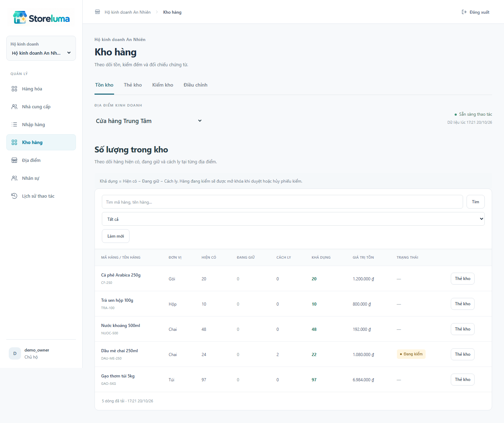
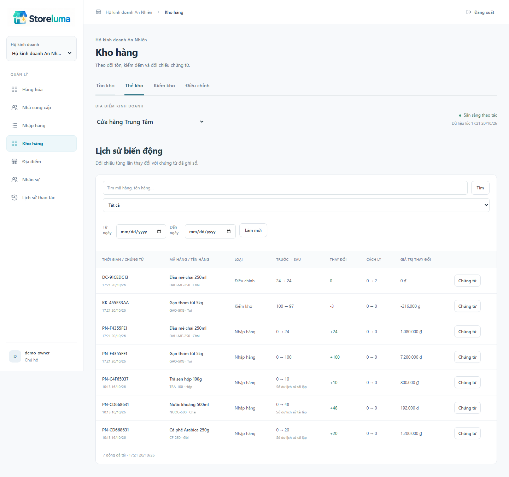
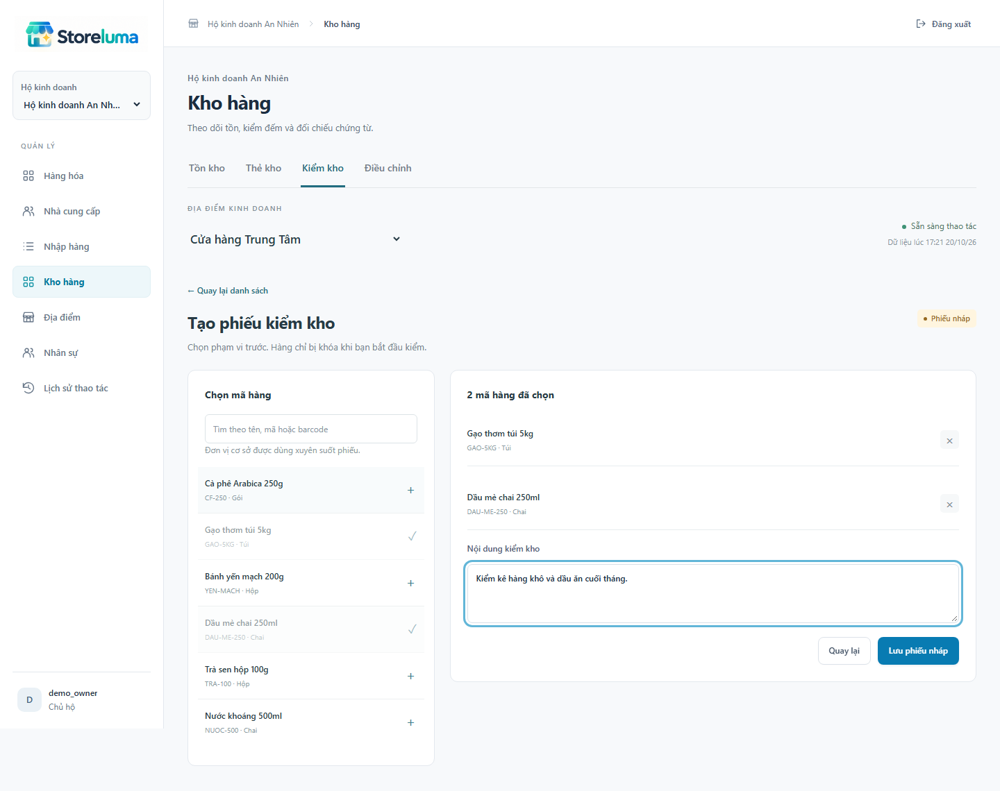
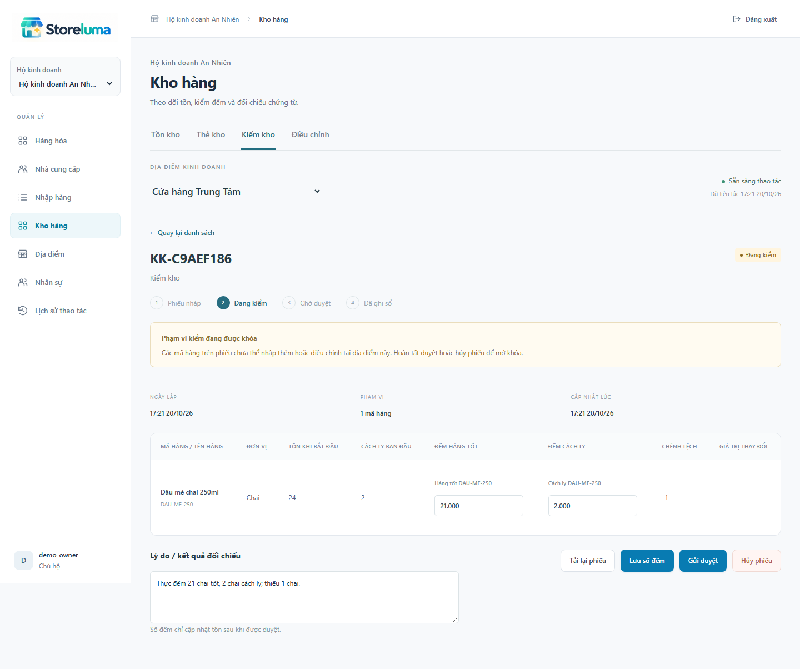
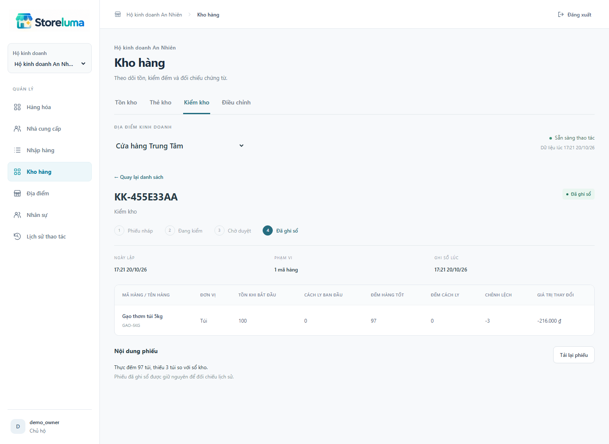
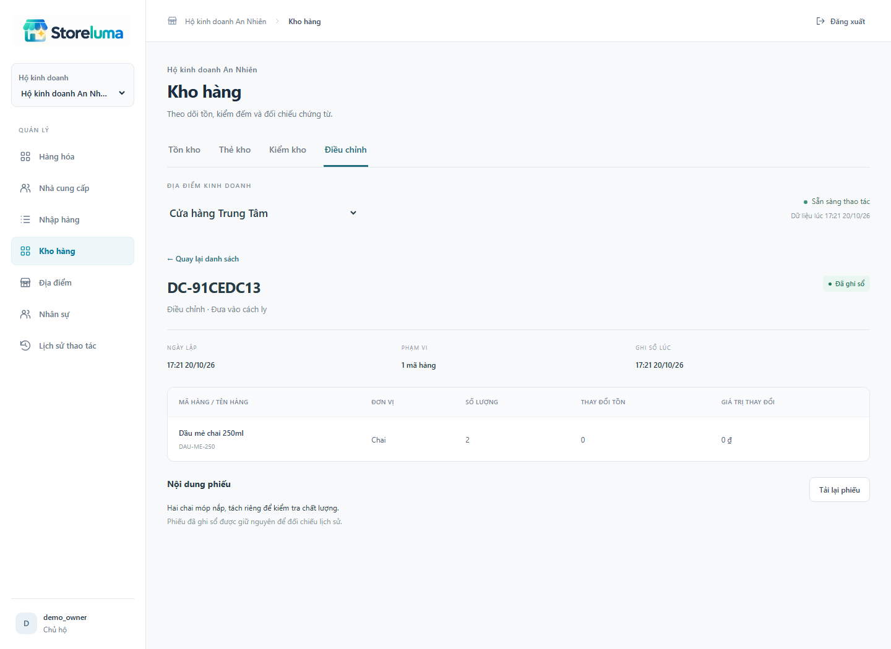
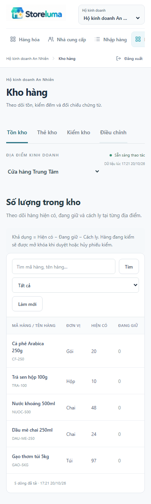

# STORELUMA - BÁO CÁO TIẾN ĐỘ TUẦN 6
Phan Chí Cường - 23520207 | GVHD: ThS. Trần Anh Dũng
Kỳ kế hoạch: 26/10-01/11/2026. Ngày báo cáo: 30/10/2026. Phiên bản: 0.6.0.

## 1. Mục tiêu và kết quả tuần 6

Theo kế hoạch tuần 6 (26/10-01/11/2026), công việc tập trung vào tồn kho, lịch sử nhập xuất và kiểm kho. Sản phẩm tuần này là khả năng theo dõi số lượng theo địa điểm, đối chiếu với thực đếm và cập nhật chênh lệch qua chứng từ có duyệt.

| Hạng mục | Sản phẩm thực hiện |
| --- | --- |
| Tra cứu tồn | Hiện có, đang giữ, cách ly, khả dụng; tìm/lọc/phân trang và quyền xem vốn. |
| Thẻ kho | Lịch sử nhập, kiểm và điều chỉnh; trước/sau, lượng tăng giảm, nguồn chứng từ. |
| Kiểm kho | Nháp, bắt đầu khóa, nhập thực đếm, gửi duyệt, đếm lại, duyệt hoặc hủy. |
| Điều chỉnh | Xuất hủy, cách ly, giải phóng, tăng/giảm; duyệt và tính giá trị tồn. |
| Kiểm chứng | Giao diện thật, dữ liệu/API thật; thử đồng thời, quyền, restart và hồi quy. |

Kế thừa và giới hạn phạm vi

Kế thừa nền đăng nhập/phân quyền tuần 4 và danh mục/nhập hàng tuần 5. Không dựng lại dữ liệu nền, không thay nghiệp vụ bằng màn hình tĩnh. Phần xuất trong tuần này là xuất hủy hoặc điều chỉnh giảm; xuất bán, giữ hàng từ đơn bán, trả hàng và điều chuyển chưa được nhận là hoàn thành.

Ngày báo cáo 30/10/2026 thuộc kỳ kế hoạch. Các lần kiểm tra thực tế ghi ngày riêng trong mục 11-12, không thay ngày kiểm thử bằng ngày trên bìa.

## 2. Phân công trách nhiệm dịch vụ

| Thành phần | Trách nhiệm trong phiên bản 0.6.0 |
| --- | --- |
| Web / Gateway | UI tiếng Việt, phiên BFF, CSRF và định tuyến tồn/kiểm/điều chỉnh đến Inventory. |
| Business | Kiểm membership và site hiện tại; tách quyền đọc, lập/sửa/hủy và duyệt. |
| Catalog | Cung cấp snapshot mã/tên/đơn vị cơ sở bằng API nội bộ có chữ ký dịch vụ. |
| Inventory | Sở hữu chứng từ kho, snapshot kiểm, freeze, balance, movement, audit và Outbox. |
| Finance | Tiếp tục phải trả từ nhập mua. Kiểm và điều chỉnh không phát sinh nợ nhà cung cấp. |

Ghi sổ nguyên tử

Một transaction Inventory khóa chứng từ và các SKU theo thứ tự thống nhất, kiểm trạng thái/version/freeze, cập nhật balance và movement, ghi audit/Outbox rồi chuyển POSTED. Nếu một dòng lỗi, toàn bộ transaction hoàn tác. Không mở transaction SQL xuyên dịch vụ.

Sự kiện và phụ thuộc

Sự kiện inventory.stock-changed.v1 giữ hợp đồng hiện tại; correlationId trỏ chứng từ kho. Publisher confirms, retry và Outbox được kế thừa. Sự kiện chờ consumer các tuần sau nằm trong deferred queue; chưa có read model báo cáo hoàn chỉnh. Business gián đoạn thì không bỏ qua kiểm quyền.

## 3. Dữ liệu, khóa và bảo toàn lịch sử

| Đối tượng | Nội dung |
| --- | --- |
| StockDocument | COUNT/ADJUSTMENT; site/kho, trạng thái, version, lý do, người lập/duyệt và thời điểm. |
| StockDocumentLine | Snapshot SKU, lượng lúc bắt đầu, số đếm tốt/cách ly, lượng điều chỉnh và kết quả. |
| StockFreeze | Một SKU tại một kho chỉ thuộc một phiên kiểm đang mở. |
| StockMovement | Nguồn đa loại, trước/sau, delta lượng/giá trị, cách ly trước/sau và sequence. |

Migration 003 nối tiếp schema đã chạy, không sửa/xóa migration cũ. Các phiếu nhập cũ giữ nguyên định danh. Số dư movement cũ được tái lập theo thời gian ghi và đánh dấu rõ trên UI; không coi thứ tự tái lập là thứ tự commit lịch sử đã được chứng minh.

Mọi lệnh thay đổi tồn dùng cùng khóa transaction theo tenant/kho/SKU; khóa bảo vệ cả mã chưa có balance. Bắt đầu kiểm ghi snapshot và freeze dưới khóa. Nhập hàng đã được sửa để kiểm freeze trong cùng transaction ghi sổ, không chỉ kiểm trước trên UI.

Hai yêu cầu đồng thời được tuần tự hóa: nhập hoàn tất trước thì snapshot thấy lượng mới; kiểm khóa trước thì nhập trả lỗi hàng đang kiểm. Hủy chỉ mở khóa. Khởi động lại dịch vụ không mất freeze đã commit.

## 4. Tra cứu số lượng tồn

Hiển thị hiện có, đang giữ, cách ly và khả dụng. Khả dụng bằng hiện có trừ đang giữ và cách ly. Mã đang kiểm có badge riêng; không cho lệnh thay đổi tồn bỏ qua khóa dù khả dụng còn dương.

Tìm theo mã/tên, lọc còn khả dụng/hết khả dụng/cách ly/đang kiểm. Bảng phân trang từ server và hiện thời điểm lấy dữ liệu. OWNER/ACCOUNTANT được xem giá trị; các vai trò khác không nhận trường này từ API.

SKU chưa có balance vẫn tìm được trong bộ chọn Catalog khi lập kiểm hoặc điều chỉnh. Không chèn tồn giả chỉ để lấp đầy màn hình.

## 5. Thẻ kho và chứng từ nguồn

Thẻ kho lọc theo mã hàng, loại chứng từ và khoảng ngày. Mỗi dòng cho biết lượng trước/sau, tăng giảm và cách ly; giá trị chỉ trả theo quyền. Phân trang dùng thời gian cùng sequence để tránh trùng khi nhiều movement có cùng thời điểm.

Người có quyền có thể mở phiếu nhập, kiểm hoặc điều chỉnh từ dòng thẻ kho. CASHIER chỉ tra số lượng, không có nút mở nguồn bị hạn chế; backend vẫn kiểm quyền độc lập khi gọi trực tiếp.

Dữ liệu lịch sử có nguồn thực: RECEIPT, COUNT, ADJUSTMENT. Tuần này chưa có movement bán hoặc điều chuyển; không tạo chứng từ giả cho các chức năng chưa triển khai.

## 6. Lập phạm vi kiểm kho

Chọn địa điểm, tìm mã hàng qua Catalog và ghi nội dung kiểm. Một phiếu tối đa 100 SKU không trùng, dùng đơn vị cơ sở. DRAFT chưa khóa và chưa đổi tồn; nút bắt đầu kiểm yêu cầu xác nhận phạm vi.

Khi bắt đầu, Inventory khóa từng SKU và lưu onHand/quarantined/version. Hàng có reservation không được bắt đầu kiểm. Nếu một mã đã thuộc phiên khác, toàn bộ thao tác bị từ chối, không khóa được một phần scope.

Phiếu đã chọn scope không đổi danh sách SKU; nếu chọn sai, hủy và lập lại. STOCK chỉ thao tác phiếu của mình; OWNER/MANAGER có thể quản lý theo phạm vi quyền.

## 7. Ghi nhận thực đếm và gửi duyệt

Nhập riêng số đếm hàng tốt và cách ly; UI xem trước chênh lệch bằng phép tính fixed-point. Lưu số đếm chưa cập nhật balance. Chỉ gửi duyệt khi đã lưu đủ toàn bộ dòng. Trong thời gian COUNTING/SUBMITTED, nhập và điều chỉnh cùng mã tại kho đó bị chặn.

Người duyệt có thể yêu cầu đếm lại, chuyển SUBMITTED về COUNTING và giữ khóa/snapshot. Hủy ở trạng thái chưa ghi sổ chỉ mở khóa. Site tạm ngừng vẫn cho hủy để tránh giữ khóa vô hạn.

## 8. Duyệt chênh lệch và ghi sổ

Khi duyệt, đối chiếu freeze thuộc đúng phiếu, version balance bằng snapshot và không có reservation. Tồn mới bằng số tốt cộng số cách ly. Mỗi dòng có một movement, kể cả tổng lượng không đổi nhưng cần ghi nhận phân loại hoặc xác nhận kiểm.

Bốn yêu cầu duyệt đồng thời cho trường hợp snapshot 100, đếm 95 tốt + 2 cách ly chỉ tạo một movement -3. Tồn thành 97, khả dụng 95; không tạo công nợ. Phiếu POSTED không sửa/hủy; muốn thay đổi tiếp phải có chứng từ mới.

Tăng từ tồn 0 cần giá vốn chỉ định được duyệt. Khi còn tồn có thể dùng vốn hiện hành; giá trị và avgCost được tính lại bằng numeric, không dùng số thực JavaScript.

## 9. Điều chỉnh, cách ly và xuất hủy

| Loại | Quy tắc |
| --- | --- |
| Xuất hủy hàng tốt / cách ly | Giảm đúng bucket, không lấy hàng reserved hoặc vượt lượng cách ly. |
| Cách ly / giải phóng | Giữ onHand và giá trị; giải phóng cần xác nhận chất lượng. |
| Correction tăng / giảm | Tăng cần vốn khi tồn 0; giảm không làm âm phần khả dụng. |

Lập/sửa/hủy nháp chưa đổi tồn. OWNER/MANAGER ghi sổ; POSTED bất biến. Vốn xuất làm tròn HALF_UP đến đồng rồi trừ giá trị đang có; xuất hết đưa giá trị và avgCost về 0. Khi sửa mà không gửi vốn, hệ thống giữ giá cũ, tránh xóa trường đang bị ẩn theo quyền.

## 10. Phân quyền và giao diện nhỏ

| Vai trò | Đọc lượng | Phiếu kho | Lập/sửa | Duyệt | Vốn |
| --- | --- | --- | --- | --- | --- |
| OWNER | Có | Có | Có | Có | Có |
| MANAGER | Theo site | Theo site | Có | Có | Không |
| STOCK | Theo site | Theo site | Phiếu mình | Không | Không |
| ACCOUNTANT | Theo site | Theo site | Không | Không | Có |
| CASHIER | Theo site | Không | Không | Không | Không |

Bộ lọc xuống dòng và form chọn hàng chuyển một cột trên màn hình nhỏ. Không đưa nhãn môi trường phát triển vào sản phẩm. Logo gốc được dùng nhất quán với các tuần trước. Khi chuyển tab, dữ liệu bảng cũ được xóa ngay để không render sai cấu trúc.

## 11. Kiểm thử chức năng và đồng thời

Chạy 22 ca tuần 6 qua Playwright trên Docker cục bộ; bắt đầu 20/10/2026 17:11:31 (Asia/Ho_Chi_Minh), thời gian 48.4 giây. Kết quả 22/22 đạt, không skipped/flaky và không retry. Typecheck và build thành công.

| Mã | Nội dung kiểm tra | Kết quả |
| --- | --- | --- |
| W6-01 | Giữ định danh nguồn nhập và số dư trước/sau; delta khớp lượng và giá trị. | Đạt |
| W6-02 | Cô lập hộ/site; CASHIER chỉ đọc lượng; backend loại trường vốn và chặn chứng từ. | Đạt |
| W6-03 | Nháp không đổi tồn; kiểm SKU thuộc hộ, scope kho, trùng dòng và idempotency. | Đạt |
| W6-04 | Bắt đầu kiểm snapshot và khóa đúng scope; kho khác vẫn nhận hàng được. | Đạt |
| W6-05 | Nhập và điều chỉnh bị chặn khi SKU đang kiểm; không có ghi một phần. | Đạt |
| W6-06 | Nhập đủ scope, lượng không âm; version cũ bị từ chối; chưa duyệt chưa đổi tồn. | Đạt |
| W6-07 | 100 đếm 97: bốn lệnh duyệt chỉ ghi -3 một lần; mở khóa và không tạo nợ. | Đạt |
| W6-08 | Phiếu ghi sổ không sửa/hủy; quản lý không nhận giá vốn ẩn trong JSON. | Đạt |
| W6-09 | Site ngừng chặn ghi mới nhưng vẫn hủy kiểm được; tồn giữ nguyên. | Đạt |
| W6-10 | Hai phiên kiểm và nhập/bắt đầu kiểm đồng thời được tuần tự hóa, kể cả balance mới. | Đạt |
| W6-11 | Tăng tồn từ 0 cần vốn; người duyệt trả lại để đếm lại, giữ nguyên khóa. | Đạt |

Các kiểm tra gọi HTTP thật, đăng nhập TOTP, đối chiếu database riêng của từng dịch vụ và thử trạng thái lỗi. Không dùng dữ liệu hardcode để thay kết quả nghiệp vụ.

## 12. Hồi quy và kết quả tích hợp

| Mã | Nội dung kiểm tra | Kết quả |
| --- | --- | --- |
| W6-12 | Cách ly, giải phóng có xác nhận và xuất hủy giữ đúng bucket/giá trị. | Đạt |
| W6-13 | Fixture reserved chặn kiểm và xuất vượt phần khả dụng; chưa coi là luồng bán. | Đạt |
| W6-14 | Correction tính bình quân chính xác; giảm hết đưa giá trị và avgCost về 0. | Đạt |
| W6-15 | STOCK chỉ sửa nháp của mình; quản lý đúng site; tài chính chỉ đọc vốn. | Đạt |
| W6-16 | Lọc thẻ kho theo SKU/loại/ngày; phân trang không trùng; không lẫn kho. | Đạt |
| W6-17 | Lỗi tràn số dòng sau hoàn tác mọi cập nhật dòng trước và movement. | Đạt |
| W6-18 | Khởi động lại Inventory giữ freeze; hủy xong mới ghi sổ phiếu nhập chờ. | Đạt |
| W6-19 | UI tạo phiếu, nhập số đếm, gửi duyệt, ghi sổ và mở chứng từ từ thẻ kho. | Đạt |
| W6-20 | UI sửa/ghi sổ điều chỉnh; bảng tồn và màn hình 390 px không tràn trang. | Đạt |
| W6-21 | Làm tròn phần xuất ở nửa đồng; sửa số lượng không xóa giá vốn bị ẩn. | Đạt |
| W6-22 | Toàn bộ movement cộng lại khớp balance; phiếu kho không tạo payable. | Đạt |

Chạy hồi quy cục bộ riêng: 6 AUTH + 25 tuần 5 = 31/31 đạt, bắt đầu 20/10/2026 17:14:43, không skipped/flaky. Đây là lần chạy khác với 22 ca tuần 6, không ghi thành một lượt chạy chung.

GitHub Actions chạy toàn bộ 73/73 ca trên Ubuntu/Docker mới: 6 AUTH + 20 tuần 4 + 25 tuần 5 + 22 tuần 6. Run 39407137328, commit 881ee644d55d; kết quả success. Link đầy đủ trong evidence/verification.md. Bộ kiểm tra ghi lượng reserved trực tiếp chỉ là fixture để thử bất biến, không chứng minh đã có chức năng giữ hàng từ đơn bán.

## 13. Sản phẩm bàn giao và bước tiếp theo

| Sản phẩm | Vị trí |
| --- | --- |
| Giao diện | apps/web/src/stock.tsx, stock.css; menu Kho hàng. |
| Backend / migration | services/inventory/stock.ts, stock-ledger.ts, migrations/003.sql. |
| Tích hợp | Business authorize; Catalog snapshot; Gateway route; luồng nhập dùng khóa chung. |
| Kiểm thử | tests/week06.spec.ts; workflow Verify Storeluma lưu kết quả và ảnh. |
| Tài liệu | Báo cáo Markdown/PDF, hợp đồng API, thiết kế UI và minh chứng tuần 6. |

Đánh giá hoàn thành

Đã triển khai theo dõi tồn, lịch sử nhập/điều chỉnh, kiểm kho và đối chiếu số lượng có duyệt. Dữ liệu và thao tác đi qua backend thật. Kết quả kiểm thử xác nhận phạm vi hiện có, không phải chứng nhận production.

Chuẩn bị tuần 7

Tiếp tục đơn bán và phối hợp kho/tài chính. Lệnh reserve/commit/release phải dùng khóa và kiểm freeze chung; cần tách rõ thanh toán, công nợ và phục hồi lỗi. Chưa tạo POS, ca, trả hàng hoặc báo cáo doanh thu chỉ để hoàn thiện hình thức màn hình.

Giới hạn vận hành

Môi trường hiện tại dùng một máy Docker, HTTP và Keycloak start-dev. Chưa có kiểm thử tải lớn, HTTPS, khôi phục mất dữ liệu hoặc migration không gián đoạn. Runtime DB còn sở hữu database, broker credential dùng chung môi trường. Các việc triển khai/vận hành tiếp tục theo kế hoạch.

Tham khảo UI: Tabler Tables (https://preview.tabler.io/tables.html) và Tabler Invoice (https://preview.tabler.io/invoice.html). Bố cục được tham khảo, mã React/CSS và tương tác được xây dựng cho nghiệp vụ của sản phẩm.
