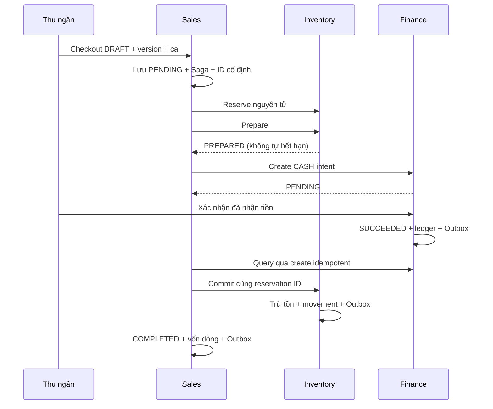

# Đơn bán, giữ hàng và thu tiền mặt

## Ranh giới dữ liệu

| Dịch vụ | Dữ liệu sở hữu | Giao tiếp |
| --- | --- | --- |
| Business | Hộ, địa điểm, thành viên, quyền hiện hành | Authorize có chữ ký dịch vụ và JWT người dùng |
| Catalog | SKU, đơn vị, hệ số, giá và phiên bản | Snapshot giá hiện hành cho Sales |
| Sales | Quote, order, line snapshot, CheckoutSaga, audit, Outbox | Điều phối HTTP bền vững; không truy vấn DB khác |
| Inventory | Reservation, dòng giữ hàng, balance, thẻ kho | Reserve, prepare, commit, release và query |
| Finance | Quầy, ca, payment, sổ tiền mặt, audit, Outbox | Intent, xác nhận tiền mặt, query, void |

Gateway phục vụ React, kiểm CSRF/session và định tuyến. Mọi URL `/v1/internal/` bị chặn từ Gateway. Sales chạy mặc định cùng các dịch vụ nghiệp vụ; Reporting và Notification còn là scaffold theo profile `full`.

## API người dùng

Các đường dẫn dưới đây có tiền tố `/v1/tenants/:tenant`. POST/PATCH nghiệp vụ cần `Idempotency-Key` 16-64 ký tự; lặp cùng key/body trả kết quả cũ, đổi body bị từ chối. Các bước có version từ chối phiên bản cũ. Giá trị tiền và số lượng đều là chuỗi thập phân, không dùng số thực JS.

Tạo/sửa nháp đã lưu thành công có thể gửi lại cùng key/body sau khi quote hết hạn và nhận lại kết quả cũ. Quyền hiện hành vẫn được kiểm trước khi trả kết quả. Thao tác ghi mới và bắt đầu checkout vẫn yêu cầu quote còn hạn; cơ chế replay không kéo dài hiệu lực báo giá.

| Method / path | Nội dung chính |
| --- | --- |
| POST `/sales/quotes` | `{siteId, lines:[{skuId,unitId,quantity}], discount:{type:AMOUNT hoặc PERCENT,value}}` |
| POST `/orders` | `{quoteId,note?}`; chỉ tạo nháp, không đổi tồn/tiền |
| PATCH `/orders/:id` | `{quoteId,version,note?}`; thay bằng quote mới cùng site, chỉ DRAFT |
| GET `/orders` | `siteId`, `q` theo mã, `status`, `cursor`, `limit` tối đa 100 |
| GET `/orders/:id` | Snapshot dòng, trạng thái, tiến độ và payment đã đồng bộ |
| POST `/orders/:id/checkout` | `{version,shiftId,tenderedVnd}`; lưu Saga trước khi gọi dịch vụ |
| POST `/orders/:id/cancel` | `{version,reason}`; DRAFT hủy ngay, đơn đang xử lý gửi yêu cầu hủy |
| GET `/shifts` | `siteId`; 50 ca gần nhất và tiền dự kiến hiện tại |
| POST `/shifts` | `{siteId,openingCash}`; một ca mở/quầy |
| POST `/shifts/:id/close` | `{siteId,version,countedCash,note}`; chặn khi còn payment PENDING; chênh lệch cần lý do |
| POST `/payments/:id/confirm` | `{siteId,version,cashReceived:true}`; ghi sổ sau khi người dùng xác nhận nhận đủ tiền |

OWNER/MANAGER/CASHIER được lập đơn và thu tiền trong scope. CASHIER chỉ thao tác ca mình mở và giảm tối đa 5%; OWNER/MANAGER có thể xử lý ca trong phạm vi địa điểm. ACCOUNTANT đọc đơn, ca và giá vốn; STOCK không vào đơn bán. Giá vốn chỉ trả cho OWNER/ACCOUNTANT, kể cả sau khi đổi quyền. Site ngừng chặn ghi mới/thu tiền nhưng cho hủy và đóng ca. Công việc đã được tiếp nhận vẫn được worker hoàn tất khi người dùng mất phiên/quyền; không giữ JWT người dùng trong Saga.

## Báo giá và số học

Gộp dòng cùng SKU + đơn vị trước khi tính; khác đơn vị vẫn giữ dòng snapshot riêng. Lượng nhân hệ số phải biểu diễn chính xác với tối đa ba chữ số lẻ. Tổng tiền làm tròn HALF_UP đến đồng; giảm cấp đơn phân bổ bằng phần dư lớn nhất, thứ tự SKU/đơn vị ổn định để tổng dòng bằng tổng đơn. Quote có hiệu lực 120 giây. Checkout lấy lại giá/phiên bản từ Catalog; đổi giá trả `PRICE_CHANGED`, hết hạn trả `QUOTE_EXPIRED`. Cả hai cần người dùng lấy quote mới và xác nhận tổng tiền. Không nhận giá/tổng tiền do trình duyệt gửi.

Inventory gom lượng theo SKU, khóa theo tenant/warehouse/SKU như nhập hàng và kiểm kho. Reserve tất cả hoặc không dòng nào. Stock đang kiểm bị chặn; tồn khả dụng bằng hiện có trừ giữ trừ cách ly. Xuất bán tính vốn theo lượng và giá trị tại thời điểm commit; xuất hết chuyển hết phần giá trị còn lại. Sales phân bổ vốn SKU cho các dòng đơn theo lượng cơ sở, tổng vốn không lệch đồng.

## Máy trạng thái và phục hồi

Order: DRAFT, PENDING, COMMITTING, REVIEW, COMPLETED, CANCELLED. Saga có RESERVE, PREPARE, PAYMENT, COMMIT, COMPLETE, CANCEL, DONE. Mỗi worker nhận lease 20 giây bằng `SKIP LOCKED`, có token chống ghi đè bởi worker cũ, backoff tối đa 30 giây. Mỗi lời gọi có timeout 5 giây. Không giữ transaction SQL qua network.

Reservation ACTIVE tự hết hạn sau 120 giây; PREPARED không tự hết hạn. Commit chỉ thực hiện sau khi query Finance thấy SUCCEEDED khớp order/reservation/site/amount. Query hoặc timeout không rõ kết quả không được xem là chưa thu tiền. REVIEW giữ tham chiếu hiện tại để thử lại; không tạo đơn/intent mới.

Hủy luôn void Finance trước release kho. Void tạo bản ghi FAILED kể cả chưa từng có intent để chặn create đến muộn. Nếu cash confirm thắng khóa và payment đã SUCCEEDED, Saga tiếp tục commit thay vì hủy. Finance khóa ca rồi payment; Inventory PREPARED chỉ release sau khi query payment FAILED. Replay mỗi bước giữ ID/body và không ghi thêm ledger/movement.

## Hợp đồng nội bộ và sự kiện

Namespace máy `/v1/internal/workflows/`: Inventory `reservation/{reserve,prepare,query,commit,release}`, Finance `payment/{create,query,void}`. Chữ ký HS256 riêng theo caller, hạn 30 giây, ràng buộc issuer, audience, purpose, tenant, method, path và body hash. Mỗi endpoint hạn chế caller; không thay thế authorize của hành động người dùng. `/v1/internal/shifts/validate` và Catalog snapshot còn yêu cầu JWT người dùng + chữ ký delegated.

Mọi service có database/account riêng. Outbox cùng transaction với thay đổi sở hữu; `finance.payment-succeeded.v1`, `sales.order-completed.v1` cùng envelope version 1, correlationId là order. Đơn COMPLETED chỉ phát sau commit kho. Stock changed và sự kiện bán được giữ ở `storeluma.deferred` chờ consumer báo cáo tuần sau; chưa có read model doanh thu. Broker gián đoạn không làm mất Outbox; publisher confirm và mandatory routing vẫn áp dụng.

## Giới hạn

Chỉ CASH, khách lẻ, một quầy mặc định/địa điểm. Chưa có provider điện tử/webhook, credit, refund, in biên nhận, chuyển ca, thu chi ngoài bán hay đối soát ca đầy đủ. Trường hợp trả tiền sau khi đơn hoàn tất thuộc nghiệp vụ trả hàng tuần 8. Chưa có deployment production, TLS, xoay service key, phân tách quyền migration/runtime hay khôi phục mất database. Không gọi HTTP gián đoạn hoặc mất broker là kiểm chứng disaster recovery.
