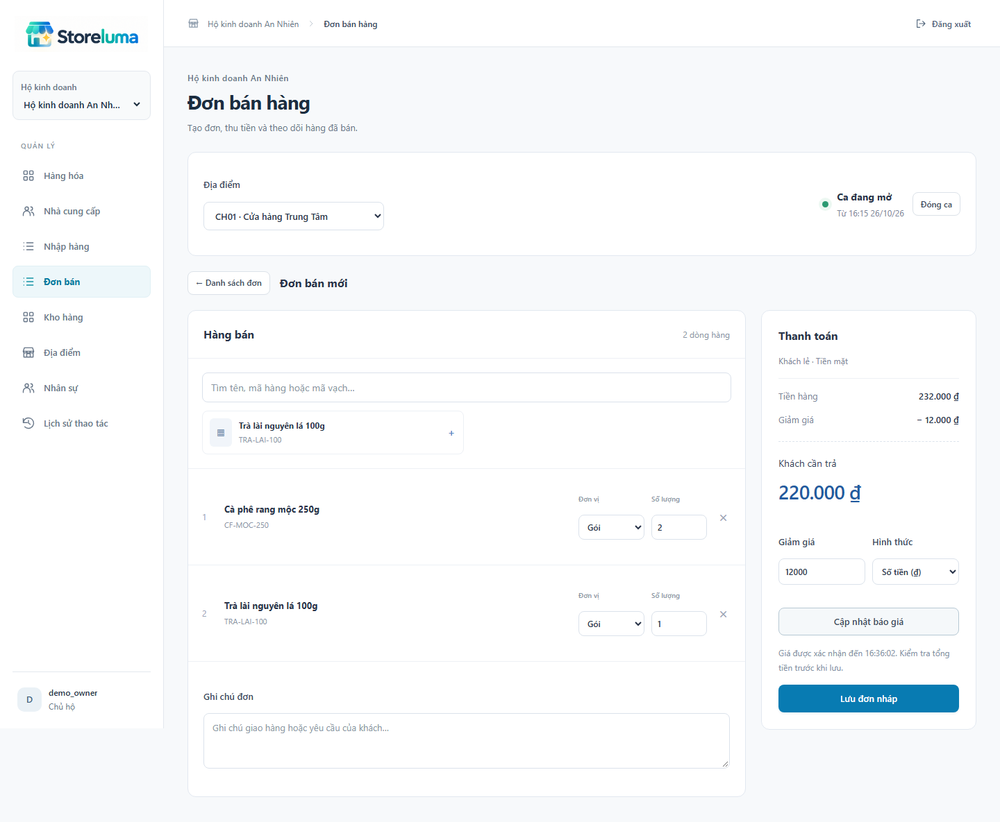
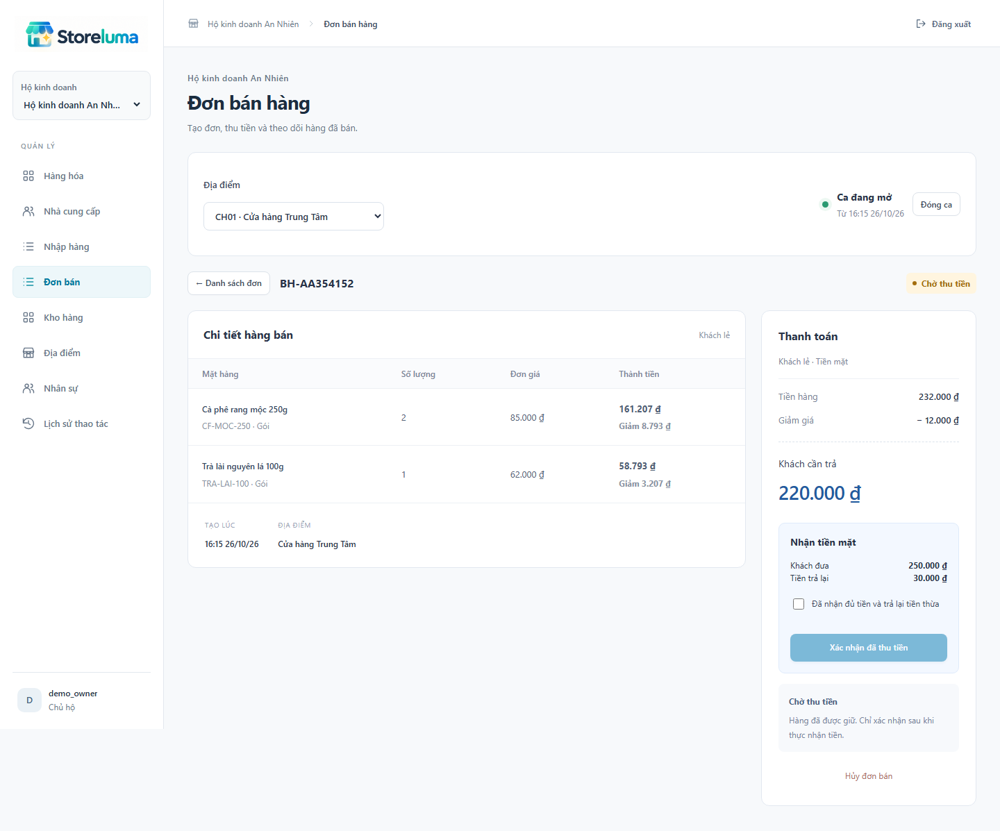
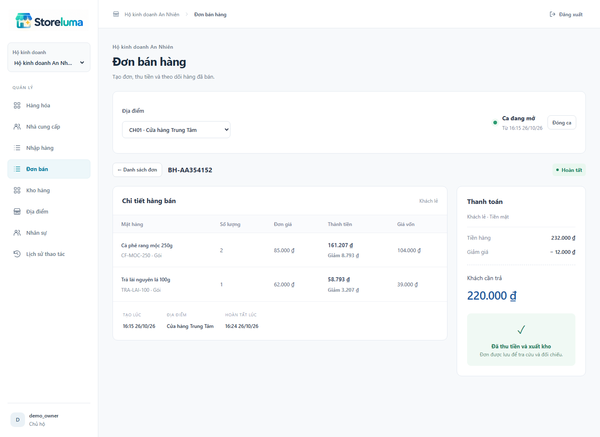
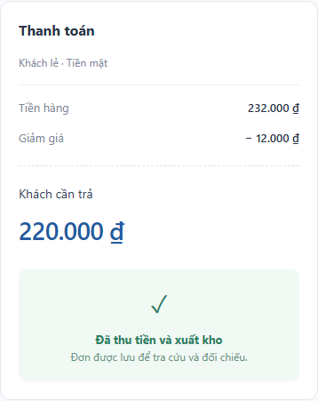
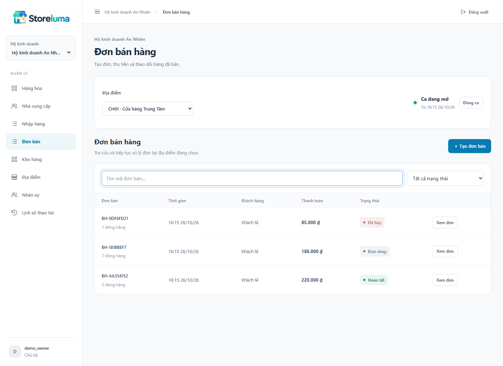

# STORELUMA - BÁO CÁO TIẾN ĐỘ TUẦN 7
Phan Chí Cường - 23520207 | GVHD: ThS. Trần Anh Dũng
Kỳ kế hoạch: 02/11-08/11/2026. Ngày báo cáo: 06/11/2026. Phiên bản: 0.7.0.

## 1. Mục tiêu và kết quả tuần 7

Theo kế hoạch tuần 7 (02/11-08/11/2026), công việc tập trung làm đơn bán và phối hợp kho, tài chính. Sản phẩm là luồng bán tiền mặt xuyên các dịch vụ, có giao diện thao tác và dữ liệu thực, tiếp nối danh mục/nhập hàng tuần 5 và quản lý tồn/kiểm kho tuần 6.

| Hạng mục | Kết quả thực hiện |
| --- | --- |
| Báo giá, đơn nháp | Tìm hàng, chọn đơn vị/số lượng, giảm giá, lấy quote từ server, lưu và sửa nháp. |
| Phối hợp kho | Giữ toàn bộ dòng, chuẩn bị giữ hàng, xuất bán và truy nguồn thẻ kho. |
| Phối hợp tài chính | Ca thu ngân tối thiểu, intent tiền mặt, xác nhận thực nhận, tiền trả lại và ledger. |
| Phục hồi | Saga bền vững, ID ổn định, retry; hủy có kiểm tra kết quả thu tiền. |
| Bàn giao | Mã 0.7.0, kiểm thử tích hợp, API, thiết kế UI, ảnh thật và báo cáo. |

Phạm vi theo tiến độ

Tuần này chỉ triển khai CASH cho khách lẻ. Mở/đóng ca tối thiểu là điều kiện để tiền mặt gắn với quầy và người chịu trách nhiệm. POS đầy đủ, biên nhận in và trả hàng tiếp tục trong tuần 8.

Chức năng được kiểm chứng bằng kiểm thử tích hợp, phục hồi gián đoạn và thao tác trên giao diện, trình bày tại mục 8-9.

## 2. Phân chia dịch vụ và dữ liệu

| Thành phần | Sở hữu và trách nhiệm |
| --- | --- |
| Business | Hộ, địa điểm, thành viên; kiểm quyền hiện hành cho mỗi hành động. |
| Catalog | SKU, đơn vị, giá và phiên bản; trả snapshot giá cho Sales. |
| Sales | Quote, order, dòng snapshot, Saga, audit, Outbox; điều phối checkout. |
| Inventory | Reservation, balance, thẻ kho; reserve/prepare/commit/release. |
| Finance | Quầy, ca, intent, ledger tiền mặt, audit, Outbox. |
| Gateway + React | Session/CSRF, định tuyến và giao diện sản phẩm. |

Mỗi service chạy độc lập và có database/account riêng. Sales gọi API dịch vụ liên quan, không đọc/ghi bảng kho hoặc tài chính. Lệnh người dùng kiểm JWT và quyền Business; lệnh worker có chữ ký riêng, hạn ngắn, gắn tenant/path/body và giới hạn caller. Gateway chặn toàn bộ namespace nội bộ.

Trình tự hoàn tất

Lưu PENDING và Saga trước; Inventory reserve nguyên tử rồi PREPARED; Finance tạo intent PENDING; người thu xác nhận thực nhận tiền; Sales thấy SUCCEEDED mới yêu cầu commit kho; kho trả COMMITTED rồi Sales ghi COMPLETED và sự kiện hoàn tất.

Mỗi transaction chỉ nằm trong database sở hữu. Sổ tiền, movement và sự kiện Outbox ghi cùng transaction địa phương. Broker được phục hồi độc lập; không mở transaction SQL chờ HTTP.

## 3. Lập giỏ và báo giá

Dòng cùng SKU và đơn vị được gộp; đơn vị khác giữ snapshot riêng. Số lượng và hệ số được quy đổi chính xác tối đa ba chữ số lẻ. Tiền dùng đồng nguyên và phân bổ giảm bằng phần dư lớn nhất, bảo đảm tổng dòng bằng tổng đơn.

Quote có hạn 120 giây; thu ngân giảm tối đa 5%, quản lý/chủ hộ theo quyền được xử lý mức cao hơn. Khi hết hạn hoặc Catalog đổi giá, người dùng cập nhật báo giá và xác nhận lại. Nháp chưa giữ hàng, chưa thu tiền và còn sửa được.

## 4. Thu tiền mặt có xác nhận

Bắt đầu thanh toán chưa ghi nhận doanh thu hoặc tiền đã nhận. Finance chỉ cho tạo intent sau khi hàng PREPARED khớp order, payment, site và tổng tiền. UI hiển thị tiền khách đưa, số phải trả và tiền thừa; người dùng chọn xác nhận đã nhận đủ tiền trước khi gửi.

Xác nhận tiền mặt ghi SUCCEEDED, một dòng ledger theo số phải trả và sự kiện Outbox. Tiền khách đưa không đồng nghĩa doanh thu; tiền đầu ca cũng không phải doanh thu. Đóng ca cần tiền thực đếm, lý do nếu lệch và không còn intent PENDING.

## 5. Xuất kho và chứng từ hoàn tất

Inventory xác minh payment thành công rồi trừ lượng giữ và hiện có trong cùng transaction, tạo movement SALE và cập nhật giá trị tồn. Các dòng cùng SKU chỉ tạo một movement; Sales phân bổ vốn về các dòng đơn, không sai tổng đồng.

Thẻ kho có bộ lọc Xuất bán và mở được đơn nguồn theo quyền. OWNER/ACCOUNTANT thấy vốn; các vai trò khác không nhận trường vốn trong JSON. Đơn COMPLETED bất biến; xử lý hoàn tiền hoặc trả hàng thuộc phần tiếp theo của tiến độ.

## 6. Hủy, cạnh tranh và phục hồi

| Tình huống | Cách xử lý |
| --- | --- |
| Thiếu hàng / đang kiểm | Reserve toàn bộ hoặc không dòng nào; không thu tiền. Dùng chung khóa và freeze với nghiệp vụ kho. |
| ACTIVE quá 120 giây | Worker giải phóng lượng giữ. Lượt đã hết hạn không được prepare lại. |
| PREPARED chờ tiền | Không tự hết hạn; cần kết quả thu tiền rõ ràng trước khi release. |
| Finance/Inventory ngừng | Order vào REVIEW, giữ các ID hiện tại và thử lại. Đã thu tiền phải tiếp tục commit, không tạo đơn mới. |
| Người dùng thoát / mất quyền | Saga đã tiếp nhận tiếp tục bằng danh tính dịch vụ; hành động mới vẫn kiểm quyền hiện hành. |
| Confirm đồng thời cancel | Finance khóa ca và payment. SUCCEEDED thì tiếp tục xuất; FAILED thì release. |
| Hủy trước intent | Tạo FAILED để chặn create đến muộn; chỉ release sau khi xác định ngừng thu tiền. |
| RabbitMQ ngừng | Giao dịch địa phương và Outbox vẫn lưu; gửi lại có confirm khi broker phục hồi. |

Worker nhận lease 20 giây bằng SKIP LOCKED và token để lượt chạy cũ không ghi đè. Timeout HTTP 5 giây, backoff tối đa 30 giây, dùng cố định order/reservation/payment ID. Lặp thao tác không tạo thêm tiền, xuất kho hoặc sự kiện hoàn tất.

Timeout là kết quả chưa xác định, không được tự coi là thất bại thu tiền. Các kiểm tra chủ động dừng dịch vụ chỉ xác nhận khả năng phục hồi gián đoạn đã thử, không chứng minh khôi phục mất database.

## 7. Phân quyền và giao diện nhỏ

| Vai trò | Lập / thu | Giảm giá | Vốn / đơn nguồn |
| --- | --- | --- | --- |
| OWNER | Theo hộ | Đến tổng tiền | Có vốn, có đơn |
| MANAGER | Theo site | Đến tổng tiền | Không vốn, có đơn |
| CASHIER | Theo site, ca mình | Tối đa 5% | Không vốn, có đơn |
| ACCOUNTANT | Chỉ đọc | Không lập | Có vốn, có đơn |
| STOCK | Không vào đơn | Không lập | Đọc thẻ kho, không mở đơn |

Giữ logo gốc và hệ màu chung. Giỏ và tổng tiền xếp một cột trên màn hình nhỏ, có nhãn rõ và thông báo trạng thái.

## 8. Kiểm thử nghiệp vụ và cạnh tranh

Lần chạy cục bộ bắt đầu 26/10/2026 16:25:02 (Asia/Ho_Chi_Minh), mất 188.5 giây: 27 ca tuần 7 + 1 migration = 28/28 đạt. Không skipped, flaky hoặc retry. Build/TypeScript và kiểm tra phụ thuộc runtime đạt.

| Mã | Nội dung kiểm tra | Kết quả |
| --- | --- | --- |
| W7-01 | Quote do server tính, gộp dòng cùng đơn vị, phân bổ giảm giá đúng đồng. | Đạt |
| W7-02 | Giới hạn giảm 5% của thu ngân, vai trò và cô lập hộ. | Đạt |
| W7-03 | Lặp tạo nháp cùng key không nhân đôi; hủy nháp không đổi kho/tiền. | Đạt |
| W7-04 | Quote hết hạn chặn checkout, không tạo giao dịch thu tiền. | Đạt |
| W7-05 | Giá Catalog thay đổi cần lấy quote và xác nhận lại. | Đạt |
| W7-06 | Giữ PREPARED, xác nhận tiền thật, một ledger và vốn đúng. | Đạt |
| W7-07 | Replay checkout/commit giữ cùng ID, không trừ kho lần hai. | Đạt |
| W7-08 | Hủy void payment trước release PREPARED; không thu sau hủy. | Đạt |
| W7-09 | Đơn nhiều dòng thiếu hàng không giữ dở dòng còn lại. | Đạt |
| W7-10 | 20 đơn tranh một đơn vị tồn: chỉ một đơn được bán. | Đạt |
| W7-11 | SKU đang kiểm kho chặn checkout mà chưa thu tiền. | Đạt |
| W7-12 | PREPARED không hết hạn khi đang chờ người dùng thu tiền. | Đạt |
| W7-13 | Chặn đóng ca có payment chờ; đầu ca không thành doanh thu. | Đạt |
| W7-14 | Confirm và cancel cạnh tranh cho một kết quả cuối nhất quán. | Đạt |

Bộ kiểm thử đăng nhập TOTP, gọi HTTP thật, kiểm tra các database sở hữu và hành vi UI. Trường hợp 20 đơn tranh một đơn vị tồn kết thúc với đúng một đơn bán, không âm kho.

## 9. Kiểm thử phục hồi và hồi quy

| Mã | Nội dung kiểm tra | Kết quả |
| --- | --- | --- |
| W7-15 | Finance gián đoạn: giữ hàng, phục hồi cùng payment ID. | Đạt |
| W7-16 | Đã thu tiền, Inventory ngừng và Sales restart: tiếp tục xuất một lần. | Đạt |
| W7-17 | Saga đã tiếp nhận hoàn tất dù người thực hiện bị đổi quyền. | Đạt |
| W7-18 | Ẩn vốn theo API và quyền mở nguồn SALE từ thẻ kho. | Đạt |
| W7-19 | Chặn internal endpoint từ Gateway và token dịch vụ giả. | Đạt |
| W7-20 | Sự kiện hoàn tất duy nhất, Sales không được kết nối DB Inventory. | Đạt |
| W7-21 | UI thật từ tìm hàng đến thu tiền; làm mới quote; màn hình 390 px. | Đạt |
| W7-22 | Đóng ca ghi tiền đếm/chênh lệch và chặn checkout ca cũ. | Đạt |
| W7-23 | ACTIVE hết hạn giải phóng lượng; không prepare lại lượt hết hạn. | Đạt |
| W7-24 | FAILED chặn create đến muộn; không commit/release sớm PREPARED. | Đạt |
| W7-25 | Khác đơn vị cùng SKU: một movement, tổng giảm giá/vốn chính xác. | Đạt |
| W7-26 | Broker ngừng vẫn hoàn tất cash; Outbox gửi lại khi phục hồi. | Đạt |
| W7-27 | Quy đổi không chính xác và tổng tràn số trả 400 trước khi lưu quote. | Đạt |

MIG-01 chạy migration thật trên database kiểm thử riêng: giữ receipt, balance và movement cũ khi nâng cấp kiểm kho/giữ hàng; khởi động đồng thời, chạy lại và rollback migration lỗi.

Hồi quy riêng bắt đầu 26/10/2026 10:49:16: 6 AUTH + 25 tuần 5 + 25 tuần 6 = 56/56 đạt, 332.8 giây, không skipped/flaky/retry. Bộ hồi quy được chạy độc lập với các ca tuần 7.

Kiểm lại UI sau chỉnh bố cục và trạng thái ca: 2/2 đạt, bắt đầu 26/10/2026 16:44:35. Có trường hợp phiên khác đóng ca trước khi người dùng mở form; màn hình lấy trạng thái mới nhất thay vì dùng ca cũ.

## 10. Bàn giao và công việc tiếp theo

GitHub Actions trên Ubuntu/Docker mới: 104/104 ca đạt (6 AUTH + 1 MIG + 20 W4 + 25 W5 + 25 W6 + 27 W7). Run 40300242656, commit 9e3e4b9fdb20. Workflow kiểm dependency, build, tích hợp và lưu artifact 7 ngày; link kiểm chứng trong evidence/verification.md.

Bàn giao code 0.7.0, migration nâng cấp dữ liệu hiện có, giao diện đơn bán, hợp đồng API/quyền, bộ kiểm thử và báo cáo Markdown/PDF. Các báo cáo tuần 3-6 giữ kết quả lịch sử; tuần 7 bổ sung luồng bán dựa trên các chức năng đã có.

Chuẩn bị tuần 8

Hoàn thiện thao tác POS, ca, biên nhận và trả hàng. Hiện chỉ CASH/khách lẻ, một quầy mặc định; chưa có provider điện tử, credit, in biên nhận, trả hàng hoặc read model báo cáo doanh thu. Reporting/Notification vẫn là scaffold.

Môi trường đã thử là Docker cục bộ và CI; chưa triển khai production/HTTPS, phân tách quyền migration, xoay key, backup/restore hoặc tải lớn. Tham khảo giao diện: Tabler Form elements và Invoice; URL đầy đủ ở ui-design.md.
