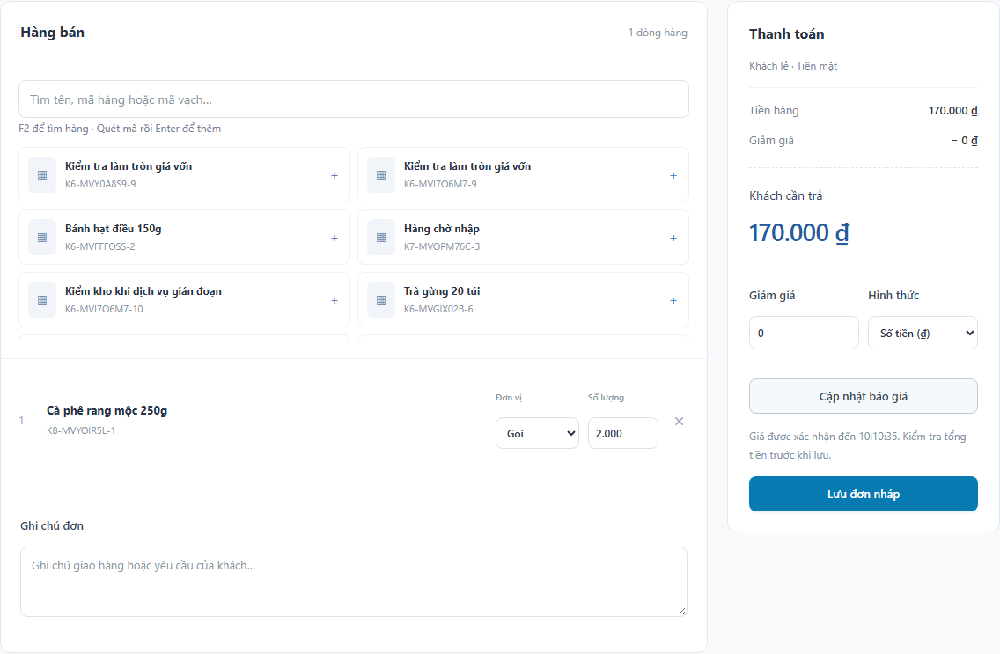
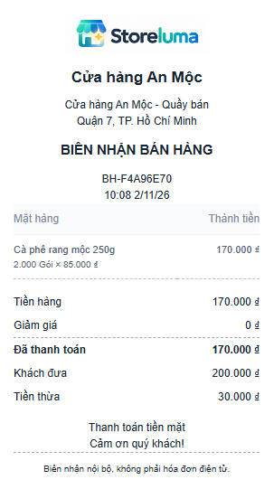
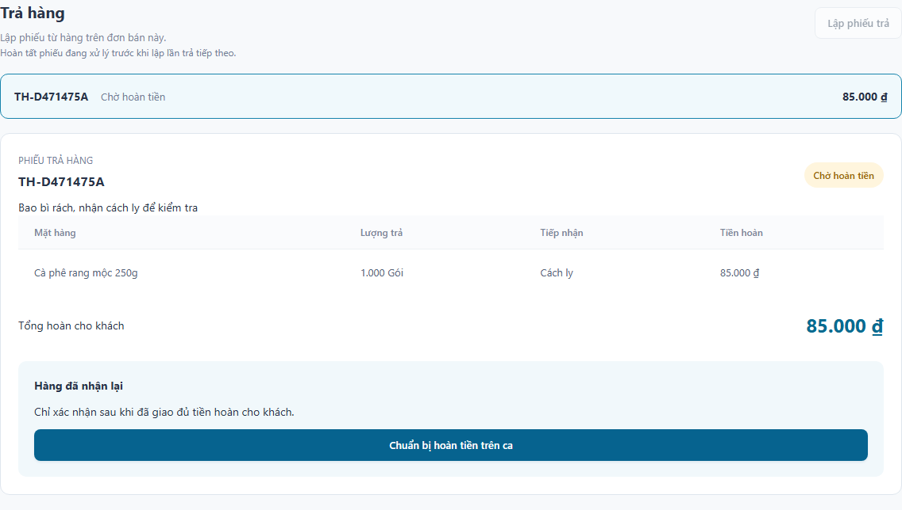
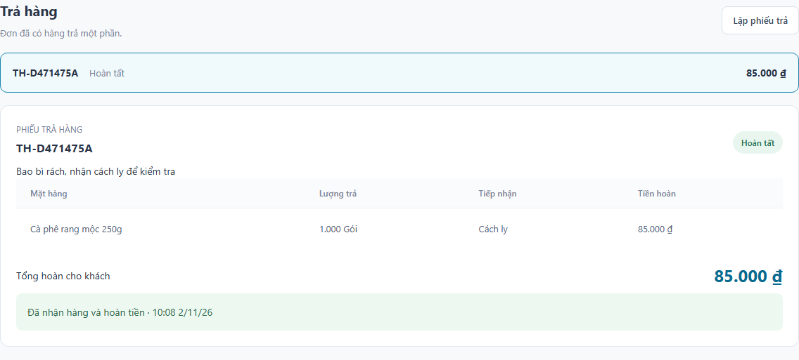
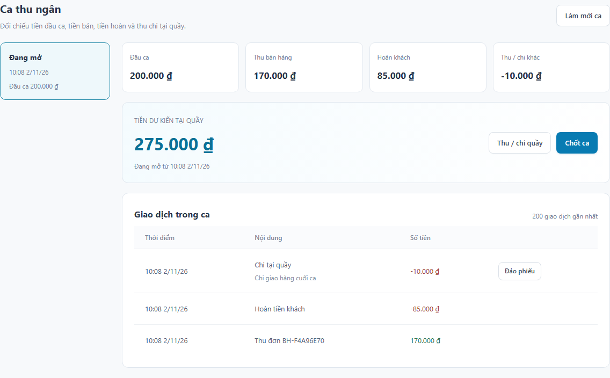
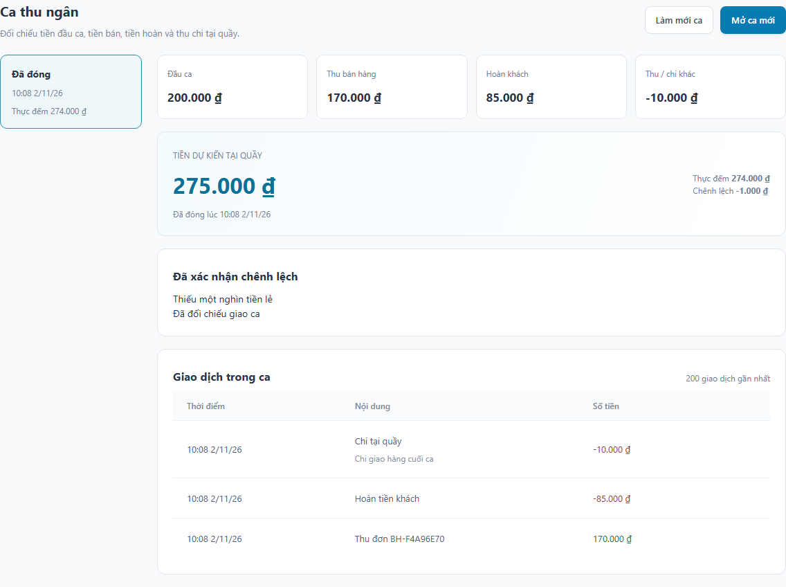
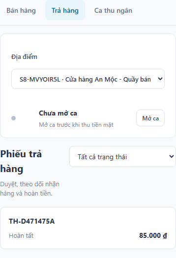
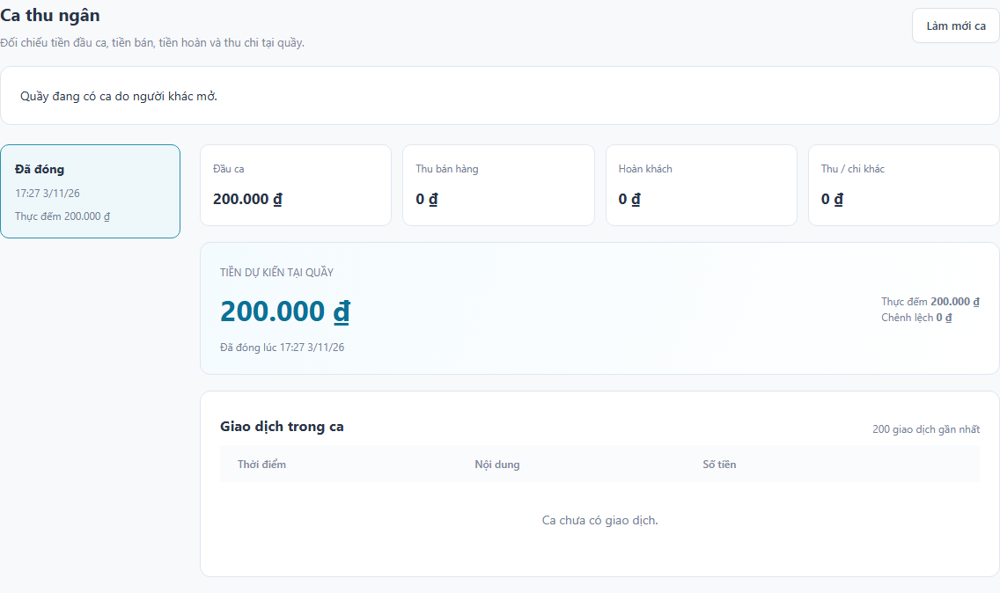

# STORELUMA - BÁO CÁO TIẾN ĐỘ TUẦN 8
Phan Chí Cường - 23520207 | GVHD: ThS. Trần Anh Dũng
Kỳ kế hoạch: 09/11-15/11/2026. Ngày báo cáo: 13/11/2026. Phiên bản: 0.8.0.

## 1. Mục tiêu và sản phẩm tuần 8

Theo kế hoạch 09/11-15/11/2026, tuần 8 hoàn thiện POS, ca thu ngân, biên nhận và trả hàng. Kết quả là một ca bán tiền mặt có thể thao tác từ mở ca, lập đơn, thu tiền, in biên nhận đến nhận trả, hoàn tiền và chốt quỹ.

| Hạng mục | Sản phẩm thực hiện |
| --- | --- |
| POS | Tìm hoặc nhập mã hàng, Enter thêm hàng, F2 tìm nhanh, gộp lượng; lập đơn, thu tiền và tiếp tục bán. |
| Biên nhận | Xem/in khổ 80 mm, số lần yêu cầu in, dấu bản in lại; giữ snapshot chứng từ. |
| Trả hàng | Trả một phần hoặc toàn bộ, lý do, duyệt, nhập bán được/cách ly, hoàn theo số thực thu. |
| Ca và quỹ | Lịch sử ca, thu/chi quầy, hoàn khách, tiền dự kiến, thực đếm, chênh lệch và xác nhận. |
| Kỹ thuật | Return Saga, khóa cạnh tranh, idempotency, Outbox, migration nâng cấp có giữ dữ liệu. |

Phạm vi thực hiện

Tiếp nối luồng bán và các dịch vụ đã có ở tuần 7. Tuần này phục vụ khách lẻ thanh toán CASH tại quầy mặc định của địa điểm; xử lý sau bán bằng chứng từ liên kết, giữ nguyên đơn COMPLETED.

Bàn giao phiên bản 0.8.0, giao diện sử dụng API thực, hợp đồng API, bộ kiểm thử tích hợp, ảnh giao diện và báo cáo Markdown/PDF.

## 2. POS và biên nhận bán hàng

Phím F2 đưa con trỏ vào ô tìm hàng; Enter nhận SKU hoặc barcode khớp chính xác. Thêm lại cùng hàng/đơn vị tăng lượng trên dòng hiện có. Báo giá, giảm giá và tổng thanh toán do server tính; vẫn giữ giới hạn quyền và hạn báo giá từ tuần 7.

Sau thu tiền và xuất kho, người dùng mở biên nhận hoặc bắt đầu đơn mới. Danh sách đơn hỗ trợ mã, trạng thái và khoảng ngày. Thông báo lỗi, trạng thái chờ và thao tác tiếp theo hiển thị ngay tại khu vực làm việc.

Dữ liệu chứng từ

Biên nhận lưu nội dung tại lần yêu cầu in đầu tiên: hộ/địa điểm, thời gian hoàn tất, dòng bán, giảm giá, tổng tiền, tiền khách đưa và tiền thừa. Đổi tên hoặc giá trong danh mục không làm thay đổi chứng từ đã lưu.

## 3. In và in lại biên nhận

Mỗi lần gửi lệnh in có khóa idempotency. Yêu cầu gửi lại không tăng bộ đếm; một lần in mới được ghi audit và có nhãn BẢN IN LẠI khi phù hợp. Bộ đếm ghi số lần yêu cầu in, không xác nhận máy in đã xuất giấy.

Biên nhận ghi rõ là chứng từ nội bộ, không phải hóa đơn điện tử. Chưa có nhà cung cấp hóa đơn hoặc cấu hình thuế; không tự gán trạng thái đã phát hành. Kiểm thử đã xác nhận nút gọi window.print và bố cục in 80 mm; chưa kiểm chứng máy in vật lý.

## 4. Yêu cầu và duyệt trả hàng

Từ đơn hoàn tất, người dùng chọn dòng, lượng, tình trạng bán được/cách ly và nhập lý do. Server đối chiếu lượng bán gốc trừ các lần trả đã hoàn tất. Mỗi đơn chỉ có một phiếu trả đang xử lý để giữ thứ tự phân bổ tiền và vốn; có thể hủy khi phiếu còn REQUESTED.

Chủ hộ hoặc quản lý duyệt phiếu. Khi có nhiều người đủ quyền, người duyệt phải khác người lập. Chủ hộ duy nhất đủ quyền tại địa điểm được tự duyệt có audit riêng. Phiếu quá 7 ngày cần lý do ngoại lệ.

Đơn bán gốc vẫn COMPLETED. Trạng thái chưa trả/trả một phần/trả toàn bộ được tính từ chứng từ trả liên kết; không xóa dòng hoặc sửa số tiền đã bán.

## 5. Tiền hoàn và nhập kho hàng trả

Tiền và giá vốn

Hoàn theo giá trị dòng sau phân bổ giảm giá, không lấy giá Catalog hiện tại. Với nhiều lần trả lượng lẻ, số tiền lần này là chênh lệch hai tổng lũy kế làm tròn HALF_UP. Trả đủ lượng phải khớp đúng số tiền và vốn gốc, không vượt số đã thu.

Inventory nhập lại theo cost snapshot của dòng bán. Hàng bán được tăng tồn khả dụng; hàng cách ly tăng onHand và quarantined cùng lượng, giữ giá trị tồn nhưng chưa được bán. Dùng chung khóa SKU và freeze của kiểm kho.

Xác nhận chi tiền

Finance chỉ tạo refund khi đã xác minh phiếu được duyệt và Inventory đã nhận hàng. Người có quyền chọn ca đang mở cùng địa điểm, chuẩn bị rồi xác nhận đã giao đủ tiền. Khi đó mới ghi ledger âm; refund PENDING đã gắn ca chặn chốt ca.

## 6. Ca thu ngân và sổ quỹ

Tiền dự kiến = tiền đầu ca + thu bán hàng - hoàn khách + thu khác - chi khác tại quầy. Tiền khách đưa và tiền thừa không làm tăng doanh thu. Mỗi giao dịch ledger trỏ đúng một nguồn payment, refund hoặc cash entry.

Thu/chi quầy yêu cầu số tiền dương, loại và lý do. Quản lý có thể đảo phiếu bằng chứng từ ngược dấu ở một ca mở cùng địa điểm; chỉ đảo một lần, giữ lịch sử gốc và audit. Không sửa tổng tiền của ca đã đóng.

Người thu ngân chỉ thao tác ca của mình. Chủ hộ/quản lý theo phạm vi được xử lý ca; kế toán đọc số liệu. Lịch sử hiển thị 50 ca gần nhất, sổ tiền hiển thị tối đa 200 dòng gần nhất; tổng tiền tính từ toàn bộ ledger trong ca.

## 7. Chốt ca và xác nhận chênh lệch

Chốt ca khóa cùng bản ghi Shift với ghi tiền mặt. Sau khi kiểm tra không còn khoản thu/hoàn PENDING đã gắn ca, Finance tính tiền dự kiến, lưu thực đếm và chênh lệch rồi chuyển OPEN sang CLOSED trong một transaction. Khóa này ngăn giao dịch mới chen vào lúc tính quỹ; không lưu trạng thái CLOSING thành một bước riêng.

Chênh lệch khác 0 phải có lý do. Người quản lý xác nhận theo nguyên tắc tách người thực hiện; xác nhận chỉ thêm thông tin đối soát, không điều chỉnh số tiền để khớp quỹ. Ca đóng không mở lại; ca tiếp theo nhận ID mới.

Tình huống nghiệm thu: đầu ca 500.000, bán 200.000, hoàn 50.000, chi quầy 20.000 cho tiền dự kiến 630.000 đồng; thực đếm 620.000 đồng thì chênh lệch -10.000 đồng.

## 8. Phối hợp dịch vụ và phục hồi

| Dịch vụ | Trách nhiệm tuần 8 |
| --- | --- |
| Business | Kiểm quyền return/refund/cash/variance và điều kiện tự duyệt. |
| Sales | Phiếu trả, snapshot, biên nhận, Return Saga và sự kiện hoàn tất. |
| Inventory | Nhận hàng trả, vốn gốc, cách ly, movement RETURN. |
| Finance | Refund, xác nhận chi, ledger, thu/chi quầy và chốt ca. |
| Gateway / Web | Định tuyến đúng owner; session/CSRF; màn hình bán, trả, ca và bản in. |

Mỗi dịch vụ sở hữu database/account riêng. Runtime trao đổi qua API có chữ ký và sự kiện, không đọc hoặc ghi chéo database. Sales lưu Saga trước khi gọi Inventory; nhận thành công mới gọi Finance. Phiếu hoàn tất sau khi Finance trả trạng thái SUCCEEDED.

Worker dùng lease 20 giây, token chống lượt cũ ghi đè, ID cố định và retry có backoff tối đa 30 giây. Transaction không giữ khóa trong lúc chờ HTTP. Unique constraint cùng idempotency bảo vệ một lần nhập hàng và một lần ghi tiền, dù yêu cầu có thể được gửi lại.

Outbox lưu cùng transaction nghiệp vụ. RabbitMQ ngừng không làm mất giao dịch đã commit; relay gửi lại khi kết nối phục hồi. Người dùng thoát hoặc thay quyền sau khi duyệt không làm mất Saga đã được tiếp nhận; thao tác mới vẫn kiểm quyền hiện hành.

Migration Sales 003, Inventory 005 và Finance 005 mở rộng schema hiện có. Kiểm thử nâng cấp dùng database riêng có dữ liệu cũ; không sửa checksum migration đã phát hành.

## 9. Kiểm thử trả hàng và phân quyền

Lượt kiểm thử cục bộ bắt đầu 01/11/2026 22:45:18 (Asia/Ho_Chi_Minh), thời lượng 779.6 giây: 116/116 đạt, không bỏ qua, flaky hoặc retry. Gồm 6 AUTH, 2 migration, 25 tuần 5, 25 tuần 6, 29 tuần 7 và 29 tuần 8.

| Mã | Nội dung | Kết quả |
| --- | --- | --- |
| W8-01 | Biên nhận chỉ từ đơn hoàn tất; snapshot, in lại và quyền xem. | Đạt |
| W8-02 | Tiền hoàn theo dòng sau giảm giá; chưa duyệt chưa đổi tồn/tiền. | Đạt |
| W8-03 | Một phiếu đang xử lý trên mỗi đơn; lặp key không nhân đôi. | Đạt |
| W8-04 | Chặn vượt lượng, dòng lạ, dòng trùng và payload không hợp lệ. | Đạt |
| W8-05 | Quyền duyệt, tách người lập/duyệt; ngoại lệ chủ hộ duy nhất. | Đạt |
| W8-06 | Nhận hàng trước hoàn tiền; xác nhận đồng thời và chặn đóng ca. | Đạt |
| W8-07 | Lặp nhận/hoàn không tạo thêm movement, ledger hoặc sự kiện. | Đạt |
| W8-08 | Trả nốt lượng còn lại, giữ nguyên đơn và vốn gốc. | Đạt |
| W8-09 | Lượng lẻ: làm tròn lũy kế, trả đủ khớp tiền/vốn ban đầu. | Đạt |
| W8-10 | Hàng cách ly giữ giá trị tồn, không tăng lượng khả dụng. | Đạt |
| W8-11 | Đang kiểm kho chặn nhận trả; tiếp tục sau khi hết khóa. | Đạt |
| W8-12 | Finance gián đoạn sau nhận hàng: phục hồi một lần hoàn. | Đạt |
| W8-13 | Khởi động lại Sales: tiếp tục Saga đã lưu, không lặp hàng/tiền. | Đạt |
| W8-14 | Inventory gián đoạn: chưa hoàn tiền trước khi nhận hàng. | Đạt |
| W8-15 | Trả quá 7 ngày bắt buộc lý do duyệt ngoại lệ. | Đạt |

Kiểm thử đăng nhập TOTP thật, gọi HTTP qua Gateway, thao tác UI và đối chiếu dữ liệu các dịch vụ. Dừng/khởi động dịch vụ dành riêng cho trường hợp phục hồi, không thay nghiệp vụ bằng mock.

## 10. Kiểm thử ca, giao diện và nâng cấp

| Mã | Nội dung | Kết quả |
| --- | --- | --- |
| W8-16 | Hủy phiếu chưa duyệt giải phóng lượng có thể trả. | Đạt |
| W8-17 | Vai trò, cô lập hộ, chặn API nội bộ và ẩn giá vốn. | Đạt |
| W8-18 | Đối soát đầu ca 500.000 + bán 200.000 - hoàn 50.000 - chi 20.000. | Đạt |
| W8-19 | Chênh lệch cần xác nhận; tiền ca đã đóng giữ nguyên. | Đạt |
| W8-20 | Đảo thu/chi bằng chứng từ mới ở ca mở, không sửa ca cũ. | Đạt |
| W8-21 | Đóng ca cạnh tranh ghi tiền: một thứ tự commit nhất quán. | Đạt |
| W8-22 | Trả đơn của ca cũ; hoàn tiền tại ca mới cùng địa điểm. | Đạt |
| W8-23 | RabbitMQ gián đoạn: Outbox gửi lại, không lặp hiệu ứng. | Đạt |
| W8-24 | Đổi quyền sau duyệt không làm mất Saga đã tiếp nhận. | Đạt |
| W8-25 | Đổi tên hàng không đổi biên nhận; lọc ngày từ bao gồm/đến loại trừ. | Đạt |
| W8-26 | POS thật: F2, quét/gộp dòng, thu tiền, biên nhận 80 mm và in lại. | Đạt |
| W8-27 | UI lập phiếu, duyệt, cách ly và xác nhận hoàn từng phần. | Đạt |
| W8-28 | UI chi quầy, chốt ca, xác nhận lệch; lịch sử ca đúng bố cục. | Đạt |
| W8-29 | UI 390/768 px không tràn; mở ca từ tab khác hiện đúng form. | Đạt |

MIG-01 kiểm nâng cấp Inventory đến 005, giữ tồn/thẻ kho cũ, chạy đồng thời, lặp lại và rollback lỗi. MIG-02 kiểm Finance 001-004 lên 005 với ca đã đóng, payment và ledger cũ; kiểm ràng buộc một nguồn ledger, số tiền refund âm và chạy lặp.

Build/TypeScript đạt; audit dependency runtime không có lỗ hổng tại lần kiểm tra. Đối chiếu dữ liệu sau chạy: 17 kiểm tra đạt về tồn, vốn, thu/hoàn, ca và quyền kết nối database. Lượt UI bắt đầu 02/11/2026 10:08:17: W8-26 đến W8-29 đạt 4/4, kiểm lại thao tác và chụp vùng nội dung cho báo cáo.

Tại lần bàn giao ban đầu, workflow GitHub Actions cấu hình chạy toàn bộ 136 ca trên Ubuntu/Docker mới, gồm thêm 20 ca tuần 4; audit runtime, build, tích hợp và lưu artifact 7 ngày. Kết quả CI gắn với từng commit trong workflow Verify Storeluma. Lượt cục bộ 116 ca nêu trên được ghi riêng, không thay cho bộ CI đầy đủ.

## 11. Giao diện nhỏ và bàn giao

Ba khu vực Bán hàng, Trả hàng và Ca thu ngân dùng chung địa điểm đang chọn. Bố cục giữ hệ màu và logo gốc, nhãn tiếng Việt, ô tổng tiền rõ và hành động theo trạng thái. Đã kiểm ở 390 px, 768 px và desktop; bảng rộng cuộn trong vùng nội dung.

Giới hạn và bước tiếp theo

Chưa tích hợp thanh toán điện tử, bán chịu, hóa đơn điện tử hoặc máy in phần cứng. Môi trường kiểm chứng là Docker cục bộ; chưa nghiệm thu production/HTTPS, tải lớn, nhiều replica hoặc khôi phục mất database.

Tuần 9 tiếp tục báo cáo, thông báo và giao diện quản lý để chủ hộ theo dõi số liệu và công việc. Reporting/Notification hiện vẫn là scaffold. Tài liệu API, thiết kế và kết quả kiểm chứng đi kèm trong thư mục tuần 8; tham khảo giao diện Tabler Invoice và Card được dẫn tại ui-design.md.

## 12. Rà soát phân quyền ca ngày 03/11/2026

Rà soát trước khi chuyển sang tuần 9 phát hiện API danh sách ca còn trả số tiền của ca người khác cho thu ngân dù UI đã lọc. Finance được sửa để giới hạn ngay tại truy vấn; thông tin quầy đang bận chỉ gồm định danh, người mở, trạng thái và thời gian, không có tiền hoặc ghi chú.

Xác nhận thu, chuẩn bị/xác nhận hoàn và đóng ca nay kiểm sở hữu ca trước cả khi trả kết quả idempotency đã lưu. Ca thuộc người khác bị từ chối 403; người có quyền vẫn nhận kết quả cũ sau khi đóng ca. Việc tái hiện lỗi trước sửa không tạo thêm giao dịch tiền.

| Mã | Kiểm tra bổ sung | Kết quả |
| --- | --- | --- |
| W8-30 | Danh sách ca theo người dùng, dữ liệu quầy tối thiểu; UI và quyền quản lý/kế toán. | Đạt |
| W8-31 | Bốn lệnh tiền/ca kiểm sở hữu trước replay; giữ replay hợp lệ và đúng một lần ghi tiền. | Đạt |

Lượt hồi quy bắt đầu 03/11/2026 17:28:56: 118/118 đạt trong 789.0 giây, không skipped/flaky/retry. Gồm 6 AUTH, 2 MIG, 25 W5, 25 W6, 29 W7 và 31 W8. Đối chiếu dữ liệu sau chạy: 17/17 đạt. CI hiện cấu hình chạy 138 ca trên môi trường mới, có thêm 20 W4; kết quả CI theo từng commit được công bố tại Verify Storeluma.

## 13. Đối chiếu yêu cầu và chuẩn bị tuần 9

Đề cương tuần 1, khảo sát tài liệu và yêu cầu tuần 2, thiết kế tuần 3 đã có đầu ra. Tuần 2 chưa phỏng vấn cửa hàng; tuần 3 là sơ đồ và phác thảo, không phải giao diện chạy backend. Chức năng tuần 4-8 đã có các luồng thực cho hộ, danh mục, nhập/tồn/kiểm kho, đơn bán và một ca bán tiền mặt.

| Nhóm yêu cầu | Hiện trạng và phần còn lại |
| --- | --- |
| YC01-11, YC13, YC15-17, YC20 | Đã có trong phạm vi khách lẻ, CASH, một quầy mặc định mỗi địa điểm; chưa kiểm máy in phần cứng. |
| YC12, YC18 | Giỏ, báo giá đã có; chưa chọn khách có hồ sơ, chưa có lịch sử mua theo khách. |
| YC14, YC23 | Có xác nhận tiền, audit và phục hồi; chưa có bàn đối soát/lịch sử nghiệp vụ hợp nhất. |
| YC19 | Có thu/chi quầy và đảo phiếu; chưa trả nhà cung cấp, phân bổ công nợ hoặc tài khoản ngoài quầy. |
| YC21-22 | Reporting/Notification còn là scaffold; triển khai báo cáo, thông báo và giao diện quản lý ở tuần 9. |
| YC24, CL04, CL07 | Chưa đo mục tiêu p95/tải 10 phiên; chưa nghiệm thu vận hành, HTTPS, backup/restore hoặc nhiều replica. |

Nền dữ liệu và phối hợp dịch vụ đủ để tiếp tục tuần 9; chưa thể kết luận đã hoàn thành toàn bộ 24 yêu cầu cuối kỳ. Hồ sơ khách, trả nhà cung cấp và đối soát tổng hợp phải tiếp tục nằm trong danh sách việc còn lại, cần phân bổ công việc trước nghiệm thu.

Tuần 9 cần phân biệt doanh thu, tiền thu/hoàn, giá vốn và thu/chi quầy; giới hạn quyền tại API và xuất dữ liệu. Consumer cần chống trùng, nạp dữ liệu lịch sử, xử lý sự kiện đang chờ và công bố thời điểm cập nhật. Tuần 10-11 tiếp tục kiểm quyền, tải và lỗi; tuần 12 hoàn thiện triển khai, CI/CD, HTTPS, sao lưu và khôi phục.

Bảng đối chiếu đầy đủ được lưu trong docs/week-08/review-weeks-01-08.md. Các ngày thực thi và môi trường kiểm chứng được ghi riêng với kỳ kế hoạch trên bìa báo cáo.
