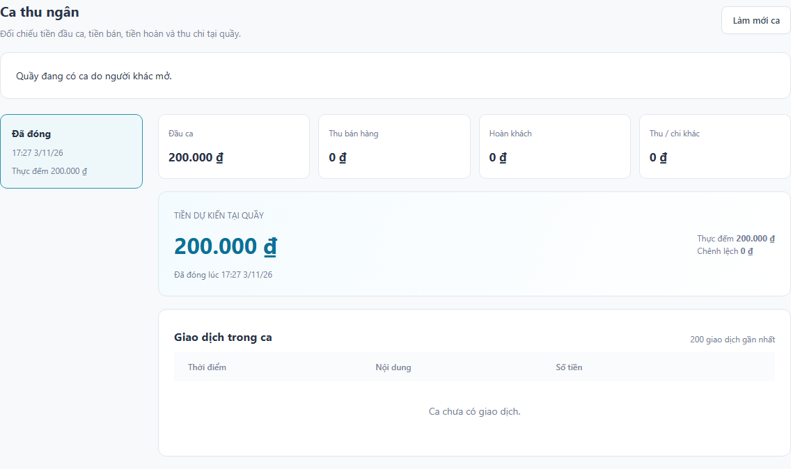

# Rà soát tiến độ tuần 1-8

Ngày kiểm tra: **03/11/2026**. Phiên bản: **0.8.0**. Phạm vi: tài liệu tuần 1-3, chức năng và mã nguồn tuần 4-8; xác định phần còn lại trước khi triển khai tuần 9.

## 1. Căn cứ và cách đánh giá

Đối chiếu [đề cương](../../output/pdf/Storeluma_De_cuong_Do_an_2.pdf), [yêu cầu tuần 2](../week-02/bao-cao-tuan-02.md), [thiết kế tuần 3](../week-03/bao-cao-tuan-03.md), các báo cáo tuần 4-8, API và giao diện đang chạy. Kiểm thử dùng Docker, PostgreSQL, RabbitMQ, Keycloak/TOTP thật và Chromium; có kiểm trạng thái dữ liệu sau thao tác và khi dịch vụ gián đoạn.

Các mốc tuần là kỳ kế hoạch của đề cương. Tuần 8 dự kiến 09/11-15/11, ngày trên bìa báo cáo là 13/11; lượt rà soát này thực hiện sớm vào 03/11 và được ghi riêng. Hoàn thành đầu ra một tuần không đồng nghĩa đã nghiệm thu mọi yêu cầu cuối kỳ.

## 2. Đầu ra theo tuần

| Tuần | Yêu cầu tiến độ | Đầu ra đã có và giới hạn |
| --- | --- | --- |
| 1 | Đề cương, phạm vi, kế hoạch cá nhân | Có đề cương PDF và kế hoạch 13 tuần. Đây là tài liệu định hướng, chưa là kết quả chạy phần mềm. |
| 2 | Khảo sát nhu cầu, sản phẩm tương tự, yêu cầu ưu tiên | Có khảo sát tài liệu công khai, 24 yêu cầu chức năng, 9 yêu cầu chất lượng và quy tắc nghiệp vụ. Chưa phỏng vấn cửa hàng hoặc thử nghiệm sản phẩm đối chứng; báo cáo đã nêu giới hạn này. |
| 3 | Phân tích nghiệp vụ, sơ đồ, phác thảo UI | Có use case, luồng nghiệp vụ, mô hình dịch vụ/dữ liệu, 13 sơ đồ và 7 phác thảo màn hình. Đây là thiết kế; không coi phác thảo là UI có backend hoặc prototype tương tác. |
| 4 | Nền hệ thống, đăng nhập, hộ, địa điểm, quyền cơ bản | Có BFF/OIDC/TOTP, session/CSRF, hộ/địa điểm, cấp kho/quầy qua sự kiện, mời nhân viên, phạm vi vai trò và audit. 20 W4 và 6 AUTH bảo vệ luồng này. |
| 5 | Danh mục, nhà cung cấp, nhập hàng | Có CRUD có kiểm quyền, SKU/barcode/đơn vị/giá, nhà cung cấp, phiếu nhập, quy đổi và giá vốn bình quân, khoản phải trả được tạo qua sự kiện. 25 W5; chưa có chi trả nhà cung cấp. |
| 6 | Tồn, lịch sử nhập xuất, kiểm kho | Có tồn khả dụng/giữ/cách ly, thẻ kho và chứng từ nguồn, freeze, kiểm đếm/duyệt/đếm lại, điều chỉnh/xuất hủy. 25 W6 và migration Inventory. |
| 7 | Đơn bán và phối hợp kho, tài chính | Có báo giá server, đơn nháp, giữ hàng, thu CASH, xuất kho, hoàn tất/hủy và phục hồi Saga. 29 W7; khách lẻ, một quầy mặc định mỗi địa điểm. |
| 8 | POS, ca, biên nhận, trả hàng | Có quét mã dạng bàn phím, in 80 mm/in lại, trả một phần/toàn bộ, duyệt, nhập bán được/cách ly, hoàn tiền, thu/chi quầy và chốt lệch. 31 W8 sau bổ sung rà soát; chưa kiểm máy in vật lý. |

## 3. Đối chiếu yêu cầu tuần 2

“Đã có” dưới đây chỉ áp dụng cho phạm vi tiền mặt/khách lẻ đã triển khai. Các dòng “một phần” và “chưa có” cần tiếp tục theo dõi đến nghiệm thu cuối kỳ.

| Yêu cầu | Hiện trạng đến tuần 8 | Phần cần tiếp tục |
| --- | --- | --- |
| YC01-03: đăng nhập, tổ chức, nhân viên | Đã có, kiểm chéo hộ/địa điểm và thu hồi quyền trong session hiện hữu | Mở rộng kiểm phân quyền ở tuần 10 khi thêm màn hình mới |
| YC04-07: danh mục, đơn vị/giá, nhà cung cấp, nhập hàng | Đã có trong phạm vi hiện tại; chứng từ đã ghi sổ giữ snapshot | Khoản phải trả chưa phải bằng chứng đã trả tiền |
| YC08-10: tồn, kiểm kho, điều chỉnh | Đã có; khóa cạnh tranh, freeze, giá vốn và quyền xem vốn | Chuyển kho chưa thuộc luồng đã kiểm chứng |
| YC11: mở ca | Đã có, một ca mở trên quầy mặc định | Chưa có cấu hình nhiều quầy tại cùng địa điểm |
| YC12: giỏ và báo giá | Một phần: tìm/quét, đơn vị, lượng, giảm giá, tính tiền đã có | Chưa chọn/lưu khách hàng có hồ sơ |
| YC13: hoàn tất đơn | Đã có cho CASH; tiền và kho được đối chiếu trước COMPLETED | Thanh toán điện tử/bán chịu chưa triển khai |
| YC14: xác nhận/đối soát tiền | Một phần: người xác nhận, tiền mặt, trạng thái và retry đã có | Chưa có bằng chứng nhà cung cấp thanh toán hoặc bàn xử lý đối soát tổng hợp |
| YC15-17: hủy, trả, biên nhận | Đã có cho CASH, trả theo đơn gốc và giá thực thu | In phần cứng và hóa đơn điện tử chưa kiểm chứng |
| YC18: khách hàng | Chưa có hồ sơ và lịch sử mua theo khách | Là yêu cầu còn thiếu trong danh sách cốt lõi, không tự coi là đã hoàn tất vì bán khách lẻ được |
| YC19: thu chi/trả nhà cung cấp | Một phần: thu/chi quầy và đảo chứng từ đã có | Chưa có tài khoản tiền ngoài quầy, trả nhà cung cấp và phân bổ khoản trả vào công nợ |
| YC20: chốt ca | Đã có dự kiến/thực đếm/lý do/duyệt lệch, chặn khoản chờ đã gắn ca | Tiếp tục giữ khóa và quy tắc một nguồn ledger khi mở rộng Finance |
| YC21: báo cáo/xuất dữ liệu | Chưa có Reporting nghiệp vụ | Nội dung chính tuần 9 |
| YC22: thông báo/công việc | Chưa có Notification nghiệp vụ | Nội dung chính tuần 9, gồm tồn thấp và giao dịch cần xử lý |
| YC23: lịch sử/xử lý phát sinh | Một phần: audit Business có UI; dịch vụ lưu audit, chứng từ nguồn, Saga và lịch sử trạng thái | Chưa có màn hình lịch sử nghiệp vụ/đối soát hợp nhất cho toàn hệ thống |
| YC24: vận hành | Một phần: health, Compose, CI, retry và kiểm phục hồi dịch vụ đã có | Chưa có quản trị vận hành đầy đủ, cảnh báo, backup/restore và production |

## 4. Hai lỗi phát hiện và chỉnh sửa

1. **Dữ liệu ca của người khác trong API danh sách.** UI đã lọc theo thu ngân, nhưng response vẫn chứa tiền và ghi chú của ca khác. Finance nay lọc ở SQL theo người dùng; trạng thái quầy bận được trả riêng bằng tập trường không có tiền hoặc ghi chú. UI giữ cảnh báo quầy đang được dùng, không gợi ý mở ca trùng hoặc hoàn tiền qua ca không được xử lý.
2. **Kiểm sở hữu ca sau khi tra kết quả idempotency.** Yêu cầu mới bị chặn nhưng dùng lại key/body đã thành công có thể nhận response của ca khác. Xác nhận thu, chuẩn bị/xác nhận hoàn và đóng ca nay kiểm quyền sở hữu trước khi trả kết quả lưu. Người có quyền vẫn replay được sau khi ca đóng; dữ liệu ledger không được ghi lần nữa.

W8-30 tái hiện lỗi danh sách trước sửa; sau sửa kiểm cả API, UI, quyền thu ngân và quyền đọc của quản lý/kế toán. W8-31 tái hiện bốn response 201 sai quyền trước sửa; sau sửa yêu cầu trái quyền phải trả 403, replay hợp lệ trả kết quả cũ, chỉ có một dòng thu và một dòng hoàn. Đây là lỗi truy cập kết quả; không ghi nhận phát sinh thu/hoàn trùng từ các yêu cầu tái hiện.

## 5. Kiến trúc và yêu cầu chất lượng

- Gateway và năm dịch vụ nghiệp vụ chạy riêng; mỗi dịch vụ sở hữu database/account riêng. Runtime dùng API nội bộ xác thực và sự kiện, không truy vấn database của dịch vụ khác. Test/audit được phép đối chiếu nhiều database để kiểm tính nhất quán.
- Transaction nghiệp vụ ghi Outbox cùng dữ liệu. Inbox, unique constraint, khóa và idempotency chống ghi trùng. Sales lưu trạng thái phối hợp bán/trả để phục hồi qua gián đoạn, không giữ transaction SQL chờ HTTP từ dịch vụ khác.
- Một PostgreSQL host và một RabbitMQ trên Compose là mô hình triển khai hiện tại; chưa là HA. Reporting/Notification chỉ là scaffold. Chưa nghiệm thu nhiều replica, mạng production, xoay service identity hoặc broker credential riêng từng dịch vụ.
- CL01-03 đã có kiểm quyền, tính chính xác tiền/lượng và phục hồi. CL05 có thao tác UI và viewport nhỏ/tablet/desktop; chưa có nghiên cứu khả dụng với người dùng thật. CL06 có ranh giới dịch vụ, migration, build và CI; chưa có CD từng dịch vụ.
- CL04 **chưa đo** tải 10 phiên, tìm hàng p95 dưới 800 ms và bán tiền mặt p95 dưới 3 giây. Thời gian chạy bộ test không chứng minh đạt mục tiêu hiệu năng.
- CL07/YC24 còn HTTPS, sao lưu ngoài máy và thử khôi phục ở tuần 12. CL08 có audit/mã giao dịch; chưa có hệ thống tập trung theo dõi toàn bộ lỗi. CL09 cần đánh giá thêm khi có hồ sơ khách, xuất báo cáo hoặc tích hợp bên ngoài.

## 6. Điều kiện chuyển sang tuần 9

Có thể tiếp tục Reporting/Notification dựa trên dữ liệu bán, trả, nhập kho và tiền hiện có sau khi bộ kiểm thử của bản sửa đạt. Chưa thể kết luận đã đáp ứng toàn bộ 24 yêu cầu hoặc sẵn sàng production.

Tuần 9 cần tách doanh thu bán, tiền thực thu/hoàn, giá vốn và thu/chi ngoài doanh thu; ghi rõ thời điểm cập nhật dữ liệu. Consumer phải chống trùng, xử lý sự kiện cũ trong `storeluma.deferred`, có phương án nạp dữ liệu lịch sử và đối chiếu với chứng từ nguồn. Giữ giới hạn tenant/site/role ở API và xuất dữ liệu, đặc biệt giá vốn/lãi gộp.

Danh sách công việc còn lại cần giữ trong kế hoạch: hồ sơ khách và chọn khách trên đơn (YC12/18); thanh toán nhà cung cấp/phân bổ công nợ (YC19); lịch sử/đối soát tổng hợp (YC14/23). Các mục này chưa có tuần riêng trong đề cương, nên cần phân bổ lại công việc trước nghiệm thu cuối kỳ; không mặc nhiên đánh dấu hoàn thành hoặc chuyển thành tùy chọn. Tuần 10-11 tiếp tục kiểm quyền, tải và tình huống lỗi; tuần 12 hoàn thiện triển khai, CI/CD, HTTPS, sao lưu và khôi phục.

Kết quả chạy và phạm vi môi trường được ghi tại [minh chứng kiểm thử](evidence/verification.md).
