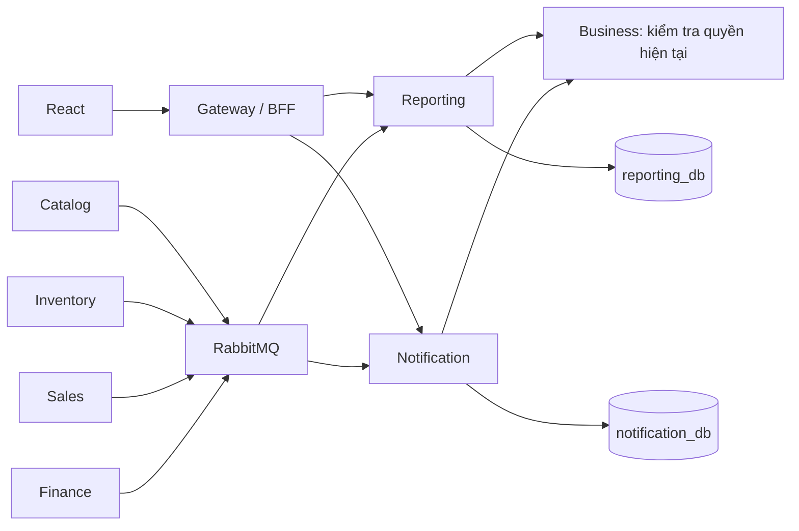
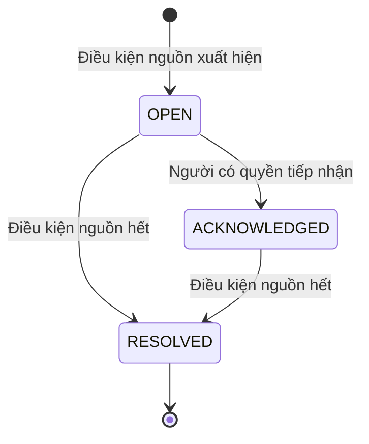

# Kiến trúc báo cáo và thông báo

## Ranh giới dịch vụ

Catalog sở hữu tên, mã, đơn vị và trạng thái SKU. Inventory sở hữu số lượng, hàng giữ, hàng cách ly và giá trị tồn. Sales sở hữu đơn bán và phiếu trả. Finance sở hữu ca, khoản thu, khoản hoàn và sổ tiền tại quầy. Reporting chỉ ghi dữ liệu tổng hợp và công việc xuất tệp; Notification chỉ ghi dữ liệu tổng hợp, quy tắc nhắc và trạng thái công việc. Hai dịch vụ không đọc bảng nghiệp vụ của dịch vụ khác.

## Giao nhận và phục hồi

Mỗi bên phát có `projection_source`, `projection_records` và `projection_snapshots` trong cơ sở dữ liệu của mình. Trigger sau cập nhật ghi snapshot phiên bản mới và Outbox trong cùng giao dịch với dữ liệu gốc. Không đổi snapshot nếu nội dung không đổi. Migration bổ sung dữ liệu tổng hợp từ chứng từ đã có, không sửa số dư hoặc chứng từ gốc.

Thông điệp `catalog|inventory|sales|finance.projection-updated.v1` mang `aggregateType=Projection`, ID, hộ, địa điểm, phiên bản tăng dần và dữ liệu theo loại. Consumer xác thực cấu trúc, kiểm tra dịch vụ phát và loại bản ghi, dùng Inbox chống lặp sự kiện và chỉ nhận phiên bản mới hơn. Bản ghi cũ không ghi đè bản mới, kể cả khi đến qua một đợt đồng bộ muộn.

Mỗi consumer tự quản lý checkpoint và lease đồng bộ. API nội bộ chụp một tập dữ liệu nhất quán tại nguồn, chia trang 250 dòng, giữ nguyên tập này trong một giờ. HMAC có mục đích, đường dẫn, phương thức, body hash, bên gọi, bên nhận và hạn 30 giây; credential đồng bộ không thay cho credential thao tác checkout. Gateway không chuyển tiếp API này cho trình duyệt.

Đồng bộ ban đầu và đối chiếu định kỳ năm phút đi qua API nguồn. Các lần tải trang không giữ giao dịch SQL trong lúc chờ HTTP. Sự kiện trực tiếp có thể tới trước hoặc sau trang snapshot; phiên bản quyết định bản ghi được giữ. Nếu nguồn gián đoạn, checkpoint giữ nguyên và thử lại sau mười giây. Snapshot hết hạn được chụp lại. Các hàng nghiệp vụ hiện dùng trạng thái hủy/ngừng, không xóa vật lý; nếu bổ sung xóa vật lý cần bổ sung tombstone vào hợp đồng đồng bộ.

`dataAsOf` là mốc nhỏ nhất của bốn nguồn đã đối chiếu đầy đủ, không phải thời điểm trả HTTP. Giao diện báo đang tổng hợp khi thiếu nguồn; báo đồng bộ chậm khi có lỗi hoặc mốc đối chiếu quá mười phút. Đây là mô hình nhất quán cuối cùng, không bảo đảm snapshot giao dịch xuyên bốn cơ sở dữ liệu. Dữ liệu mới có thể hiện trước mốc đối chiếu này nhờ RabbitMQ.

## Quy tắc tính số liệu

| Nội dung | Nguồn và quy tắc |
| --- | --- |
| Bán hàng | Chỉ đơn COMPLETED, theo ngày hoàn tất, số tiền sau phân bổ giảm giá |
| Trả hàng | Chỉ phiếu COMPLETED, trừ vào ngày phiếu trả hoàn tất; không sửa kỳ của đơn gốc |
| Giá vốn thuần | Tổng vốn các dòng bán trừ vốn các dòng trả hoàn tất |
| Lãi gộp | Doanh thu thuần trừ giá vốn thuần; chưa phải lợi nhuận ròng |
| Tồn kho | Snapshot hiện tại theo hàng và địa điểm, không suy diễn tồn lịch sử từ bộ lọc ngày |
| Thu chi | Sổ tiền đã ghi tại quầy; tách thu bán, hoàn khách, thu khác, chi khác; không cộng tiền đầu ca vào doanh thu |
| Thời gian | Asia/Ho_Chi_Minh; từ 00:00 ngày đầu đến trước 00:00 ngày sau ngày cuối |

Số tiền nguyên đồng truyền bằng chuỗi; phép tổng hợp SQL dùng numeric, phép trừ tiền dùng BigInt. Số lượng theo đơn vị cơ sở, không cộng các đơn vị khác nhau thành một chỉ số tồn chung trên giao diện.

## Phân quyền và xuất tệp

OWNER xem toàn hộ; MANAGER và ACCOUNTANT xem địa điểm được giao. Giá vốn, lãi gộp và giá trị tồn chỉ trả cho OWNER/ACCOUNTANT. CASHIER và STOCK không đọc báo cáo tổng hợp. Business kiểm tra lại quyền trên từng API.

Tệp CSV được tạo bất đồng bộ ở Reporting, gắn với hộ, người yêu cầu, bộ lọc và phiên bản quyền. Mỗi người tối đa ba yêu cầu chưa hoàn tất, tối đa 10.000 dòng tồn, hạn tệp 15 phút. Trước tải phải kiểm tra lại vai trò, địa điểm, quyền giá vốn và phiên bản quyền; đổi quyền buộc tạo tệp mới. CSV có BOM UTF-8, escape dấu nháy, dấu phẩy và ngắt dòng; nhãn bắt đầu bằng ký tự công thức được thêm dấu nháy đơn. Số âm hợp lệ giữ nguyên dạng số.

## Vòng đời công việc

Các điều kiện gồm tồn khả dụng không vượt ngưỡng, thu/hoàn tiền chờ quá thời gian, đơn REVIEW, phiếu trả REQUESTED và ca CLOSED có chênh lệch chưa xác nhận. Khóa duy nhất theo hộ/loại/nguồn giữ tối đa một công việc đang mở. Tiếp nhận không tự sửa chứng từ. Khi điều kiện xuất hiện lại sau giải quyết, tạo công việc mới, giữ lịch sử cũ.

STOCK chỉ xem nhắc tồn; CASHIER xem nhắc tồn và chứng từ gắn với mình; các vai trò còn lại xem theo phạm vi địa điểm. OWNER/MANAGER thay ngưỡng nhắc bằng version và idempotency. Liên kết công việc mở đúng kho, đơn, phiếu trả hoặc ca; API chứng từ tiếp tục kiểm tra quyền riêng.

## Giới hạn vận hành

Đã cấu hình khởi động tám dịch vụ trong Compose mặc định. Database/account riêng; vẫn dùng chung máy PostgreSQL và broker. Snapshot chứa toàn tập dữ liệu trong JSONB và giữ một giờ, phù hợp quy mô kiểm chứng hiện tại; cần đo dung lượng và tải trước khi mở rộng. Chưa triển khai SMTP, push notification, báo cáo thuế, dòng tiền ngoài quầy, HTTPS hoặc cơ chế triển khai production. Thông báo tuần này là hộp công việc trong ứng dụng.
