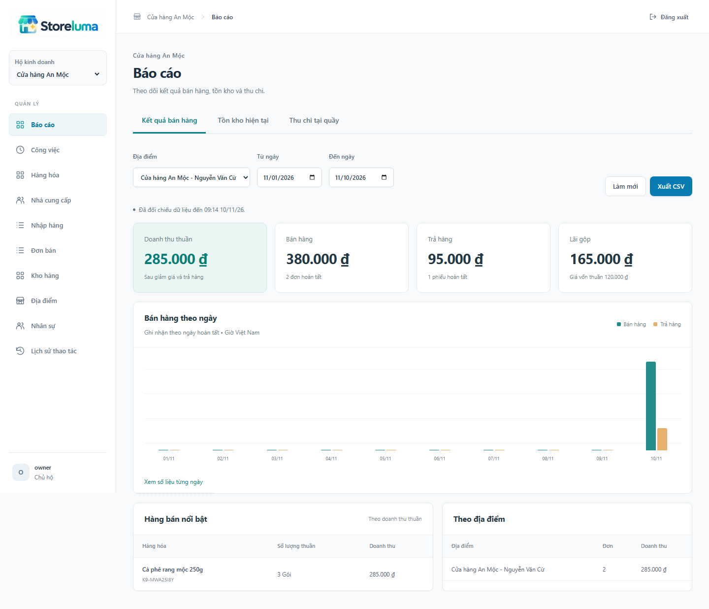
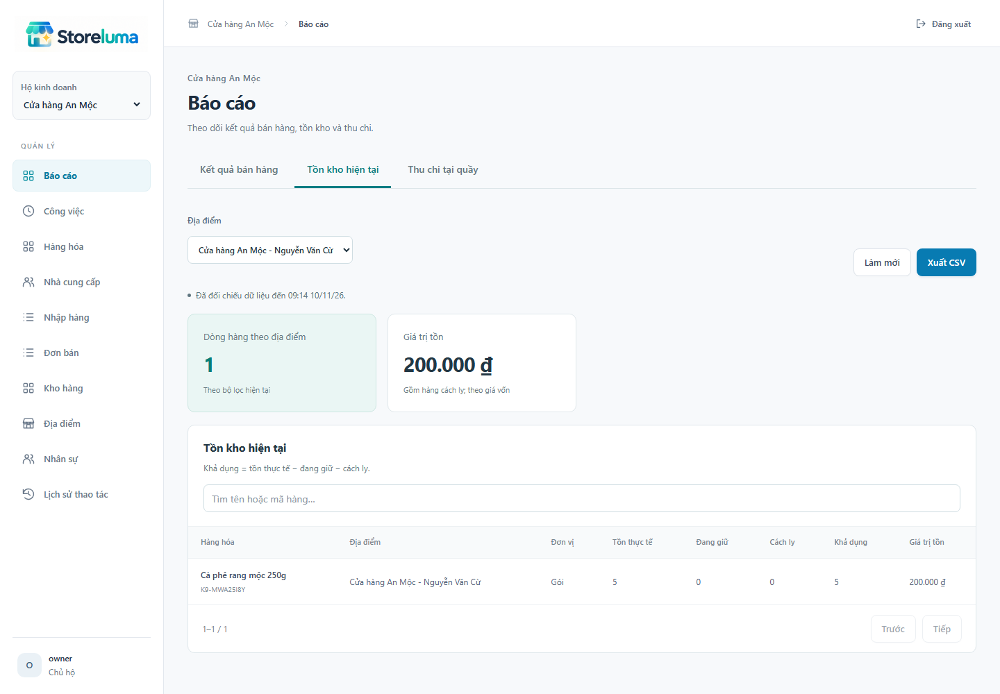
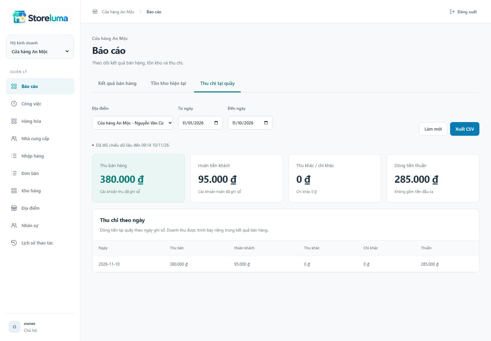
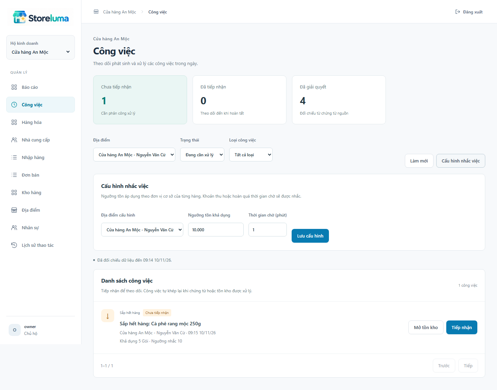
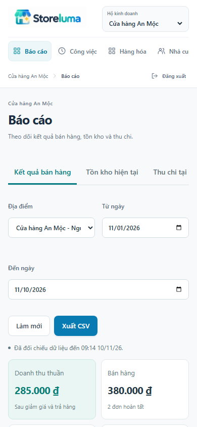

# STORELUMA - BÁO CÁO TIẾN ĐỘ TUẦN 9

Phan Chí Cường - 23520207 | GVHD: ThS. Trần Anh Dũng

**Kỳ kế hoạch:** 16/11-22/11/2026. **Ngày báo cáo:** 20/11/2026. **Phiên bản:** 0.9.0.

## 1. Mục tiêu và sản phẩm tuần 9

Theo kế hoạch 16/11-22/11/2026, tuần 9 xây dựng báo cáo, thông báo và giao diện quản lý. Trên các nghiệp vụ nhập, xuất, bán, trả hàng và ca thu ngân đã thực hiện, chủ hộ cần theo dõi kết quả kinh doanh và nhận biết những công việc còn chờ xử lý.

| Hạng mục | Sản phẩm |
| --- | --- |
| Báo cáo bán hàng | Doanh thu, giảm giá, trả hàng, giá vốn, lãi gộp; theo ngày, hàng và địa điểm. |
| Báo cáo tồn kho | Tồn thực tế, đang giữ, cách ly, khả dụng và giá trị tồn theo quyền. |
| Thu chi tại quầy | Thu bán, hoàn khách, thu khác, chi khác và dòng tiền thuần theo ngày ghi sổ. |
| Xuất dữ liệu | Tệp CSV UTF-8 được tạo bất đồng bộ; kiểm tra lại quyền khi tải. |
| Công việc | Nhắc tồn, thu/hoàn đang chờ, đơn cần đối chiếu, trả hàng chờ duyệt và chênh lệch ca. |
| Kiến trúc | Hai dịch vụ Reporting và Notification có dữ liệu riêng, đồng bộ bằng sự kiện và snapshot nguồn. |

### Phạm vi bàn giao

Phiên bản 0.9.0 bổ sung hai mục Báo cáo và Công việc vào giao diện sản phẩm. Các màn hình dùng dữ liệu thật qua Gateway; thao tác xử lý vẫn thuộc dịch vụ sở hữu chứng từ. Thông báo tuần này được cung cấp trong ứng dụng, chưa gửi email hoặc push notification.

Kết quả kiểm chứng và thời điểm thực hiện được trình bày ở mục 7.

## 2. Báo cáo kết quả bán hàng

Bộ lọc gồm địa điểm và khoảng ngày theo giờ Việt Nam. Chỉ đơn bán và phiếu trả hoàn tất tham gia số liệu. Tiền trả được ghi giảm vào kỳ hoàn tất phiếu trả, không thay lại kỳ của đơn gốc. Biểu đồ thể hiện bán và trả theo ngày; bảng chi tiết cho phép xem số chính xác.

Doanh thu thuần bằng tiền bán sau giảm giá trừ tiền trả. Giá vốn thuần bằng vốn các dòng bán trừ vốn các dòng trả. Lãi gộp bằng doanh thu thuần trừ giá vốn thuần, chưa bao gồm chi phí hoạt động. Giá vốn, lãi gộp và giá trị tồn chỉ hiển thị cho chủ hộ hoặc tài chính được cấp quyền.

Danh sách hàng nổi bật xếp theo doanh thu thuần và giữ thông tin dòng chứng từ. Báo cáo theo địa điểm giúp đối chiếu kết quả trong phạm vi người dùng được giao.

## 3. Tồn kho và xuất dữ liệu

Tồn thực tế, lượng đang giữ, cách ly và khả dụng được lấy từ dữ liệu tổng hợp Inventory. Khả dụng bằng tồn thực tế trừ đang giữ và cách ly. Tồn là số hiện tại; bộ lọc ngày của báo cáo bán hàng không được hiểu là tồn lịch sử. Không cộng các đơn vị cơ sở khác nhau thành một số lượng tổng.

### Xuất CSV

Người dùng chọn Xuất CSV, chờ tạo tệp rồi tải xuống. Tệp thuộc về người yêu cầu, hết hạn sau 15 phút. Server kiểm tra lại hộ, vai trò, địa điểm và phiên bản quyền ngay trước khi trả nội dung. Nếu quyền đã đổi, người dùng phải tạo tệp mới.

Nội dung có BOM UTF-8 và mốc đối chiếu dữ liệu; dấu phẩy, nháy và ngắt dòng được escape. Nhãn có dạng công thức được thêm dấu nháy đơn để hạn chế thực thi khi mở bằng phần mềm bảng tính. Một lần xuất tồn tối đa 10.000 dòng.

## 4. Thu chi tại quầy

Báo cáo thu chi lấy các bút toán tiền đã ghi sổ trong Finance. Khoản thu bán, hoàn khách, thu khác và chi khác được tách thành từng cột; dòng tiền thuần là tổng có dấu của các khoản này. Tiền đầu ca không được cộng vào doanh thu hoặc dòng tiền phát sinh của kỳ.

| Tình huống kiểm chứng | Kết quả mong đợi |
| --- | --- |
| Bán 2 gói, giá 100.000 đồng, giảm 10.000 đồng | Tiền bán 190.000 đồng; giá vốn 80.000 đồng. |
| Trả 1 gói trong kỳ | Hoàn 95.000 đồng; giảm vốn 40.000 đồng; lãi gộp còn 55.000 đồng. |
| Ca mở với 500.000 đồng | Tiền đầu ca không làm tăng doanh thu 190.000 đồng. |
| Phiếu trả hoàn tất ở ngày thuộc kỳ sau | Kỳ bán giữ 190.000 đồng; kỳ trả có doanh thu thuần âm 95.000 đồng. |

Phạm vi này chưa bao gồm tài khoản tiền ngoài quầy, thanh toán nhà cung cấp hoặc báo cáo thuế.

## 5. Thông báo và xử lý công việc

Các điều kiện theo dõi gồm: tồn khả dụng không vượt ngưỡng; tiền thu hoặc hoàn chờ quá số phút cấu hình; đơn đang REVIEW; phiếu trả REQUESTED; ca đóng có chênh lệch chưa được xác nhận. Chủ hộ và quản lý thiết lập ngưỡng tồn, thời gian chờ theo địa điểm.

Mỗi điều kiện nguồn chỉ có một công việc đang mở. Tiếp nhận ghi người và thời điểm, không làm thay nghiệp vụ nguồn. Khi nguồn hết điều kiện, công việc tự chuyển sang đã giải quyết. Nếu điều kiện xuất hiện lại, hệ thống tạo mục mới và giữ lịch sử cũ.

Nút mở nguồn dẫn đến đúng tồn kho, đơn, phiếu trả hoặc ca. Thu ngân chỉ nhận chứng từ gắn với mình và nhắc tồn trong phạm vi; nhân viên kho chỉ xem nhắc tồn. API nguồn tiếp tục kiểm tra quyền khi mở chứng từ.

## 6. Phối hợp dịch vụ và đồng bộ dữ liệu

| Dịch vụ nguồn | Dữ liệu cung cấp |
| --- | --- |
| Catalog | SKU: mã, tên, đơn vị cơ sở, trạng thái. |
| Inventory | Tồn, đang giữ, cách ly, khả dụng, giá trị tồn. |
| Sales | Đơn và phiếu trả: dòng, tiền, vốn, trạng thái, thời gian. |
| Finance | Khoản thu, hoàn, sổ tiền và trạng thái ca. |
| Reporting | Dữ liệu tổng hợp riêng, kết quả truy vấn và công việc xuất tệp. |
| Notification | Dữ liệu tổng hợp riêng, quy tắc và lịch sử công việc. |

Ghi nhận nghiệp vụ, tăng phiên bản snapshot và ghi Outbox nằm trong cùng giao dịch của dịch vụ nguồn. Reporting và Notification nhận sự kiện qua RabbitMQ, dùng Inbox chống xử lý lặp và chỉ cập nhật bản ghi khi phiên bản đến mới hơn. Không truy vấn bảng nghiệp vụ của dịch vụ khác.

Đồng bộ ban đầu và đối chiếu mỗi năm phút đi qua API nội bộ có chữ ký. Nguồn chụp một tập dữ liệu nhất quán, chia trang 250 dòng và giữ snapshot một giờ. Consumer lưu checkpoint, lease và tiếp tục sau gián đoạn; phiên bản ngăn trang snapshot cũ ghi đè sự kiện mới.

Mốc dữ liệu là mốc nhỏ nhất của bốn nguồn đã đối chiếu đầy đủ. Giao diện hiển thị khi đang tổng hợp hoặc đồng bộ chậm. Đây là nhất quán cuối cùng, không phải giao dịch phân tán chụp đồng thời cả bốn cơ sở dữ liệu.

Migration mới được đánh số bổ sung; dữ liệu tồn và sổ tiền cũ được giữ nguyên. Hai dịch vụ mới khởi động cùng Compose mặc định. PostgreSQL và RabbitMQ vẫn dùng chung hạ tầng trong môi trường kiểm chứng.

## 7. Kiểm thử và kết quả

Lần chạy hồi quy tại máy bắt đầu 10/11/2026 09:00:16 (Asia/Ho_Chi_Minh), gồm 131 kiểm thử đạt, không lỗi, không bỏ qua trong tập đã chọn và không flaky. Tổng thời gian 883.6 giây. Tập này gồm xác thực, migration và tuần 5-9. Bộ 20 ca nền tảng tuần 4 cần kịch bản tạo hộ trên dữ liệu khởi tạo mới được thực hiện trong lượt CI; kết quả được ghi nhận riêng theo môi trường.

Kiểm thử dùng Chromium, Docker Compose, Keycloak/TOTP và PostgreSQL thật; có các ca chủ động dừng, khởi động lại dịch vụ.

Bộ 13 ca tuần 9 được chạy lại lúc 10/11/2026 09:15:21, đều đạt sau rà soát cuối. Lượt này bổ sung kiểm tra giới hạn tệp chờ và hai bản ghi cùng ID nhưng khác hộ đến đồng thời; bản ghi không được thay đổi hộ hoặc nhận dữ liệu của hộ khác.

| Nhóm | Nội dung kiểm chứng |
| --- | --- |
| Báo cáo | Tiền bán, giảm giá, vốn, trả khác kỳ, ngày rỗng, tồn hiện tại và tiền đầu ca. |
| Quyền | Vai trò, hộ khác, địa điểm ngoài phạm vi, ẩn vốn, quyền tải tệp sau thay đổi. |
| Xuất tệp | Idempotency, chủ sở hữu, hạn tệp, CSV chống công thức và dữ liệu số âm. |
| Thông báo | Tiếp nhận có version, tự giải quyết, phát sinh lại, ngưỡng và phạm vi người dùng. |
| Phục hồi | Bản tin cũ/trùng, mất bản ghi tổng hợp, đối chiếu lại, dừng Notification không chặn checkout. |
| Giao diện | Báo cáo và CSV thực, mở nguồn từ công việc, màn hình 390 px không tràn ngang. |
| Nâng cấp | Migration Inventory/Finance giữ tồn, tiền và lịch sử; snapshot/outbox cùng rollback. |

## 8. Giới hạn kiểm chứng và môi trường vận hành

Lệnh build hoàn tất; kiểm tra dependency runtime không ghi nhận lỗ hổng tại lần kiểm tra. Workflow GitHub Actions được mở rộng để lưu ảnh tuần 9 và có giới hạn 35 phút cho bộ kiểm thử. Kết quả CI của commit bàn giao được theo dõi riêng trên repository.

| Thành phần | Môi trường kiểm chứng |
| --- | --- |
| Ứng dụng | Gateway và bảy dịch vụ nghiệp vụ chạy độc lập trong Docker Compose. |
| Dữ liệu | Một máy PostgreSQL, database và tài khoản riêng từng dịch vụ; dữ liệu cũ được nâng cấp bằng migration bổ sung. |
| Xác thực | Keycloak, OIDC và mã TOTP; Gateway giữ phiên đăng nhập. |
| Giao tiếp | HTTP nội bộ có chữ ký; RabbitMQ, Outbox và Inbox cho dữ liệu sự kiện. |
| Trình duyệt | Chromium; thao tác API và giao diện thật, có kiểm tra khung nhìn di động. |
| CI | Ubuntu mới, cài dependency, build, khởi tạo dịch vụ, chạy tất cả kiểm thử và lưu artifact. |

### Giới hạn kết luận

Các kết quả phản ánh môi trường cục bộ và bộ dữ liệu kiểm chứng; chưa đo tải lớn, chưa triển khai production hoặc kiểm tra máy in vật lý. Snapshot toàn tập cần đánh giá dung lượng khi dữ liệu tăng. SMTP, push notification và triển khai HTTPS chưa nằm trong thành phẩm tuần này.

## 9. Giao diện di động và công việc tiếp theo

Trên màn hình hẹp, bộ lọc xuống dòng, thẻ chỉ số chuyển hai cột và bảng có vùng cuộn riêng. Các thao tác xuất tệp, chuyển báo cáo và mở công việc dùng cùng API với giao diện máy tính.

### Chuẩn bị tuần 10

Tiếp tục rà soát phân quyền, liên kết giữa các chức năng và lỗi tích hợp theo đề cương. Các ca tải lớn, gián đoạn kéo dài và vận hành triển khai cần được kiểm chứng ở những mốc sau. Không mở rộng kết luận của tuần 9 sang các nghiệp vụ chưa có như thanh toán điện tử, công nợ khách hoặc thanh toán nhà cung cấp.
