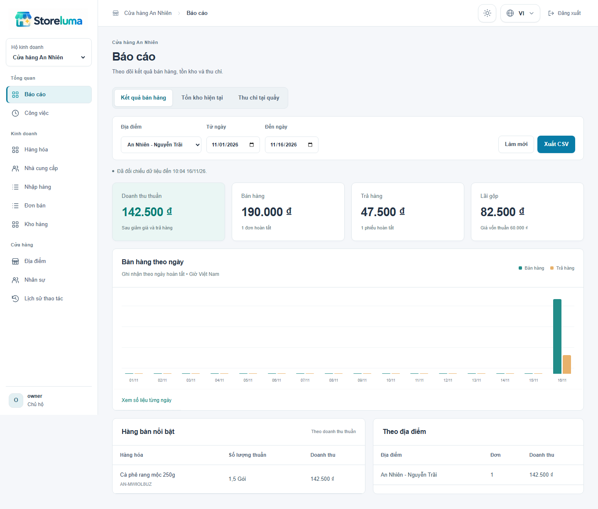
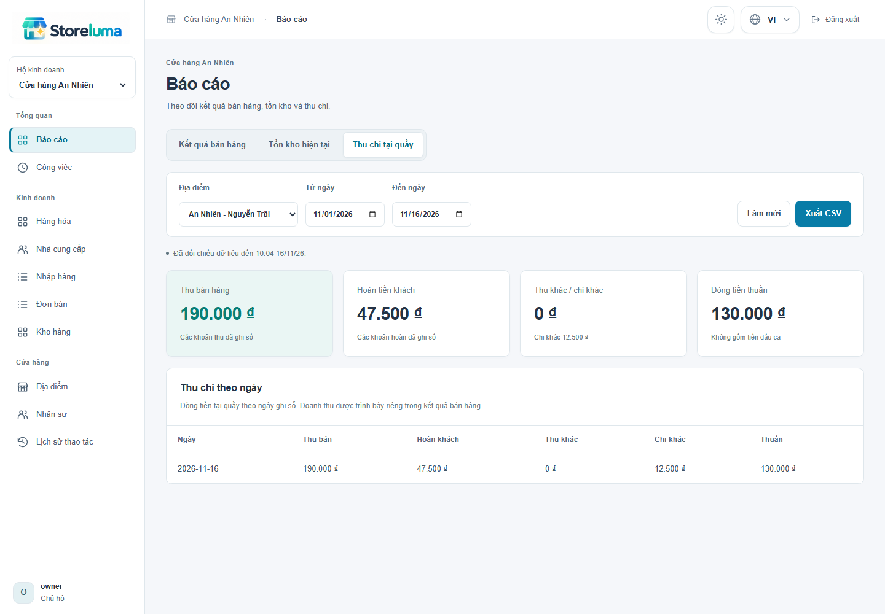
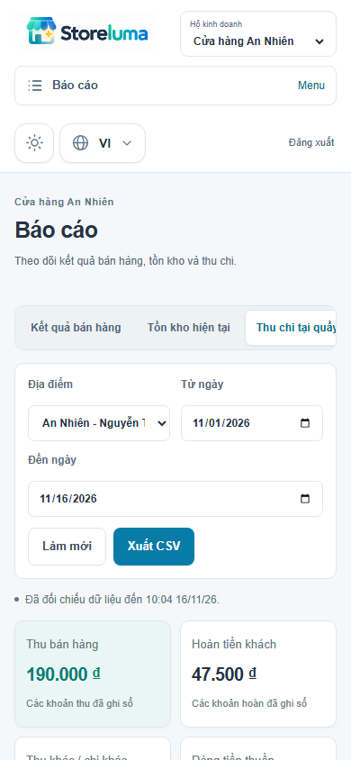

# STORELUMA - BÁO CÁO TIẾN ĐỘ TUẦN 10

Phan Chí Cường - 23520207 | GVHD: ThS. Trần Anh Dũng

**Kỳ kế hoạch:** 23/11-29/11/2026. **Ngày báo cáo:** 27/11/2026.

## 1. Mục tiêu và công việc tuần 10

Tuần 10 kiểm tra phân quyền và sự phối hợp giữa các chức năng đã xây dựng. Trọng tâm là đối chiếu chứng từ, tồn kho, tiền quầy và báo cáo trong cùng một chuỗi giao dịch; đồng thời kiểm tra việc thu hồi quyền khi người dùng vẫn đang đăng nhập.

| Hạng mục | Công việc và sản phẩm |
| --- | --- |
| Phân quyền | 11 ca cho năm vai trò, hai hộ, phạm vi địa điểm, giá vốn, thay đổi quyền và API nội bộ. |
| Tích hợp | 8 ca nối nhập hàng, bán, thu tiền, trả hàng, hoàn tiền, chi quầy, chốt ca và xuất báo cáo. |
| Hồi quy | Chạy toàn bộ 179 ca, gồm xác thực, giao diện, kiến trúc, migration và các tuần 4-10. |
| Đối chiếu yêu cầu | Rà soát đầu ra tuần 1-10; phân biệt chức năng đã có, chức năng còn thiếu và điều kiện vận hành. |
| Tài liệu | Ma trận kiểm thử, kết quả, ảnh giao diện và danh sách công việc cần tiếp tục. |

Không bổ sung mô-đun nghiệp vụ mới trong tuần này. Các ca mới được triển khai qua API công khai và giao diện thật, dùng tài khoản và dữ liệu kiểm thử riêng. Kết quả là cơ sở tiếp tục thử tình huống lỗi ở tuần 11, chưa phải nghiệm thu toàn bộ sản phẩm cuối kỳ.

Kỳ kế hoạch: 23/11-29/11/2026. Ngày báo cáo: 27/11/2026. Các lần chạy kiểm chứng được thực hiện ngày 14/11 và 16/11/2026, trước kỳ kế hoạch; thời điểm và môi trường được ghi riêng ở mục 6.

## 2. Kiểm thử phân quyền trên các dịch vụ

Nhóm W10-01 đến W10-11 dùng hai hộ kinh doanh và ba địa điểm. Năm vai trò được đối chiếu trên 15 API đọc của Business, Catalog, Inventory, Sales, Finance, Reporting và Notification. Trạng thái HTTP được kiểm cùng dữ liệu trả về; số dư tồn hoặc số tiền không được suy ra chỉ từ việc có hay không có nút trên màn hình.

| Phạm vi | Điều kiện đã kiểm |
| --- | --- |
| Vai trò | Chủ hộ và kế toán xem vốn; quản lý, thu ngân và kho không nhận trường giá trị tồn trái quyền. API ngoài vai trò trả 403. |
| Hộ và địa điểm | Đổi tenant hoặc dùng ID đối tượng thuộc hộ khác không lấy được dữ liệu. Địa điểm ngoài phạm vi không được đọc/ghi chứng từ. |
| Quyền trong phiên | Khóa thành viên, đổi vai trò hoặc đổi địa điểm có hiệu lực với yêu cầu tiếp theo, không cần đăng nhập lại. |
| Yêu cầu gửi lại | Lệnh đã thành công vẫn phải kiểm quyền trước khi trả kết quả lưu. Cấp lại quyền không tạo thêm bản ghi khi gửi lại cùng key. |
| Ranh giới nội bộ | Header vai trò hoặc chữ ký giả từ trình duyệt không cấp thêm quyền; Gateway chặn namespace nội bộ. |

Nhóm tích hợp mở rộng kiểm tra tại thời điểm xác nhận thu tiền, xác nhận hoàn và ghi chi quầy. Lệnh bị từ chối không tạo ledger. Tệp CSV thuộc người yêu cầu và phiên bản quyền lúc tạo; đổi quyền phải xuất tệp mới, kể cả khi vai trò mới được xem thêm giá vốn.

Việc thu hồi quyền thao tác mới được phân biệt với xử lý tiếp một workflow đã được chấp nhận. Các ca phục hồi của tuần 7-8 tiếp tục bảo vệ nguyên tắc không bỏ dở tiền hoặc hàng đã ghi nhận.

## 3. Đối chiếu chuỗi nhập, bán và trả hàng

| Bước | Kết quả đối chiếu |
| --- | --- |
| Nhập PURCHASE | 10 gói, vốn 40.000đ/gói: tồn 10, giá trị 400.000đ, phải trả 400.000đ. Gửi đồng thời cùng key chỉ có một movement và một payable. |
| Bán tại quầy | 2 gói, giá 100.000đ/gói, giảm 10.000đ: thực thu 190.000đ, vốn 80.000đ. Chỉ hoàn tất sau xác nhận tiền và xuất kho. |
| Thu hồi quyền thu | Chuyển thu ngân sang kho trước confirm: trả 403, tiền còn chờ, chưa có ledger. Cấp lại và gửi hai lần: chỉ một dòng thu, một lần xuất. |
| Trả hàng cách ly | Trả 0,5 gói: hoàn 47.500đ, giảm vốn 20.000đ. Thu ngân không tự duyệt; người duyệt xác nhận hàng và chứng từ. |
| Thu hồi quyền hoàn | Đổi sang kế toán sau chuẩn bị hoàn: confirm bị chặn. Cấp lại và gửi đồng thời không hoàn tiền hoặc nhận hàng hai lần. |
| Tồn sau trả | Tồn thực tế 8,5; cách ly 0,5; khả dụng 8; giá trị tồn 340.000đ. Snapshot biên nhận đơn gốc giữ nguyên. |
| Hủy đơn chưa thu | Đơn chuyển CANCELLED, payment FAILED, giải phóng giữ hàng; không thêm sổ tiền và doanh thu. |

Số lượng và tiền được kiểm bằng giá trị chính xác qua API, kèm số dòng movement, payable và ledger. Nhập hàng chưa đồng nghĩa đã chi trả nhà cung cấp. Hàng cách ly vẫn nằm trong tồn thực tế và giá trị tồn, nhưng không tham gia lượng có thể bán.

## 4. Đối chiếu báo cáo bán hàng

Doanh thu thuần là 190.000 - 47.500 = 142.500 đồng. Giá vốn thuần là 80.000 - 20.000 = 60.000 đồng. Lãi gộp là 82.500 đồng. Khoản chi vận chuyển tại quầy không làm thay đổi doanh thu hoặc giá vốn của đơn.

Kiểm thử mở báo cáo trên ứng dụng, đối chiếu chỉ số với API rồi nhấn Xuất CSV và tải tệp thật. Nội dung tệp có doanh thu và lãi gộp đúng. Tệp của quản lý không có các cột vốn/lãi gộp; tệp mới do kế toán tạo được xem các giá trị này theo quyền.

Reporting đọc bản tổng hợp của riêng mình. Kiểm thử chờ dữ liệu hội tụ rồi so số liệu, không giả định sự kiện được xử lý ngay trong cùng giao dịch của Sales hoặc Finance.

## 5. Tiền quầy, chốt ca và giao diện hẹp

| Khoản đối chiếu | Giá trị |
| --- | --- |
| Tiền đầu ca | 500.000đ |
| Thu bán - hoàn khách - chi vận chuyển | 190.000 - 47.500 - 12.500 = 130.000đ |
| Tiền dự kiến / thực đếm / chênh lệch | 630.000đ / 629.000đ / -1.000đ |

Phiếu chi chỉ được ghi một lần khi gửi lại; người bị khóa hoặc chuyển sang địa điểm khác không lấy lại được kết quả lệnh cũ. Chốt ca có chênh lệch tạo công việc cần xử lý. Sau khi người có quyền duyệt, công việc được giải quyết; sổ tiền và số dự kiến không bị sửa để khớp số đếm.

Giao diện báo cáo được kiểm ở 1440 px và 390 px. Các thao tác mở báo cáo, chuyển tồn/tiền và tải CSV dùng cùng backend. Không ghi nhận lỗi JavaScript hoặc tràn ngang toàn trang trong kịch bản này. Kiểm tra viewport mô phỏng không thay thế thử trên điện thoại hoặc máy in vật lý.

## 6. Môi trường và kết quả kiểm chứng

Lượt hồi quy đầy đủ bắt đầu 16/11/2026 09:48:09 (giờ Việt Nam), dùng Chromium trên Windows và Docker Linux containers. Kết quả: 179/179 đạt, không lỗi, không bỏ qua, không flaky; thời gian 1103.9 giây. Không cấu hình chạy lại tự động khi một ca thất bại.

| Nhóm | Số ca / điểm kiểm tra |
| --- | --- |
| Giao diện và xác thực | 13 ca: DISPLAY 5, AUTH 6 và UI 2. |
| Kiến trúc và migration | 3 ca: quyền database, nâng cấp Inventory và Finance có lịch sử. |
| Tuần 4-6 | 70 ca: nền tảng 20, danh mục/nhập hàng 25, tồn/kiểm kho 25. |
| Tuần 7-9 | 74 ca: bán hàng 29, POS/trả/chốt ca 31, báo cáo/thông báo 14. |
| Tuần 10 | 19 ca: phân quyền 11, chuỗi tích hợp 8. |
| Build và dependency | TypeScript backend/frontend và Vite đạt; audit runtime ghi nhận 0 lỗ hổng tại lần kiểm tra. |

Các container và volume kiểm thử tách khỏi dữ liệu đang sử dụng. Bộ hồi quy có chủ động dừng, khởi động lại dịch vụ và broker; các phép thử migration dùng database riêng. Đây là môi trường kiểm chứng, chưa phải triển khai production.

Nửa đầu tuần 10 đã có 11/11 ca chạy riêng và CI 171/171 đạt tại commit 52f1331. Nửa sau bổ sung 8 ca, chạy riêng 8/8 đạt rồi chạy lại toàn bộ 179 ca. Không cộng các lượt chạy trùng thành số ca khác nhau.

Trong phạm vi các ca mới và hồi quy đã kiểm chứng, chưa phát hiện lỗi nghiệp vụ cần sửa backend. Các kết quả này chỉ áp dụng cho môi trường, dữ liệu và luồng kiểm thử đã nêu.

## 7. Rà soát sản phẩm từ tuần 1 đến tuần 10

| Giai đoạn | Kết quả và giới hạn |
| --- | --- |
| Tuần 1-2 | Có đề cương, khảo sát tài liệu, yêu cầu và mức ưu tiên. Chưa phỏng vấn cửa hàng; không coi nghiên cứu tài liệu là thử nghiệm người dùng. |
| Tuần 3 | Có phân tích, sơ đồ nghiệp vụ/kiến trúc/dữ liệu và phác thảo UI; đây là sản phẩm thiết kế. |
| Tuần 4-5 | Có xác thực, hộ/site, nhân sự, danh mục, nhà cung cấp và nhập hàng. API kiểm tenant/site/role và chống ghi trùng. |
| Tuần 6 | Có tồn, nguồn biến động, kiểm đếm, duyệt, điều chỉnh và cách ly; có test khóa cạnh tranh và bảo toàn giá trị. |
| Tuần 7-8 | Luồng tiền mặt/khách lẻ, Saga, POS, biên nhận, trả và chốt ca hoạt động qua backend thật; chưa kiểm máy in vật lý. |
| Tuần 9 | Reporting/Notification có dữ liệu riêng; có báo cáo, CSV và công việc. Giao diện Việt/Anh, sáng/tối được kiểm lại. |
| Tuần 10 | Hoàn thành bộ kiểm quyền/tích hợp và lượt hồi quy trong phạm vi đã triển khai; ghi rõ yêu cầu chưa hoàn tất. |

Bảng truy vết đầy đủ YC01-YC24 và CL01-CL09 được lưu trong tài liệu rà soát tuần 1-10. Mỗi yêu cầu ghi phần đang có, nhóm kiểm thử và phần còn lại; số kiểm thử đạt không thay thế việc đối chiếu đủ chức năng.

## 8. Kiến trúc, CI và phần còn lại

Gateway và bảy dịch vụ nghiệp vụ chạy độc lập. Mỗi dịch vụ sở hữu database và tài khoản riêng; HTTP nội bộ có chữ ký, sự kiện đi qua RabbitMQ với Outbox/Inbox. Reporting/Notification không truy vấn trực tiếp bảng nghiệp vụ của dịch vụ nguồn.

ARCH-01 đối chiếu quyền CONNECT và quyền role giữa chín tài khoản database. Các test nghiệp vụ còn kiểm sự kiện trùng/cũ, mất broker, khởi động lại và migration giữ lịch sử. Cùng hạ tầng PostgreSQL hoặc cùng repository không thay thế ranh giới sở hữu dữ liệu này.

CI giữ toàn bộ test của các tuần trước, build, audit runtime và khởi tạo Compose mới. Tuần 10 bổ sung ảnh minh chứng vào artifact; chưa tạo workflow triển khai khi môi trường HTTPS và quy trình phục hồi chưa hoàn thành.

| Khoảng trống | Yêu cầu cần tiếp tục |
| --- | --- |
| Khách hàng | YC12/18: hồ sơ, chọn khách trên đơn và lịch sử mua theo quyền. |
| Tài chính | YC19: tài khoản tiền ngoài quầy, trả nhà cung cấp và phân bổ vào công nợ. |
| Đối soát/truy vết | YC14/23: tra cứu và xử lý giao dịch cần xem xét trên giao diện hợp nhất. |
| Vận hành | YC24/CL07: quyền runtime/migration, bí mật/broker theo dịch vụ, giám sát, HTTPS và backup/restore ngoài máy. |
| Hiệu năng | CL04: chưa đo 10 phiên, 10.000 SKU/đơn hoặc p95/p99 theo mục tiêu. |

Các mục trên là phần chưa hoàn tất cần được theo dõi đến nghiệm thu. Thanh toán điện tử, bán chịu, chuyển kho, nhập CSV và các mở rộng khác không được ghi nhận là đã có.

## 9. Kết quả bàn giao và hướng thực hiện tuần 11

Bản kiểm chứng có thể dùng làm nền cho tuần 11 trong phạm vi bán tiền mặt hiện có. Kết luận này dựa trên chuỗi nghiệp vụ và hồi quy đã chạy, không đồng nghĩa đã đáp ứng đầy đủ sản phẩm cuối kỳ hoặc đủ điều kiện vận hành production.

Tuần 11 ưu tiên tình huống mất phản hồi sau commit, ngắt worker trước ACK, hết lease và nhiều worker cùng xử lý; ghi rõ số lần tác động tiền/hàng và thời gian hội tụ. Đồng thời chuẩn bị phép đo tải có cấu hình, dữ liệu và tiêu chí được công bố.

Phần bổ sung nghiệp vụ cần ưu tiên khoảng trống cốt lõi theo phụ thuộc: khách hàng; tài khoản tiền và trả nhà cung cấp; tra cứu/đối soát có quyền. Mỗi phần có UI, API và kiểm thử riêng. Công việc triển khai HTTPS, phát hành và sao lưu/khôi phục tiếp tục ở tuần 12.

Tài liệu đối chiếu: Đề cương Đồ án 2; báo cáo tiến độ tuần 2-9; ma trận kiểm thử, bảng rà soát và kết quả kiểm chứng tuần 10 trong repository.
