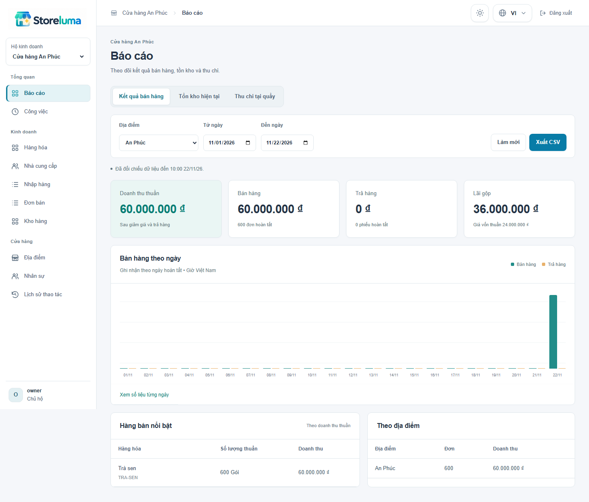
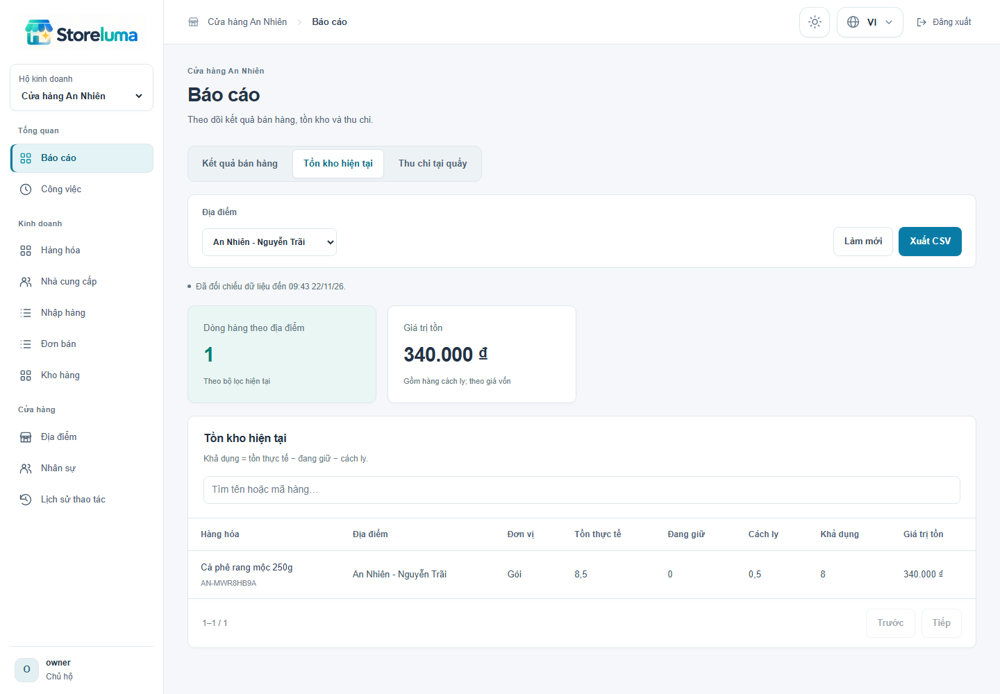

# Storeluma — Báo cáo tiến độ tuần 11

Phan Chí Cường — 23520207 | GVHD: ThS. Trần Anh Dũng

Kỳ kế hoạch 30/11–06/12/2026. Ngày báo cáo 04/12/2026. Các lượt kiểm chứng thực tế diễn ra ngày 18, 19 và 22/11/2026.

## 1. Mục tiêu và kết quả thực hiện

Sau khi kiểm phân quyền và tích hợp ở tuần 10, tuần 11 tập trung vào thời điểm giao dịch dễ bị ghi hai lần. Một phiếu nhập đã phát sự kiện có thể được phát lại. Tương tự, kho đã xuất hàng hoặc quầy đã thu tiền nhưng dịch vụ bán hàng vẫn có thể mất phản hồi. Kết quả được đối chiếu bằng chứng từ, dòng tiền và biến động tồn sau phục hồi.

| Ngày kiểm | Công việc | Sản phẩm |
| --- | --- | --- |
| 18/11 | Ngắt tiến trình tại biên ghi dữ liệu, phát sự kiện và xác nhận. | 4 ca W11-01–04 dùng Finance, PostgreSQL và RabbitMQ. |
| 19/11 | Ngắt Sales trong lúc xử lý bán và trả. Kiểm worker trở lại sau khi quyền xử lý hết hạn. | 6 ca W11-05–10 và bản sửa kiểm tra lease. |
| 22/11 | Chạy lại các nhóm kiểm thử. Tạo áp lực tra cứu và thanh toán. Cho Finance xử lý lại 100 phiếu. | Kết quả hồi quy, độ trễ, số liệu tiền/hàng và thời gian xử lý công nợ. |

Báo cáo sử dụng kỳ kế hoạch 30/11–06/12. Ba mốc trong bảng là ngày chạy kiểm chứng thực tế. Môi trường dùng các dịch vụ Compose trên một máy, với dữ liệu được tạo riêng cho từng lượt.

## 2. Phục hồi khi sự kiện được giao lại

Inventory ghi phiếu nhập và sự kiện vào cùng giao dịch. Finance ghi mã sự kiện đã nhận và khoản phải trả trước khi gửi ACK. Vì vậy, khi mất xác nhận, hai dịch vụ phải giữ nguyên định danh và kiểm nguồn chứng từ khi thử lại.

| Tình huống | Kết quả đối chiếu |
| --- | --- |
| Consumer dừng sau commit, trước ACK | Broker đánh dấu giao lại. Phiếu mua hai đơn vị hàng chỉ có một dòng nhập và một khoản phải trả 80.000 đồng. |
| Publisher dừng sau confirm | Outbox vẫn chờ. Sau khởi động lại, hai bản phát mang cùng ID và nội dung. Địa điểm chỉ có một quầy. |
| Mất callback confirm | Publisher hết thời gian chờ. Sau khi lease hết hạn, sự kiện được phát lại và được đánh dấu đã giao. |
| Hai consumer cùng nhận bản lặp | 32 lần phát với hai ID sự kiện cho một phiếu. Lượt CI ngày 18/11 ghi nhận hai worker xử lý lần lượt 20 và 12 thông điệp. Finance chỉ ghi một công nợ. |

Khi Finance dừng, hệ thống ghi 100 phiếu mua, mỗi phiếu nhập 10 đơn vị với giá vốn 40.000 đồng. Trước khi khởi động lại Finance, Inventory đã phát đủ 100 sự kiện và chưa có khoản phải trả nào của hộ thử. Sau 2,41 giây kể từ lệnh khởi động, Finance có 100 khoản phải trả với tổng 40.000.000 đồng. Kiểm tra ghi nhận đủ 100 bản ghi Inbox tương ứng và 100 dòng nhập, tổng cộng 1.000 đơn vị. Mục tiêu của phép thử là 60 giây.

## 3. Khôi phục đơn bán và phiếu trả

Sales dùng lease để giới hạn thời gian một worker được quyền ghi tiến độ. Lỗi phát hiện trong tuần nằm ở trường hợp token vẫn khớp nhưng thời hạn đã hết. Checkout và trả hàng hiện kiểm cả token và thời hạn bằng đồng hồ PostgreSQL ngay tại bước khóa dòng để ghi kết quả.

| Ca | Thời điểm ngắt | Trạng thái sau phục hồi |
| --- | --- | --- |
| 05 | Mất kết quả đọc payment đã thu. | Sales ghi REVIEW, tra lại cùng paymentId và hoàn tất. Tiền quầy tăng đúng 100.000 đồng. |
| 06 | Kho đã commit, Sales dừng trước khi lưu bước tiếp theo. | Một reservation COMMITTED, một lần xuất trị giá vốn 40.000 đồng và một sự kiện hoàn tất. |
| 07–08 | Worker hết hạn trước khi được thay, hoặc quay lại sau khi worker mới đã xong. | Worker cũ không đổi bước, phiên bản hoặc kết quả cuối của đơn. |
| 09–10 | Kho đã nhận 0,5 đơn vị trả vào cách ly. Sales bị dừng hoặc lease hết hạn. | Một dòng nhập lại trị giá 20.000 đồng và một khoản hoàn 50.000 đồng sau xác nhận chi. |

Ở bản trước, mỗi bước thành công được hẹn lại sau một giây. Bản tuần 11 cho phép nhận ngay bước kế tiếp khi tiến độ đã ghi bền vững. Worker kiểm công việc mỗi 250 ms và thăm dò payment sau 500 ms nếu còn chờ xác nhận tiền. Lỗi liên dịch vụ vẫn tăng khoảng thử lại, tối đa 30 giây. Các bước giữ hàng, xác nhận thu và xuất kho vẫn đi qua dịch vụ sở hữu dữ liệu.

## 4. Thiết kế và kết quả đo tải

Môi trường Docker có 16 CPU logic và 7,62 GiB RAM cấp cho engine. Dữ liệu nền gồm 10.000 SKU có đơn vị cơ sở và 10.000 đơn nháp. Các bản ghi nền được nạp bằng SQL vào database sở hữu, giữ các ràng buộc và trigger tạo sự kiện. Giao dịch được đo đi qua Gateway, xác thực OIDC/TOTP và các API nghiệp vụ.

Mười phiên đăng nhập độc lập của ba tài khoản tra cứu đồng thời theo từng nhóm. Trong 10 phút, mỗi giây bắt đầu một lượt bán, tổng cộng 600 lượt tại một quầy trên cùng SKU có tồn. Khi payment chuyển sang chờ thu, bộ đo xác nhận tiền ngay. Thời gian hoàn tất gồm thời gian nhận lệnh, xử lý liên dịch vụ và thăm dò trạng thái cuối qua API.

| Chỉ tiêu | Số mẫu | p50 | p95 | p99 | Cao nhất |
| --- | --- | --- | --- | --- | --- |
| Tra SKU | 600 | 90,9 | 142,6 | 154,8 | 169,5 |
| Nhận checkout | 600 | 57 | 98,1 | 148,8 | 276,7 |
| Hoàn tất đơn | 600 | 2039,7 | 2212,4 | 2829,6 | 3522,5 |

Đơn vị trong bảng là mili giây. Phân vị lấy theo thứ hạng gần nhất trên toàn bộ mẫu. 600 lượt đã hoàn thành, 0 lượt lỗi. Thời gian từ đầu lịch phát đến phản hồi cuối là 601,15 giây, tương ứng 0,998 đơn/giây. Mốc so sánh là p95 tra cứu dưới 800 ms và hoàn tất checkout dưới 3.000 ms.

Độ trễ p95 từ lịch phát đến lúc gửi checkout là 210,1 ms, bao gồm phần chuẩn bị báo giá và đơn. Outbox còn chờ của Catalog/Sales trước cửa sổ đo là 7549/7590, sau cửa sổ đo là 0/0. Đây là số dòng chờ phát tại hai nguồn.

## 5. Đối chiếu kết quả trên giao diện

Mỗi lượt bán một đơn vị giá 100.000 đồng. Báo cáo ghi nhận 60.000.000 đồng doanh thu, giá vốn 24.000.000 đồng và lãi gộp 36.000.000 đồng. Đối chiếu trực tiếp tại Finance cho thấy 600 dòng thu tiền. Inventory ghi 600 dòng xuất với tổng lượng −600 và tổng giá trị −24.000.000 đồng.

Bộ dữ liệu nền dùng đơn nháp để kiểm luồng tra cứu và ghi đơn khi bảng đã có lịch sử. Các đơn nháp không tham gia doanh thu. Phép đo trên một máy tập trung vào bán tiền mặt và các SKU được tra cứu theo mã. Chưa có số đo cho nhiều máy chủ, tìm kiếm tự do trên mọi trường hoặc thanh toán qua đối tác.

## 6. Hồi quy và rà soát tiến độ tuần 1–11

Ngày 22/11, bộ hồi quy chạy trên project Compose mới, hoàn tất 189/189 ca trong 19,2 phút, không bỏ qua hoặc chạy lại. Các ca xác thực, migration, cách ly database và giao diện cùng chạy với các nhóm nghiệp vụ. Phép đo 600 giao dịch và 100 phiếu nhập sử dụng một project riêng.

| Tuần | Sản phẩm đã đối chiếu |
| --- | --- |
| 1–3 | Đề cương 13 tuần, khảo sát và yêu cầu ưu tiên, phân tích nghiệp vụ, mô hình dữ liệu, sơ đồ và phác thảo màn hình. |
| 4–6 | OIDC/TOTP và quyền theo hộ/địa điểm. Danh mục, nhà cung cấp, nhập hàng, theo dõi tồn và kiểm đếm. |
| 7–9 | Đơn và kho phối hợp với thu tiền. POS, biên nhận, trả hàng, ca quầy, báo cáo, thông báo và xuất CSV. |
| 10–11 | 19 ca quyền/tích hợp tuần 10, 10 ca phục hồi tuần 11, phép đo có tải và xử lý số phiếu tồn sau gián đoạn. |

Các đầu ra của mốc tuần 1–11 đã được đối chiếu. Luồng tiền mặt và tồn kho trên Compose có thể dùng làm đường cơ sở cho bản triển khai tuần 12. Bước tiếp theo là kiểm lại đăng nhập và giao dịch qua HTTPS, quy trình phát hành, sao lưu và khôi phục trên môi trường đích.

Hồ sơ khách hàng, trả nợ nhà cung cấp và màn hình đối soát hợp nhất tiếp tục nằm trong danh sách yêu cầu nghiệp vụ cần theo dõi. Kết quả tuần này áp dụng cho phạm vi luồng tiền mặt đã chạy. Phần rà soát kèm báo cáo ghi rõ đầu ra của từng tuần và bộ kiểm thử tương ứng.

## Phụ lục. Kiểm lại số liệu sau giao dịch hỗn hợp

Trong bộ dữ liệu hồi quy, quầy nhập 10 gói, bán 2 gói và nhận trả 0,5 gói hỏng. Màn hình ghi nhận tồn thực tế 8,5 gói, trong đó 0,5 gói cách ly, tồn khả dụng 8 gói và giá trị 340.000 đồng. Đây là hộ và bộ chứng từ riêng với phép đo tải ở mục 4.
