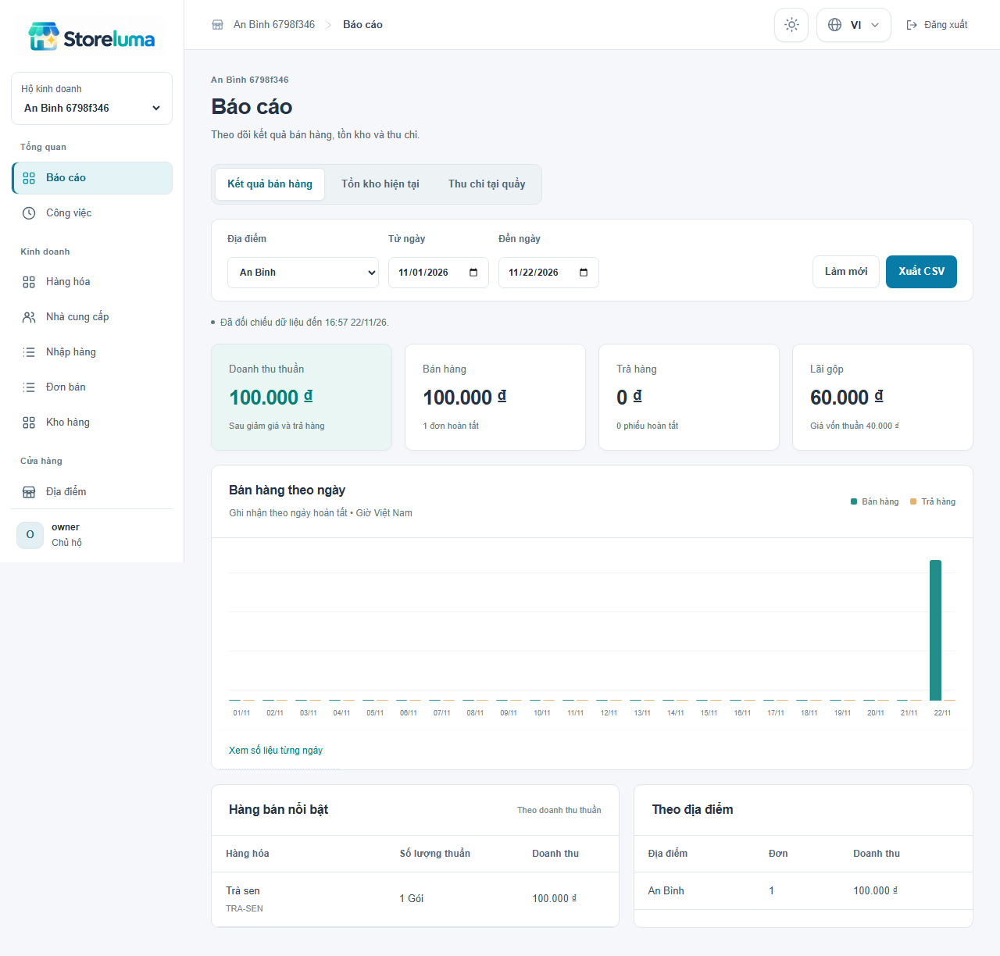

# Storeluma — Báo cáo tiến độ tuần 12

Phan Chí Cường — 23520207 | GVHD: ThS. Trần Anh Dũng

Kỳ kế hoạch 07/12–13/12/2026. Ngày báo cáo 11/12/2026.

## 1. Phạm vi và môi trường thực hiện

Tuần 12 kiểm tra khả năng tiếp tục bán hàng khi phải dựng lại cơ sở dữ liệu và hàng đợi. Hai câu hỏi cần trả lời là đơn đã thu tiền có còn nguyên sau khôi phục và quầy có bán được đơn tiếp theo hay không.

| Môi trường | Cách kiểm | Kết quả |
| --- | --- | --- |
| Docker trên máy thử | Dựng Caddy, Keycloak và các dịch vụ. Tắt cụm nguồn, khôi phục vào volume trống. | Đăng nhập TOTP và bán hàng qua HTTPS trước và sau khôi phục. |
| GitHub Actions | Hồi quy trên Ubuntu. Triển khai HTTPS và diễn tập bằng các job ARM64 độc lập. | 189 ca hồi quy đạt. Hai lượt kiểm HTTPS và phục hồi đều đạt. |
| Máy chủ công khai | Chuẩn bị cấu hình tên miền, image theo digest, tài khoản chủ hộ và kho sao lưu riêng. | Chờ cấp máy chủ, DNS và kho lưu trữ để nghiệm thu từ Internet. |

Lượt đo trên máy và CI diễn ra ngày 22/11/2026. Ngày 23/11 tiếp tục kiểm tra bộ sinh cấu hình và chuẩn bị quy trình cài máy chủ. Mỗi cụm diễn tập sử dụng cơ sở dữ liệu riêng. Dữ liệu trên máy đang dùng được giữ nguyên.

## 2. Đường vào HTTPS và bản phát hành

Trình duyệt mở ứng dụng qua Caddy. Khi đăng nhập, người dùng được chuyển sang tên miền xác thực và nhập mật khẩu cùng mã TOTP. Sau callback, gateway đặt cookie phiên trên tên miền ứng dụng với các thuộc tính Secure, HttpOnly và SameSite=Lax. Yêu cầu đọc phiên sau đăng xuất trả HTTP 401.

| Thành phần | Kiểm tra và đầu ra |
| --- | --- |
| Caddy và Keycloak | Tách tên miền ứng dụng và xác thực. Staging kiểm chứng chỉ bằng CA riêng. Cổng quản trị của Keycloak không được xuất qua proxy. |
| Compose | Chỉ Caddy mở cổng. Kiểm danh sách cổng, trạng thái sẵn sàng, kiến trúc và image của 12 container. |
| Phát hành | Ngày 23/11, bản 169e868 đạt cả bốn job. GitHub Container Registry lưu chín image ARM64 của Storeluma. Danh sách triển khai cố định cả 12 image theo digest, gồm cả Caddy, Keycloak và RabbitMQ. |
| Máy pilot | Bộ sinh cấu hình tạo khóa dịch vụ, realm, một chủ hộ và thông tin mã hóa backup. Lịch full, differential và kiểm archive được cài sau khi dịch vụ đáp ứng qua HTTPS. |

Đích triển khai dự kiến sử dụng Ubuntu ARM64 và hai bản ghi DNS trỏ về máy chủ. Việc xác nhận chứng chỉ công khai, đường truyền đến bucket và giao dịch từ mạng bên ngoài cần thực hiện trên đích triển khai.

## 3. Tạo bản sao và chọn điểm khôi phục

PostgreSQL chứa dữ liệu bán hàng, kho, tài chính và danh tính trong các database riêng. pgBackRest sao lưu toàn cluster, ghi tiếp các đoạn WAL và mã hóa repository bằng AES-256-CBC. Cách này giữ các database ở cùng mốc khi khôi phục.

| Mốc | Thao tác | Dấu hiệu kiểm chứng |
| --- | --- | --- |
| 1 | Tạo full backup và kiểm quá trình chuyển WAL qua SFTP. | Có backup hoàn chỉnh, repository báo đã mã hóa. |
| 2 | Đăng nhập, nhập hai gói trị giá 40.000 đồng/gói, bán một gói giá 100.000 đồng. | Đơn hoàn tất sau khi full backup đã kết thúc. |
| 3 | Ghi bản đánh dấu thứ nhất, tạo restore point rồi ghi bản đánh dấu thứ hai. | Chờ đoạn WAL chứa mốc đích được chuyển vào kho. |
| 4 | Dừng dịch vụ và broker nguồn. Khôi phục vào volume PostgreSQL mới, dùng broker trống. | Còn bản đánh dấu thứ nhất, mất bản thứ hai đúng theo mốc chọn. |
| 5 | Phát lại các sự kiện giữ trong Outbox với cùng định danh. | Hàng đợi được xử lý, số dòng thu tiền và xuất hàng của đơn gốc vẫn bằng một. |

Trong diễn tập, repository SFTP có volume và khóa riêng nhưng nằm trên cùng máy Docker với nguồn. Cấu hình pilot hỗ trợ kho ngoài máy. Việc chứng minh khả năng chịu mất cả máy cần thêm một lượt khôi phục từ kho đó trên máy thay thế.

## 4. Thời gian phục hồi và kết quả đối chiếu

RPO là khoảng từ timestamp của giao dịch đánh dấu còn giữ được đến thời điểm giả lập sự cố. RTO tính từ khi bắt đầu dừng nguồn đến khi phục hồi, phát lại sự kiện, bán thêm một đơn và hoàn tất đối chiếu. Máy chạy thử đã có sẵn tài nguyên.

| Môi trường | RPO (giây) | RTO (giây) | Sự kiện phát lại |
| --- | --- | --- | --- |
| Máy thử AMD64 | 2,517 | 119 | 25 |
| CI ARM64 | 1,119 | 90,4 | 25 |

Hai lượt nằm trong mục tiêu 15 phút cho RPO và 4 giờ cho RTO của kịch bản có máy thay thế. Trong phép thử, đoạn WAL cuối được chủ động chuyển đi trước sự cố. Số đo phản ánh tập dữ liệu và cách chọn mốc của lượt diễn tập.

| Đối tượng | Giá trị kiểm sau khi phát lại |
| --- | --- |
| Đơn và tiến độ xử lý | Đơn gốc COMPLETED, saga DONE, số tiền phải thu 100.000 đồng. |
| Tiền quầy | Một dòng thu 100.000 đồng cho payment của đơn gốc. |
| Thẻ kho và tồn | Một dòng xuất 1 gói trị giá 40.000 đồng. Còn 1 gói, giá trị 40.000 đồng, lượng đang giữ bằng 0. |
| Báo cáo và đơn mới | Báo cáo giữ trạng thái hoàn tất. Đơn mới có mã riêng và cũng khớp tiền, tồn, giá vốn. |

## 5. Giao dịch sau khi mở lại quầy

Hình chụp của hộ thử thứ hai, lập sau khi PostgreSQL đã phục hồi và broker mới đã nhận lại sự kiện. Mỗi hộ có một đơn bán 100.000 đồng với giá vốn 40.000 đồng. Đơn của hộ đầu được đối chiếu riêng để phát hiện việc ghi lặp trong lúc mở lại quầy.

## 6. Rà soát đầu ra và chuẩn bị tuần 13

Tuần 1–3 được đối chiếu qua đề cương, báo cáo khảo sát và hồ sơ thiết kế. Ngày 23/11, bản phát hành 169e868 đạt 189/189 ca hồi quy trong 16 phút 30 giây. Không có ca bị bỏ qua hoặc phải chạy lại. Trên ARM64, bài phục hồi của bản này phát lại 25 sự kiện, đo được RPO 1,118 giây và RTO 90,5 giây.

| Tuần | Nội dung đã đối chiếu |
| --- | --- |
| 1–3 | Phạm vi 13 tuần, yêu cầu nghiệp vụ, tác nhân, sơ đồ, mô hình dữ liệu và phác thảo màn hình. |
| 4–6 | Xác thực, quyền theo hộ/địa điểm, danh mục, nhập hàng, thẻ kho và kiểm đếm. |
| 7–9 | Đơn bán, thu và hoàn tiền, POS, chốt ca, báo cáo, thông báo và xuất CSV. |
| 10–11 | Kiểm quyền và tích hợp, phục hồi sự kiện trùng và worker mất quyền xử lý. Phép đo tải tuần 11 dùng 600 lượt bán qua 10 phiên. |
| 12 | Staging HTTPS, tích hợp liên tục, cấu hình triển khai theo digest, sao lưu toàn cụm và phục hồi theo WAL. |

Có thể bắt đầu rà soát tài liệu và chuẩn bị trình diễn tuần 13 trên staging. Hai đầu việc cần bằng chứng trên hạ tầng đích là giao dịch qua tên miền công khai và khôi phục từ kho ngoài máy. Hồ sơ khách hàng, trả công nợ nhà cung cấp và đối soát hợp nhất tiếp tục được theo dõi trong ma trận yêu cầu nghiệp vụ.
